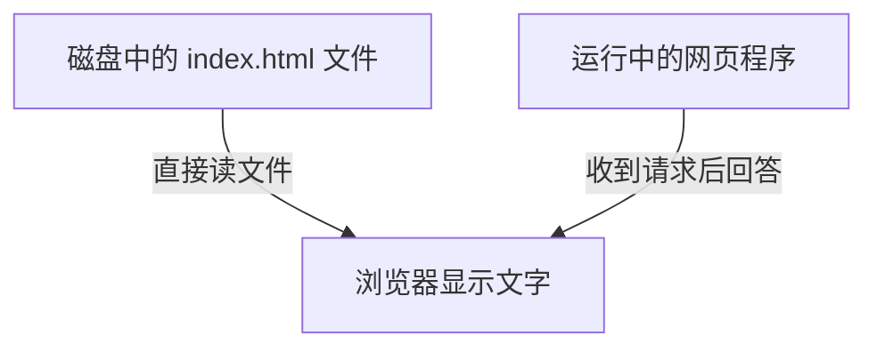

## 这一章要解决的问题

双击一个网页文件，和在地址栏输入网址，都可能看到文字。它们做的是同一件事吗？不是。前者可以只是读电脑里的文件；后者会让浏览器请求一个正在运行的程序。今天先把这两件事分开，并找到下一节需要用的窗口。

## 先回顾两件事

没有网络知识前置要求。只需要知道：**文件**是保存在磁盘上的内容，例如照片、文本和网页；**程序**是一组能运行的指令，例如 Chrome。程序运行之后才会处理动作；保存着某个程序的文件，不等于它此刻正在工作。

## 一步一步看

### 先准备一个专用文件夹

从[入门索引](/basics)下载 ZIP，找到下载的文件，双击解压。ZIP 是把多个文件装在一起的压缩包，解压后才是我们要用的普通文件夹。打开 `network-basics-demo`，确认有三个文件：`index.html` 是网页内容，`message.txt` 是一条文字，`README.txt` 是操作说明。

此时文件在磁盘上，还没有程序等着浏览器访问。你可以双击 `index.html`，再看 Chrome 地址栏。如果以 `file://` 开头，表示浏览器直接读本地文件；下一节以 `http://` 开头的访问会经过网页服务。两种方式都能显示文字，只有后者是这次要观察的请求与回应。



图里两条路最后都能显示文字，所以不能只看“页面能打开”就判断用了哪条路。下一节我们会用地址栏和程序的输出区分它们。

### 打开终端，不需要学编程

**终端**是用文字给电脑发指令的窗口。我们只用它启动、观察、停止这个实验程序。macOS 按 `⌘ 空格`，输入“终端”，打开系统自带的 Terminal。先执行下面一行：复制整行到终端，再按回车。

```sh
python3 --version
```

如果出现类似 `Python 3.9.6` 的一行，说明 Python 3 可用。这里是**示例输出**，你的版本可以不同。如果显示找不到命令，不要反复粘贴；按 [Python 官方 macOS 安装说明](https://docs.python.org/3/using/mac.html)安装 Python 3 后重新打开终端检查。若弹出“安装命令行开发工具”的窗口，可以取消，按上述官方说明安装 Python 3，再重新打开终端执行版本检查。不必为这个实验安装完整 Xcode。

终端通常有一段用户名、电脑名和 `%` 或 `$`，这叫输入提示。它不是要复制的命令。命令执行后又出现提示，表示它执行完了；下一节的网页程序会一直运行，暂时不出现新的提示，这也可以是正常的。

### 让终端位于实验目录

**目录**就是文件夹；**当前目录**是终端这会儿工作的文件夹。程序可能从这里读取文件，选错就可能把别的文件当成网页。

在终端输入 `cd`，后面留一个空格；把 Finder 里的 `network-basics-demo` **文件夹**拖进终端，再按回车。`cd` 是 change directory 的缩写，即切换目录。拖入的是文件夹路径，不是里面的网页文件。然后输入：

```sh
pwd
ls
```

`pwd` 显示当前目录的完整位置，末尾应是 `network-basics-demo`；`ls` 列出其中的文件，应看到刚才那三个文件。路径可能包含你的用户名，这是本机信息，学习时无需公开粘贴。如果不是这个目录，先重新切换，再启动服务。

<details class="advanced">
<summary>Windows 和 Linux 的对应操作</summary>

Windows 先右键 ZIP 选择“全部解压”，打开解压后的实验文件夹。在 Windows 11 文件夹空白处右键“在终端中打开”，选择 PowerShell。老版本可在资源管理器地址栏输入 `powershell` 并按回车；它会在当前文件夹打开窗口。执行 `py -3 --version` 检查 Python，`Get-Location` 查看目录，`Get-ChildItem` 查看文件。如果没有 `py`，也可检查 `python --version`，确认是 Python 3 再使用。安装方式见 [Python 官方 Windows 说明](https://docs.python.org/3/using/windows.html)。

Linux 解压后，在实验文件夹空白处选择“在终端中打开”（各桌面名称略有差别）。执行 `python3 --version`、`pwd`、`ls`。若没有 Python 3，按所用发行版的官方软件管理说明安装，不盲目照抄其他发行版的命令。

</details>

## 先预测，再观察

先想一想：只有三个文件在目录里，浏览器是不是已经有程序可以连接？然后双击网页，看 `file://`，再检查 Python 版本和当前目录。你现在证明的是文件已准备好、工具可用；还没有证明网页服务已经启动，也没有测试另一台电脑。

## 常见误解

“电脑里装了 Python，所以服务已经运行。”安装只是有了工具，启动命令才会让它工作。“终端没回到提示就坏了。”持续运行的服务正在等待请求，也会占用这个窗口。需要停止时按的是 `Control + C`，不是复制用的 `Command + C`。

## 两道练习

**练习 1：** 网页能显示文字，但地址栏是 `file://`。能据此说网页服务已启动吗？

<details class="answer"><summary>答案 1：看地址栏，而非只看文字</summary>

不能。浏览器可能只是读磁盘上的文件，并没有联系网页服务。下一节需要启动服务并使用 `http://` 访问，再观察收到请求的记录。

</details>

**练习 2：** `pwd` 显示其他文件夹，`ls` 没有演示文件。下一步该做什么？

<details class="answer"><summary>答案 2：先确认文件夹</summary>

重新用 `cd` 切换到解压后的实验目录，再检查文件。不要在任意个人目录启动网页服务，否则实验可能显示错误内容或提供不该提供的文件。

</details>

## 进阶阅读

<details class="advanced"><summary>为什么这一节只用少量命令</summary>

命令是可复现的动作，不是理解网络的门槛。`--version` 只读版本；`cd` 只改当前终端的工作目录；`pwd` 和 `ls` 只读取位置与文件列表。它们都不改变网络设置。后面的路由和监听查询同样先解释用途，再决定是否需要执行。

</details>

## 来源与下一章

终端操作参考 [Apple 终端使用手册](https://support.apple.com/guide/terminal/welcome/mac)，程序前置条件参考 [Python 官方平台说明](https://docs.python.org/3/using/index.html)。下一节：[在自己电脑上打开一个网页](/basics/local-webpage)。
