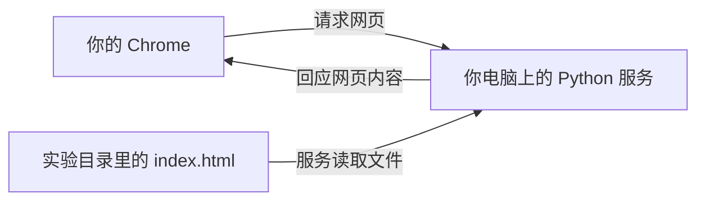

## 这一章要解决的问题

网页是从哪里来的？这一节不访问远方网站，而是让你的电脑运行一个提供网页的程序，再用同一台电脑上的 Chrome 向它提问。你将亲眼看到程序运行与网页可访问之间的关系。

## 先回顾两件事

[上一节](/basics/browser-and-programs)准备了实验文件夹，并教会你打开终端。现在确认当前目录是 `network-basics-demo`，里面有 `index.html`、`message.txt`、`README.txt`。程序必须运行，才能处理请求；单有文件还不够。

## 一步一步看

### 启动提供网页的程序

在已经进入实验目录的终端执行：

```sh
python3 -m http.server 8877 --bind 127.0.0.1
```

Windows 使用上一节确认的命令入口：把开头的 `python3` 换成 `py -3`；如果确认使用的是 `python`，则替换成它。Linux 与 macOS 通常使用上面的原命令。

这行命令让 Python 使用自带的网页功能，等着浏览器来访问。这样的程序称为**服务**：它持续运行，在请求到来时处理并回答。这里的服务提供当前实验目录里的文件。`8877` 是本次实验选的入口编号，`--bind 127.0.0.1` 限制为**本机**，即当前这台电脑。下一节会拆开它们的含义，现在先把它当成明确的本机实验入口。

你应看到类似下面的**示例输出**：

```text
Serving HTTP on 127.0.0.1 port 8877 (http://127.0.0.1:8877/) ...
```

关键是 `127.0.0.1`、`8877` 和没有退出报错。此时终端一直停在这里，程序仍在工作。保留这个窗口，不要重复启动。若显示 `Address already in use` 或同义的端口占用错误，说明启动没有成功；把命令里的 `8877` 改为 `8878`，浏览器网址也一同改为 `8878`。不要关闭未知程序来腾端口。

### 用浏览器向它请求网页

打开 Chrome，在**地址栏**输入下面的网址，不是输入搜索框：

```text
http://127.0.0.1:8877/
```

页面应该出现“**这是我电脑上的网页**”。浏览器发出“请给我这页内容”的消息，这叫**请求**；服务送回网页内容，这叫**回应**。两个角色都运行在同一台电脑上：Chrome 是请求者，刚启动的 Python 是回答者。这里不需要经过你的家庭路由器，更没有使用 EasyTier 到远端运输。



再看终端，会出现类似下面的**示例记录**：

```text
127.0.0.1 - - [某个时间] "GET / HTTP/1.1" 200 -
```

`GET /` 表示浏览器请求首页；`200` 表示服务成功回答。浏览器可能额外请求图标，出现另一条记录甚至 404，这不代表首页失败。第五节会教你只关注指定请求。

### 停止程序，再试一次

选中运行服务的那个终端，按 **Control + C**。看到输入提示重新出现，表示这个服务停止了。现在在浏览器网址末尾加上 `?after-stop=1` 后回车，或者在第五节的停用缓存状态下重新加载，确保发出新的请求。示例：

```text
http://127.0.0.1:8877/?after-stop=1
```

浏览器应提示无法连接或连接被拒绝。刚才的网页文件还在，Chrome 也还在；改变的是回答请求的程序已经停止。这个实验把“保存网页”和“提供网页”清楚地区分开了。下一节需要服务时，在同一实验目录重新执行启动命令即可。

## 先预测，再观察

启动前预测：文件已经准备好但服务没运行，会有人回答吗？启动后观察页面与终端的同一次请求。停止后预测：网页文件还在，会不会继续回答？用新网址请求检查。把你看到的现象写成三行：启动结果、访问结果、停止后结果。

成功只证明这次**本机浏览器到本机服务**的访问成立。因为明确绑定回环地址，其他电脑不能通过家庭 IP 或 EasyTier 虚拟 IP 访问这个服务；这不是组网故障，也不需要改防火墙。

## 常见误解

“网页显示出来，说明我把网站发布到互联网了。”这里服务只在本机回答。“关掉网页等于停止服务。”关闭浏览器页面不会停止终端里的程序。“停止后还能看见旧文字，所以服务没停。”可能是原页面没有发新请求或缓存；以新请求结果和服务终端为准。

## 两道练习

**练习 1：** 你关闭 Chrome 标签页，终端仍显示服务运行。另开标签访问会怎样？

<details class="answer"><summary>答案 1：两个程序各自运行</summary>

服务仍在，重新访问通常可以成功。Chrome 和网页服务是两个独立程序，关闭页面不会自动结束另一个程序。

</details>

**练习 2：** 端口占用后你用 8878 启动成功，却仍访问 8877。你访问的是新服务吗？

<details class="answer"><summary>答案 2：网址也要改</summary>

不是。浏览器还在找旧入口。应把网址改为 `http://127.0.0.1:8878/`；地址相同但端口不同，可以找到不同的程序。

</details>

## 进阶阅读

<details class="advanced"><summary>选做：看见“正在等请求”的监听状态</summary>

不要在服务运行的终端里输入查询；另开一个终端。macOS 和 Linux 可执行：

```sh
lsof -nP -iTCP:8877 -sTCP:LISTEN
```

如果出现 `Python`、`127.0.0.1:8877` 和 `LISTEN`，表示该程序正通过这个 TCP 入口等待请求，称为**监听**。`COMMAND` 是程序名称，`PID` 是进程编号，不必背。无输出仅表示这次查询没有看到匹配的监听，也可能受权限影响，不能独自证明所有网络状态。

Windows 可在另一个 PowerShell 查询 `Get-NetTCPConnection -LocalPort 8877 -State Listen`；没有匹配时可能显示报错提示，而非空白。Linux 若无 lsof，可用 `ss -ltn 'sport = :8877'`，看是否有 LISTEN 行。这些都是选做查询，不用于关闭未知进程。

</details>

## 来源与下一章

命令及绑定说明见 [Python http.server 文档](https://docs.python.org/3/library/http.server.html)。HTTP 状态的含义见 [RFC 9110](https://www.rfc-editor.org/rfc/rfc9110.html)。下一节：[拆开一行网址](/basics/read-a-url)。
