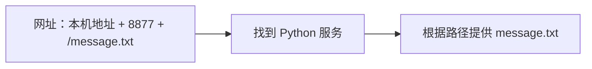

## 这一章要解决的问题

你已经打开过 `http://127.0.0.1:8877/`。这一行为什么有字母、数字、冒号和斜线？它不是一串要死记的密码，而是告诉浏览器：怎样提问、找哪里、找哪个入口、要什么内容。

## 先回顾两件事

[上一节](/basics/local-webpage)里的 Chrome 请求网页，Python 服务回答。若要边读边试，请回到实验目录重新启动服务；如果改用了 8878，本节也统一替换。

## 一步一步看

| 网址片段    | 用人话说         | 这次实际意思                              |
| ----------- | ---------------- | ----------------------------------------- |
| `http://`   | 用什么方式请求   | 用 HTTP，即浏览器与网页服务交流的一套规则 |
| `127.0.0.1` | 请求发到哪里     | 当前这台电脑的回环地址                    |
| `:8877`     | 到那边找哪个入口 | 找 TCP 8877 上等待请求的服务              |
| `/`         | 请给我什么       | 请求根路径；此演示会提供 index.html       |

**IP 地址**是用于交付网络数据的数字地址。`127.0.0.1` 特别表示在本机内部交接，称为**回环地址**。可以把它想成“我自己”，但它不是每台电脑共享的同一台服务器。你在 A 输入它，找的是 A；朋友在 B 输入它，找的是 B。后面的原有网络地址和虚拟地址用于其他范围，不能互相随意替换。

**端口**是程序在某种传输协议下使用的数字入口。这不是电脑外壳上的插孔。只知道 IP 还不足以找到网页服务，同一台电脑上可以同时运行很多程序。本次 Python 在 TCP 8877 等待，浏览器必须找这个入口。第 4 章会进一步区分 TCP、UDP；现在先记住地址和端口各承担一部分定位。

**路径**是服务收到请求后，用来决定提供什么的文字。访问 `/message.txt` 时，程序会读取对应文件。对任意网站，路径不一定对应磁盘文件，也可能是一段程序处理；此实验只是最容易看清的文件服务。

图里先找到服务，再由服务判断内容。因此“找错端口”和“写错路径”是两个不同阶段，失败现象也不同。

### localhost 又是什么

`localhost` 是一个约定用于本机的名称。电脑通常把它解析为回环地址，例如 IPv4 的 `127.0.0.1`，也可能是 IPv6 的 `::1`。**解析**就是把名称转换为可用的地址；第 17 章才会展开 DNS，不必现在学完整机制。

本实验固定使用 `127.0.0.1`，因为服务只绑定 IPv4 回环地址。换成 `localhost` 后，浏览器如何尝试 IPv4 与 IPv6会影响表现；它们不是同一种地址写法。不要为了让这一节成功扩大监听范围。

### 换一段，观察变化

打开 `http://127.0.0.1:8877/message.txt`，地址和端口没变，内容变成一句文字。再访问 `/not-here.txt`，服务仍在同一个地方，但回答没有这个文件。把端口改成别的数字则是在找另一个入口，不保证那里有程序。这些变化第五节会在网络面板里逐项确认。

## 先预测，再观察

先预测：把 `/` 改为 `/message.txt`，换的是电脑还是内容？访问后看页面及终端记录。再想：朋友在另一台电脑照抄 `127.0.0.1` 会找到你的电脑吗？不用让朋友安装东西，也能用“回环指当前机器”解释答案。

这些实验说明网址字段的作用；并没有证明外部网络可达，也没有展示互联网寻路过程。

## 常见误解

“网页里的斜线后面是端口。”冒号后的数字才是端口，斜线后是路径。“只要改一个地址就能访问朋友。”还需要数据送达朋友、目标服务允许访问，以及回应能回来。“回环就是家里的局域网。”回环甚至不必经过 Wi-Fi；家里另一台设备不属于你的本机。

## 两道练习

**练习 1：** `http://127.0.0.1:8877/message.txt` 的请求者、目标机器、服务入口、内容路径分别是什么？

答案 1：分四部分定位

请求者是你的浏览器；目标是当前电脑；入口是 TCP 8877；内容路径是 `/message.txt`。HTTP 表示浏览器与网页服务使用的交流规则。

**练习 2：** A、B 都运行各自的演示服务。A 输入 `127.0.0.1:8877`，能访问 B 吗？

答案 2：回环不跨机器

不能。它指向 A 自己。要访问 B，需要使用能指向 B 的地址及可用网络路径，同时 B 的服务须在可访问的入口等待。

## 进阶阅读

默认端口、HTTPS 与问号后的文字

HTTP URL 未写端口时通常使用 80，HTTPS 通常使用 443。因此我们显式写 8877。HTTPS 在 HTTP 通信外增加 TLS 保护，本机教学服务使用 HTTP，不能照此提供需要安全保障的公网服务。网址中的 `?after-stop=1` 是查询部分，用来让浏览器请求一个新 URL；Python 的文件服务仍根据路径 `/` 提供首页。它不等于端口，也没有自动检测服务状态。

## 来源与下一章

URL 的组成见 [RFC 3986](https://www.rfc-editor.org/rfc/rfc3986.html)，localhost 见 [RFC 6761 第 6.3 节](https://www.rfc-editor.org/rfc/rfc6761.html#section-6.3)，HTTP 见 [RFC 9110](https://www.rfc-editor.org/rfc/rfc9110.html)。下一节：[找到自己电脑的网络地址](/basics/my-network)。
