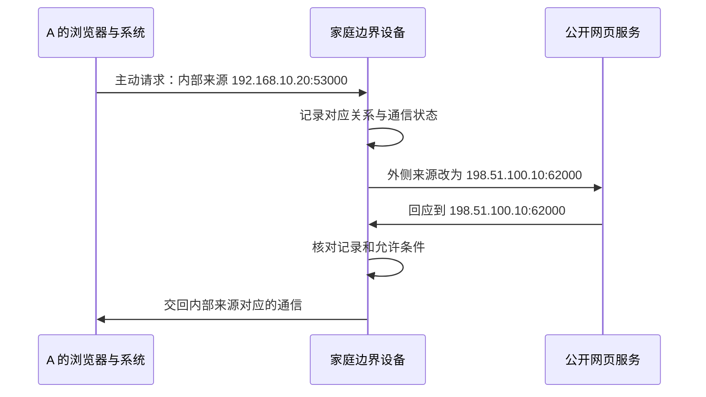
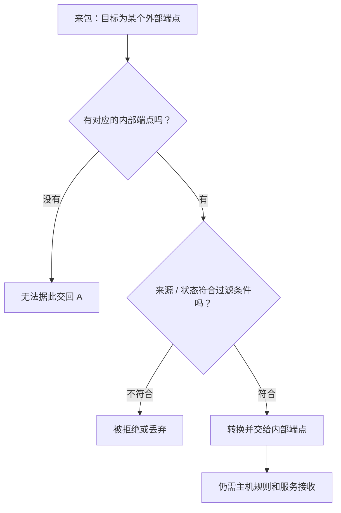

## 这一章要解决的问题

家中有电脑、手机、电视，它们常能同时访问网站。可别人知道你家的外侧地址，仍然不一定能访问你电脑上的 `8080` 服务。为什么“我先找别人”和“别人先找我”会有区别？

这一章只打开一个环节：**家中设备主动通信后，边界设备怎样留下返回记录，以及为什么记录和允许进入还不是同一件事。** 这里解释常见 IPv4 家庭 NAT 条件，不宣称所有网络都采用相同规则。

## 先回顾两件事

第一，家庭设备的原有网络 IP 可以是私有地址，不直接代表公共互联网里的唯一位置。这是[第 3 章](/chapters/03-addresses)讲的地址用途。

第二，一次访问包含目标地址、协议和端口，回应要回到正确的发起者。[第 4 章](/chapters/04-protocols)解释了端口，[第 5 章](/chapters/05-routing)解释了下一步和回程。

这两件事合起来，才能理解为什么边界上的记录不能只写“回到这个家”，还要能区分“回到家里的哪个程序”。

## 一步一步看

### 第一步：一个外侧位置后面可能有多台设备

假设家中 A 的原有网络 IP 是 `192.168.10.20`。手机有另一条内部地址。它们访问公共网站时，边界设备可能使用同一个外侧地址对外通信。

这种在网络边界改写地址的机制叫 **NAT，网络地址转换**。家庭上网常见形式还会转换端口，让多台设备的多个程序共享一个外侧地址。它不等于“给每个程序都分配一个公网 IP”。

本章采用教学外侧地址 `198.51.100.10`，公开网页服务地址 `203.0.113.80`。它们都是文档保留地址，不可用于实际连接。公开网页服务只用于本章解释主动上网过程，不是全书异地 B 的真实设备。为了继续看熟悉的端口，我们假设它提供 TCP `8080` 服务。

### 第二步：A 主动请求，边界记下对应关系

A 的浏览器发出请求，系统安排临时源端口 `53000`。它在内部的来源写作 `192.168.10.20:53000`，目标是教学公开服务的 `203.0.113.80:8080`。两个端口用途不同：一个用于这次发起端通信，一个用于服务接收。

边界设备把对外来源改为 `198.51.100.10:62000`，并记下外侧这个位置对应 A 的内部位置。这样的对应关系称 **映射**。`62000` 只是例子，不能认为所有路由器会选相同数字。

| 本章的一条简化记录 | 值                    |
| ------------------ | --------------------- |
| 通信协议           | TCP                   |
| 内部来源           | `192.168.10.20:53000` |
| 转换后的外侧来源   | `198.51.100.10:62000` |
| 这次联系的目标     | `203.0.113.80:8080`   |

真实设备会有更完整的连接状态和规则。这张表只把足以理解“回复应交给谁”的字段展开，不代表任意 NAT 都具有同一种内部表结构。

### 第三步：回复来到外侧，再交回内部

公开服务看到的是转换后的来源，因此把回应发回 `198.51.100.10:62000`。边界设备找到对应记录，再把数据交回 A 的 `192.168.10.20:53000`。A 的系统继续交给相应的浏览器通信。

主动请求先留下了线索，所以返回过程有办法找到 A。记录会随连接结束、超时或其他条件回收，不是给 A 永久开了一扇对外通道。

### 第四步：陌生请求缺的可能是对应关系

现在另一个人主动连接家中的外侧 `8080`，想找 A 的网页。他用的目标是外侧 `8080`，并不是刚才浏览器出站映射的 `62000`。

“A 内部运行了 8080”不会自动生成一条“外侧 8080 交给 A”的固定规则。边界设备也不能凭陌生人心里的目标，猜到该交给哪台内部设备。因此，A 主动上网成功，不证明外部可以主动访问 A 的服务。

**端口映射**是明确配置外侧某个接收位置交给内部某个位置的安排。它可以提供转换线索，但是否有效还要看外侧地址条件、服务监听、所有相关允许规则与回程。本章不要求配置端口映射。

### 第五步：有对应关系，还要被允许

**防火墙**是按规则允许或拒绝流量的机制。**过滤**就是依据条件判断某份通信能否通过。它们与“地址和端口怎样转换”是不同工作，虽然经常在同一设备中发生。

存在映射，不代表任何陌生来源、任何协议都能利用它进入。记录还可能限定连接状态或已经联系过的外部来源；主机自身也可能有另一层规则。反过来，仅允许某个端口，却没有正确路径、映射或接收服务，也不一定能得到网页。

EasyTier 后面会利用节点间的通信，尝试建立可用连接。双方主动发包可能改变相应 NAT 状态，但不是把 NAT 和防火墙关掉，也没有保证一定直连。第 10、11 章再用 UDP 的具体条件说明。

## 图解：两张条件表：映射与过滤

**图：两张条件表：映射与过滤。** 外部来包首先要有外部端点到内部端点的映射，再通过过滤，最后交给主机服务。

**读图顺序：**从上到下读，不要把两个问号合成“端口开了”。映射回答外侧位置对应内部谁，过滤回答这个来源能不能使用这条对应关系。主动发包可能创建映射、更新允许的远端和计时器；具体变化取决于设备规则。图是逻辑职责，不规定真实路由器内部一定有两张物理表。

**这张图的结论：**知道外侧地址与端口只提供定位线索，不能代替映射、过滤、回程和服务条件。 更多分层细节见[协议与核心原理进阶篇](/internals/connectivity)。

## 先预测，再观察

这里是一个明确的教学模型，不读取或修改你家路由器。

**先预测。** 只保留前面的那一条记录。公开网页服务给 `198.51.100.10:62000` 返回符合该通信状态的数据，模型能否找到内部接收者？随后陌生人连接外侧 `8080`，表中有没有对应线索？

**再观察。** 在表里找到 `62000 → 192.168.10.20:53000`，可以按模型交回 A。再查外侧 `8080`，这个示例没有它的固定对应规则。不要因为内部也有 `8080` 就自己补出一条不存在的表项。

**解释。** 出站请求建立的返回关系，与对外开放内部服务不是同一安排。接着在纸上给这条记录加一句“还必须符合允许条件”，你就把“找到对应机器”和“允许进入”分开了。

**边界。** 真实路由器可能有额外映射、连接状态、服务或策略，结果不能直接照搬。模型没有测量你家的 NAT 类型，也不证明打洞成败。初学时不为得到某个结果关防火墙、试公共节点或修改端口映射。

## 常见误解

“NAT 就是防火墙”混淆了转换与允许。NAT 常带有状态限制，效果有时像一道门，但它不是完整的安全策略。没有传统 NAT 的 IPv6 网络也可能有防火墙。

“知道外侧 IP 就知道内部哪台电脑”忽略了共享与端口对应关系。外侧地址后面可能有许多设备，也可能还有另一层网络边界。

“一次 NAT 分类就能决定所有通信能否成功”把一次探测当成固定物理定律。目的地、端口、网络切换和多层设备都可能改变条件；应以目标的实际连接证据为准。

## 两道练习

1. A 主动访问公开网页成功，为什么不能据此判定陌生人可通过外侧 `8080` 打开 A 的网页？

第 1 题：返回记录不等于公开服务入口

成功验证的是 A 发起的那条通信及其返回。内部 8080 服务不会自动产生外侧 8080 的固定对应规则，此外还需要可达地址、匹配监听、允许规则和回程。两种访问目标与条件不同。

2. 某份进入的数据已经能找到内部对应位置，为什么仍可能失败？

第 2 题：找到位置以后还有允许条件

还需要满足连接状态、允许来源或其他过滤条件，也需要内部路径和相应接收程序。映射解决“对应哪一个位置”，不能单独证明“被允许通过并得到业务回应”。

## 进阶阅读

UDP 映射、过滤分类、多层 NAT 和保活

家庭常见的地址加端口转换也叫 NAPT。研究 UDP 穿透时，要分别观察映射和过滤，因为 UDP 没有 TCP 那样的内置连接建立与关闭过程。

端点是协议条件下的一组地址与端口。“端点无关映射”表示同一个内部端点联系不同外部目标时，可能复用同一个外侧映射；地址依赖映射、地址与端口依赖映射则会受外部目标影响。例如联系引导节点时外侧端口为 62000，联系另一个目标时变成 63000，前一观察不能直接替代后一目标可用的端点。

过滤是另一条轴。端点无关过滤不要求来源等于之前联系过的外部目标；地址依赖过滤可能要求先向该外部 IP 发过数据；地址与端口依赖过滤还要求先向确切端口发过。独立防火墙规则仍可限制流量。旧的锥形、对称等名称把行为组合成类别，不应替代逐项条件判断。

UDP 状态可能因闲置超时而回收。保活是发送小流量以维持有关状态的做法，不存在适用于所有设备和所有网络的固定秒数保证。

家中路由器外面还可能有运营商 NAT，称 CGNAT。运营商常使用 `100.64.0.0/10` 共享地址空间，它不同于 RFC 1918 私有范围，也不是普通公网目的地址。家中路由器上的端口映射，不会自动配置上游那一层。因此界面出现一个 WAN 地址，也不证明用户拥有独占、外部可主动接入的公网地址。

本章 NAT 处理的是原有网络一侧的通信地址与端口。EasyTier 的虚拟 IP、内层业务 8080 与外层隧道端点需要分开看。把虚拟 `10.144.144.2:8080` 直接当作家庭 NAT 的打洞目标，会检查错误的一层。后续[UDP 打洞章节](/chapters/11-hole-punch)会把双方主动发送逐步展开。

## 来源与下一章

- [RFC 3022](https://www.rfc-editor.org/rfc/rfc3022.html)：传统 NAT 与地址、端口转换。
- [RFC 4787](https://www.rfc-editor.org/rfc/rfc4787.html)：UDP 映射与过滤的区分。
- [RFC 6598](https://www.rfc-editor.org/rfc/rfc6598.html)：运营商共享地址空间。
- [RFC 5737](https://www.rfc-editor.org/rfc/rfc5737.html)：本章外侧地址只作教学示例。
- [EasyTier v2.6.4 README](https://github.com/EasyTier/EasyTier/blob/v2.6.4/README.md)：NAT 穿透尝试与可用中继能力。

下一章：[07 · TUN 怎样把系统 IP 包交给 EasyTier](/chapters/07-tun)。请求、地址、程序和原有网络边界已经串起来，现在再打开虚拟接口这一层。
