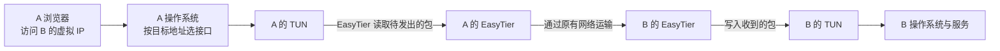
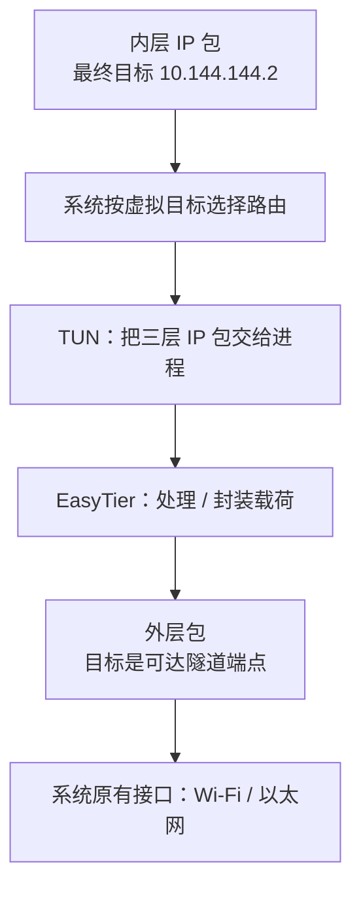

## 这一章要解决的问题

A 的浏览器要访问 B 的 `10.144.144.2:8080`。浏览器没有安装 EasyTier 插件，也不认识“打洞”这个词，EasyTier 怎么接到这次访问的数据？

浏览器先把数据交给操作系统。操作系统按照目标地址，决定把数据交给哪个**网络接口**，也就是系统收发网络数据的入口。EasyTier 创建了一个这样的入口，叫作虚拟接口。读完本章，你要能解释这次交接，以及远方的回复怎样交还浏览器。

## 先回顾两件事

- [第 2 章](/chapters/02-packets)：应用的数据会变成带有地址等信息的包，操作系统负责处理这些包。
- [第 5 章](/chapters/05-routing)：系统路由回答“发往这个目标的包，应交给哪个接口”。

## 一步一步看

### 第一步：同一台电脑可以有不止一个地址

在[预备课的本机地址观察](/basics/my-network)中，系统设置和 EasyTier GUI 显示的地址可能不同。这并不矛盾：Wi-Fi 或以太网接口使用原有网络的 IP；EasyTier 的虚拟接口使用虚拟 IP。一台电脑可以同时通过这些不同入口收发数据。

本章只需要记住 A 的虚拟 IP 是 `10.144.144.1`，B 是 `10.144.144.2`。浏览器访问 B 时，仍然使用普通的网络操作。系统查看目的地址，发现它应通过 EasyTier 对应的虚拟接口，于是把包交过去。其他目的的包可以继续走原来的 Wi-Fi、以太网或其他接口；安装 EasyTier 不意味着所有上网流量都改走它。

### 第二步：虚拟接口让程序接手 IP 包

这里的接口叫 **TUN**。它让操作系统与一个程序交换 **IP 包**：包括 IP 地址等信息，以及包里承载的数据。你可以把它暂时理解成系统为这些包开设的交接窗口。真实接口还有缓冲和系统规则，不能无限堆放数据；这个类比只解释双方怎样交包。

Wi-Fi 网卡最终通过无线信号运输数据。TUN 自己不会产生无线信号，也不会隔空找到 B。系统把准备发出的包交到 TUN 后，运行中的 EasyTier 读取这个包，再通过原有网络中的连接把它运往远方。因此，虚拟网络仍然需要现实中的互联网或其他底层网络。

“三层接口”是 TUN 的另一种说法。这里的三层指 IP 所在的网络层；TUN 交接的是 IP 包。它不是把完整的以太网局域网搬进程序。EasyTier v2.6.4 的常规虚拟网卡实现使用三层接口，这个差别会影响某些依赖局域网广播的功能。

### 第三步：请求与回复的交接方向相反

按图从左向右读：A 的系统决定出站接口，EasyTier 从 TUN **读取**包，再送向 B。B 的 EasyTier 收到包后，把它**写入** B 的 TUN。对 B 的操作系统来说，这是一份从虚拟接口到来的入站数据，系统继续把它交给对应服务。

回复也要走一次交接。B 的系统把准备返回 A 的包送到 B 的 TUN，B 的 EasyTier 读取并运输；A 的 EasyTier 收到后，写入 A 的 TUN，A 的系统再交给原来的应用。

所以，“读取 TUN”通常对应这个节点准备向外发送业务包，“写入 TUN”通常对应把远方收到的包交给本机系统。理解读写时，先说明读写者是 EasyTier；否则容易把“读”误认为浏览器正在接收回复。

### 第四步：交接入口准备好，还需要有人把包送到终点

TUN 的存在只解决系统和程序之间的交接。EasyTier 还要知道 B 是哪个节点、目前有哪些可用连接；B 的服务也要正常接收请求。若系统路由选错接口，包可能没有进入 TUN；若没有可用节点路径，进入 TUN 的包也到不了 B；若 B 没有运行 8080 服务，网络到达之后仍没有对应应用处理。

后面几章分别解释这些条件。现在先把它们区分开，就不会把“看到了虚拟 IP”当成“任何远端应用都已成功”。

## 图解：TUN 与原有接口各收哪一种包

**图：TUN 与原有接口各收哪一种包。** 内层目标 B 经系统路由进入 TUN，EasyTier 封装后用原有网卡送到 B 的外层端点。

**读图顺序：**先看内层包为什么进入 TUN，再看外层包怎样离开电脑。TUN 是操作系统和用户态进程之间的三层数据入口；它不会直接发射无线信号。EasyTier 还要通过底层 socket（套接字）发送封装后的数据，系统为外层端点选择原有网络路径。

**这张图的结论：**虚拟网卡与原有网卡是两次不同交接；两层路由必须各自正确。 更多分层细节见[协议与核心原理进阶篇](/internals/packet-pipeline)。

## 先预测，再观察

**预测：** 已运行 EasyTier GUI 的 Mac，访问一个已确认的远端虚拟 IP 时，系统更可能选择 Wi-Fi 接口，还是 EasyTier 对应的虚拟接口？如果接口存在，是否已经足以判断远端能回应？

**观察：** 先在 GUI 中找本机虚拟 IP，再看[已有组网实机案例](/cases/local-gui)的接口与目标路由摘要。那次记录中，虚拟接口是 `utun6`，到指定目标的系统路由也指向它。它是历史现场观测，不是本章刚刚在你的电脑上执行的结果。自己观察时按[本机地址预备课](/basics/my-network)确认当前地址，不要求照抄接口名。

**解释：** 地址属于虚拟接口，目标路由选择这个接口，两份信息能连接起“系统把目标包交给 EasyTier”这一步。接口编号会随运行环境改变；macOS 系统设置也未必把所有 TUN 接口列成一个直观的网络服务。

**不能证明：** 这两项信息不证明 B 在线、打洞成功、业务已经加密，或 HTTP 服务可用。案例中的四次 ICMP 回应是另一项证据，不能由接口存在直接推出来。

## 常见误解

“虚拟地址是 Wi-Fi 地址改了名字”不正确。它们属于不同接口和寻址环境，可以同时存在，彼此没有固定的数字换算关系。

“TUN 自带加密”也不正确。TUN 负责交包，EasyTier 的其他处理负责连接、封装和相应安全机制。仅看到虚拟接口不能判断采用了什么安全模式。

“两台电脑写成同一个虚拟网段，就和插在同一台交换机上一样”仍不正确。IP 业务可以通过三层虚拟网络运输，完整二层广播和设备自动发现需要分别确认。

## 两道练习

**练习 1：** A 的 EasyTier 从 A 的 TUN 读取一个包。它通常是 A 准备发向远方的数据，还是 B 刚返回的回复？

查看练习 1 的答案

通常是 A 的系统准备从虚拟接口发出的数据。B 的回复到达 A 后，通常由 A 的 EasyTier 写入 TUN，交给 A 的系统作为入站数据处理。关键是明确谁在读写。

**练习 2：** GUI 有虚拟 IP，系统也有对应接口，但远端网页打不开。为什么不能说“TUN 已证明整个网络正常”？

查看练习 2 的答案

TUN 只证明交接入口存在。还需检查目标路由是否选择它、EasyTier 是否有到目标的可用路径，以及目标服务的监听和规则。接口、路径和应用是不同条件。

## 进阶阅读

选读：内核、用户态、TAP 与广播兼容

操作系统的核心部分叫内核，负责网络协议栈等工作；普通程序运行的环境通常叫用户态。TUN 提供内核网络层与用户态程序之间的交接机制。v2.6.4 的 `virtual_nic.rs` 明确使用 `Layer::L3`，并装配 IP、系统路由和两个方向的转发任务。

TAP 是另一类虚拟接口，交接二层帧，例如以太网帧。某些平台在 TUN 数据旁附带包类型信息，这不使其成为完整的二层接口。特定 IP/UDP 广播可以有额外代理或转发机制；v2.6.4 的 Windows UDP 广播兼容实现就属于专门能力，不能推广成通用二层桥接。

本章描述常规 TUN 模式。无 TUN 等其他接入模式不一定创建同样接口，也不能直接套用本章的透明应用数据路径。

## 来源与下一章

- [Linux 内核 TUN/TAP 文档](https://docs.kernel.org/networking/tuntap.html)：接口的基本语义。
- [v2.6.4 virtual_nic.rs](https://github.com/EasyTier/EasyTier/blob/v2.6.4/easytier/src/instance/virtual_nic.rs)与[instance.rs](https://github.com/EasyTier/EasyTier/blob/v2.6.4/easytier/src/instance/instance.rs)：三层接口、系统设置与读写任务。
- [v2.6.4 windows_udp_broadcast.rs](https://github.com/EasyTier/EasyTier/blob/v2.6.4/easytier/src/instance/windows_udp_broadcast.rs)：特定广播兼容能力。

下一章：[08 · EasyTier 启动后，哪些条件才算准备好了？](/chapters/08-startup)
