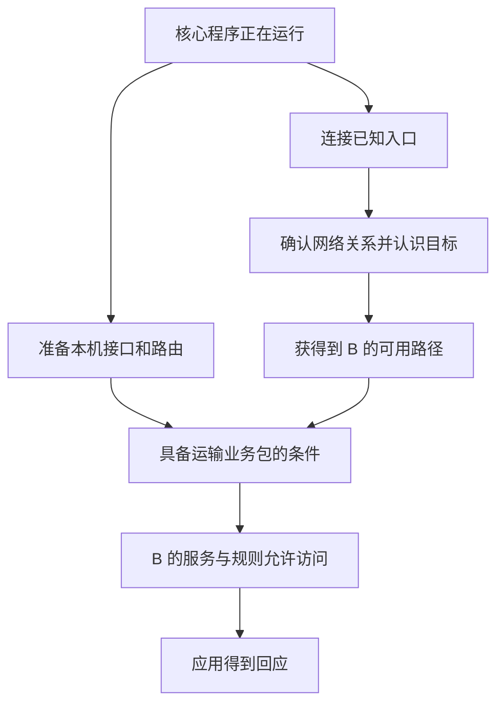
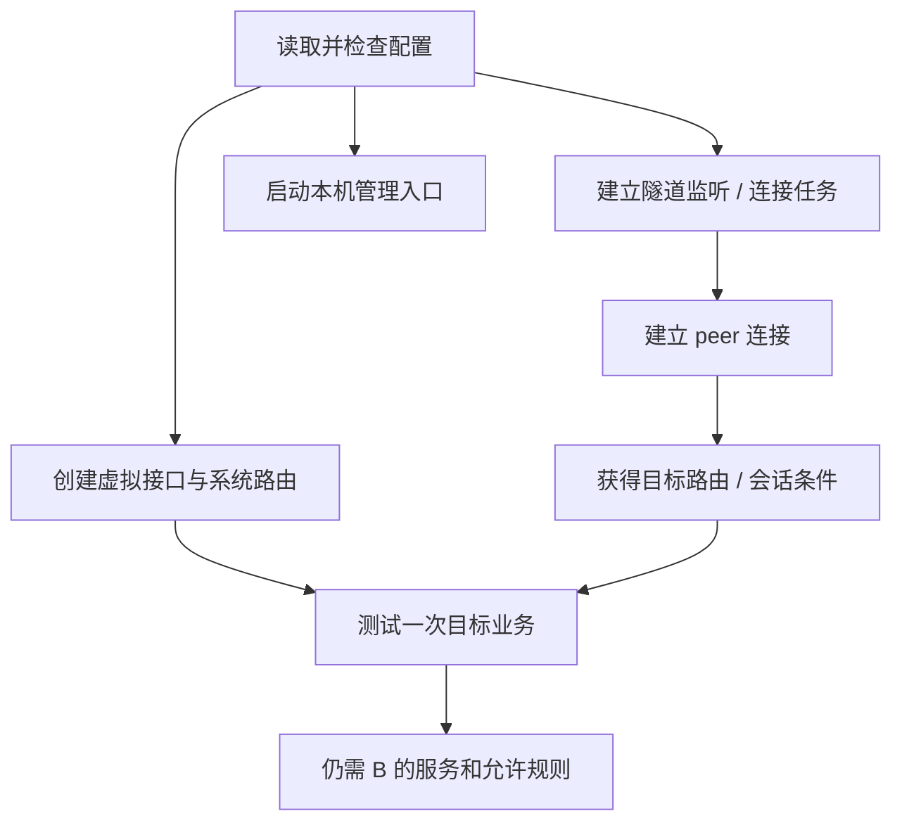

## 这一章要解决的问题

GUI 显示网络正在运行，为什么还可能打不开 B 的网页？“启动成功”到底完成了哪一部分？

我们要访问的仍是 B 的 `10.144.144.2:8080`，A 使用虚拟 IP `10.144.144.1`。把这次访问想成一件需要几个人配合的工作：本机程序要运行，系统要把数据交给它，它要找到目标和可用路径，对方还要有能回应的服务。读完本章，你能分别说出这些状态，不再用一个“在线”概括全部条件。

## 先回顾两件事

- [第 7 章](/chapters/07-tun)：TUN 是系统与 EasyTier 交接 IP 包的虚拟接口。
- [本机网页预备课](/basics/local-webpage)：服务程序运行与浏览器得到网页是不同的观察；停止服务后，地址本身不会替你回答。

## 一步一步看

### 第一步：先有运行中的程序

**进程**就是操作系统正在运行的程序。EasyTier 的核心程序 `easytier-core` 处理组网与数据；GUI 为用户提供操作和观察界面。查询用的 `easytier-cli` 是另一个程序，它读取核心的管理信息，不负责代替核心搬运业务数据。

看到 GUI 窗口，不必然等于某个网络已经开始运行；看到核心进程，也不必然等于所有工作都准备好。先确认正在观察的是哪一个网络、哪个核心实例，再谈“启动成功”，能避免拿一个窗口的状态解释另一个实例。

### 第二步：把本机的交接入口准备好

在常规模式下，EasyTier 创建 TUN，设置虚拟 IP，并配置相应系统路由。A 的应用访问 B 时，操作系统才有机会把包交给这个接口。

如果系统不允许创建接口，或者地址配置失败，程序仍可能在运行，甚至能连接别的节点，但普通应用还不能照常通过虚拟 IP 访问。反过来，接口已经存在，也不意味着程序已经找到 B。接口准备与远端连接是两项不同工作。

### 第三步：先连接一个已经知道位置的节点

第一次加入网络时，A 需要一个已知的连接地址。这个最初帮助相遇的节点叫**引导节点**，也可以叫初始入口。教程用 R 表示它，虚拟 IP 为 `10.144.144.254`。

初始连接使用的是现实网络能到达的地址，而不是凭空发向一个尚未认识的虚拟节点。这样的地址和端口组合叫**隧道端点**：说明 EasyTier 这一段连接应当发向哪里。它与 B 网页的虚拟 IP、业务端口是不同用途。

A、B 都连接 R 后，可以交换成员与连接信息。A 可能先知道“通过 R 能到 B”，随后才尝试与 B 直接连接。所以刚启动与运行一段时间后看到的路径可能不同，应用的虚拟目标地址却不需要因此改变。

### 第四步：有目标信息，还要有实际可用路径

这幅图表示依赖关系，不是程序每一步严格排队的计时表。有的工作可以同时进行，失败的连接也可能重试。你不必先理解它怎样安排后台任务；先看清每个结果解决哪一项问题。

知道 B 存在，意味着有目标信息；能把包传给 B，还需要一条当前可用的连接路径。即使这两项都成立，B 的 8080 服务若没有运行，浏览器也得不到预期网页。网络准备与应用准备必须接起来。

### 第五步：等待与失败要分清

刚启动时，界面可能暂时没有目标，稍后重试或信息传播才补齐。另一方面，地址错误、接口权限不足、入口不可达也会造成持续缺口。不能看到一个空列表就立刻重装，也不能无限等待而不检查它缺了哪一步。

一个实用记录方式是分别写下：核心是否运行；虚拟接口是否存在；目标 B 是否出现；目标目前有什么路径；具体访问是否回应。每一行都有独立证据，修改时才知道正在修哪一项。

## 图解：启动到可用需要多个条件

**图：启动到可用需要多个条件。** 配置可解析后分别建立 TUN、监听、管理入口，再连接 peer 并等待目标路由，最后验证业务服务。

**读图顺序：**按箭头看依赖，不把它当作严格线程执行顺序。日志中的“启动”可能仅代表进程活着；TUN 权限、端口占用、入口可达、成员身份、目标路由和服务监听各有独立条件。本机管理 RPC 是查询入口，与远端业务 TCP 8080 也不是同一端口。

**这张图的结论：**某项初始化成功只能证明这一项，最终可用要以具体目标和业务往返验证。 更多分层细节见[协议与核心原理进阶篇](/internals/connectivity)。

## 先预测，再观察

**预测：** 在 GUI 里看到“正在运行”和本机虚拟 IP，是否可以立即判断 B 的 8080 可用？你还想看哪一项信息？

**观察：** 使用已经运行的 GUI，读取当前网络状态、本机虚拟 IP 和已确认目标的那一行。只读这些状态，不启停网络、不保存新配置。没有现成网络时，使用[历史实机案例](/cases/local-gui)的脱敏摘要完成同样对照。

**解释：** 运行状态对应程序与网络实例，本机虚拟 IP 对应本机准备，目标行对应已知目标和相关连接状态。它们回答不同问题，应按对象分别记录。

**不能证明：** 这些快照不能复原启动步骤发生的精确顺序，也不证明目标应用可用。历史案例只做了四次 ICMP 验证，没有测试 8080，不能把它填成一次完整网页成功记录。

## 常见误解

“出现虚拟网卡就完成组网”遗漏了目标信息与连接路径。“公共入口在线就说明 B 在线”遗漏了 B 本身的状态。“没有日志报错就意味着所有服务能访问”遗漏了应用监听与规则。

R 先启动，也不使它变成网络唯一的控制器。A、B、R 都可以运行核心、发起连接或接受允许的连接。这里先准备 R，是为其他节点提供一个已知可达入口。

不要为了查询失败另开一个核心实例。已有 GUI 可能使用不同管理入口；查询工具连不到它与虚拟网络断开不是一回事。[第 19 章](/chapters/19-diagnostics)会继续解释这一点。

## 两道练习

**练习 1：** A 的虚拟接口已经出现，但 GUI 中没有 B。接口证明了什么，还缺哪一类条件？

查看练习 1 的答案

它证明本机有相应交接入口；还缺少认识目标及找到可用路径的证据。TUN 不会自己发现远方节点。继续看入口连接、成员信息和目标状态，不用接口存在代替这些检查。

**练习 2：** A、B 都通过 R 加入。后来 B 显示直连，是否必须把浏览器里的 B 虚拟 IP 改成 R 的地址？

查看练习 2 的答案

不需要。浏览器访问的最终目标一直是 B；R 是初始入口，是否承担转发由实际路径决定。业务目标地址与底层路径是两件事。

## 进阶阅读

选读：监听器、后台任务和命令参数

监听器是等待其他节点连接的程序入口，绑定协议、地址和端口。监听 `0.0.0.0` 表示本机可用的 IPv4 接口，不保证外部能穿过 NAT 和防火墙到达。核心可能同时处理监听、连接重试、拓扑同步和打洞；这种等待一项工作时仍能处理其他工作的方式叫异步。

v2.6.4 的 `-i` 指定虚拟 IPv4，`-p` 指定初始节点的连接地址，网络名与密钥参与网络身份及安全机制。`-p` 指向 R，不把 R 配成系统默认网关，也不强制所有业务永远经 R。无 TUN 模式另有应用接入条件，不等于本章的常规透明网卡模式。

命令行实践放在[第 20 章](/chapters/20-practice)。已有 GUI 网络不需要为阅读本章下载、启动或重启另一份核心。

## 来源与下一章

- [v2.6.4 中文 README：基本用法](https://github.com/EasyTier/EasyTier/blob/v2.6.4/README_CN.md)
- [v2.6.4 实例装配与生命周期](https://github.com/EasyTier/EasyTier/blob/v2.6.4/easytier/src/instance/instance.rs)
- [v2.6.4 TUN 与系统路由实现](https://github.com/EasyTier/EasyTier/blob/v2.6.4/easytier/src/instance/virtual_nic.rs)

下一章：[09 · A 只认识 R，怎样认识 B 并确认网络关系？](/chapters/09-membership)
