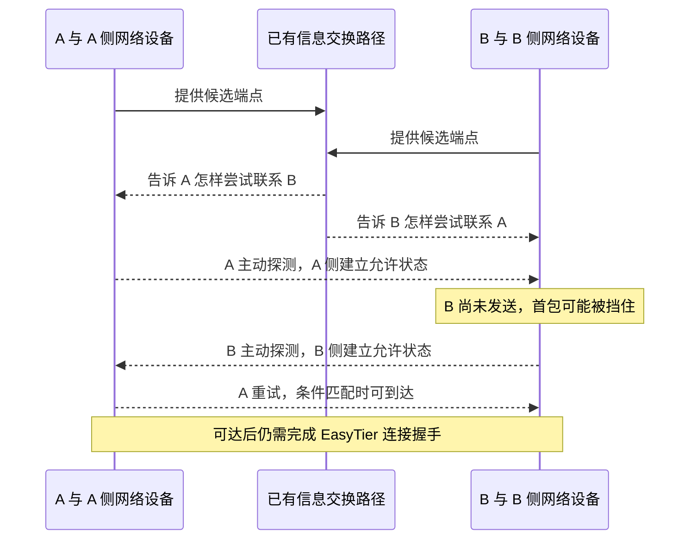
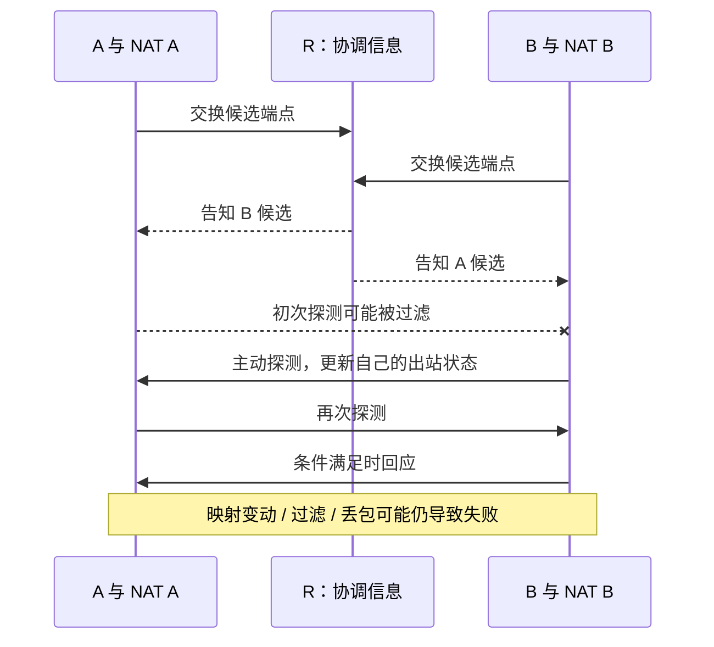

## 这一章要解决的问题

A、B 都在各自路由器后面，外面主动找它们的包可能被挡住。两端都主动向对方发包，为什么有时反而能建立直接连接？

这种协调尝试叫**打洞**：利用主动发包建立的网络状态，为直接通信创造条件。它不是破坏路由器，也不是打开永久漏洞。读完本章，你要能指出双方各做了什么，以及条件不满足时为什么仍然失败。

## 先回顾两件事

- [第 6 章](/chapters/06-nat)：映射决定地址端口怎样转换，过滤决定哪些外部来源允许进入。
- [第 10 章](/chapters/10-stun)：STUN 给出某次外部观察，不能保证向其他目标通信时端点和允许条件相同。

## 一步一步看

### 第一步：先有交换信息的路径

A、B 尚未直连时，已经可以通过 R 等已连接节点交换信息。双方把可能用于联系的外部地址端口告诉对方。这些准备尝试的端点叫**候选端点**；候选表示“可以尝试”，不是“已经确认可用”。

本章给 A、B 的候选外部端口分别写作 `40000`、`50000`，仅用于说明。B 的业务目标仍是虚拟 IP `10.144.144.2:8080`；这些候选端口是 EasyTier 底层连接的端口，不是网页服务端口。

### 第二步：A 先发包，A 自己一侧也产生变化

假设两侧映射稳定，但过滤规则要求“本机先向某个远端发过包，才允许那个远端返回”。A 主动向 B 的候选端点发一个 UDP 包。UDP 不要求先完成 TCP 那样的连接握手，但路由器或防火墙仍可以记住这次出站通信。

A 侧现在可能开始允许 B 的对应端点返回。可是 B 侧尚未向 A 发包，它的过滤条件还不允许 A，第一只探测包就可能被丢弃。

这不意味着 A 的动作毫无作用：包虽未到 B，A 自己一侧的状态可能已经改变。理解这一点，才能理解为什么双方主动尝试比只等一方敲门有用。

### 第三步：B 也发包，补上另一侧状态

B 随后向 A 的候选端点发送。这个动作让 B 侧开始允许 A 返回；而 A 之前已经发送过，A 侧可能允许 B 的探测进入。A 再次尝试时，B 侧也有了相应允许状态。

这幅图假定双方端点正确、映射能复用、过滤允许相应返回。真实网络不总满足这些前提。图中的箭头是教学过程，不是对某次 GUI 连接的抓包还原。

### 第四步：地址端口不匹配，双方发送也可能无用

假设 A 向 STUN 发送时获得外部端口 `40000`，改为向 B 发送却获得 `40001`。B 仍向之前交换的 `40000` 发送，就可能碰到只接受 STUN 回应的旧映射，而不是 A 面向 B 建立的新状态。

B 也可能遇到同样变化。两人都积极发包，却在联系错误的入口，仍无法形成双向连接。真实 EasyTier 会根据探测特征尝试不同策略，但随机端口、严格过滤、状态过期、协议阻断或不可用链路都可能使尝试失败。

双方的发送时间也重要。太早、太晚、状态已过期或包在途中丢失，都会影响结果。重试能改善部分情况，不是把所有规则都变成允许。

### 第五步：直连失败，与完全不能通信不同

只要还有允许转发的中继路径，业务可能经 R 到 B。打洞是争取直接路径的能力，不是虚拟网络可用性的唯一来源。直接连接后来失效，也可能重新尝试或回到可用转发路径。

即使打洞成功，B 的 8080 服务仍需运行并允许访问。直接连接解决节点之间的运输条件，不会代替网页服务、账号或主机规则。

## 图解：先失败，为什么双方发包后可能成功

**图：先失败，为什么双方发包后可能成功。** A第一次向B探测被B过滤，B主动向A发包后允许条件变化，A再次探测和B回应可能建立双向通道。

**读图顺序：**先读协调，再读双向探测。图采用双方主动发包可改善过滤条件的简化情形；它不意味着每个 NAT 都会保留同一个端口。目的相关映射、超时、网络切换及探测节奏会影响结果。R 传递信息和承担中继是不同阶段，直连建立后业务不一定继续经 R。

**这张图的结论：**“打洞”是尝试满足已有设备的状态规则，不是绕过所有过滤或永久开放端口。 更多分层细节见[协议与核心原理进阶篇](/internals/connectivity)。

## 先预测，再观察

**预测：** 在“需要双方发包”的预设里，A 的第一只包为什么可能被拒绝？B 发送以后，A 是否还需要再试？在“固定端点探测失败”里，失败发生在哪个条件上？

<NatLab />

**观察：** 这是浏览器内的教学模型，不发送真实探测。选择“需要双方发包”，逐步看 A、B 允许来源的变化，再看两个方向何时可达。重置后选择“固定端点探测失败”，对照旧端口和新映射端口。表里的映射与允许条件要分别读。

**解释：** 第一种预设展示双向主动发送与重试怎样补齐允许状态；后一种展示已交换的固定端点与新映射不匹配，为什么当前尝试失败。结果来自面板里的规则，不是读取了你的路由器。

**不能证明：** 模型省略真实时序、端口预测和更多策略，失败不证明真实 EasyTier 在这类网络永远不能直连。[历史实机案例](/cases/local-gui)的 `p2p` / UDP 也只描述当时目标状态，不能还原它采用的具体打洞算法。无需修改现有 GUI 网络来模仿面板。

## 常见误解

“双方各发一包一定成功”遗漏了端点、映射、过滤、时间和链路条件。“第一包被丢弃，所以发送没有用”遗漏了发送方自身状态的变化。

“打洞成功后永远不需要 R”忽略了换网、映射过期和重连。入口与备用转发路径仍可能有作用，但是否可用要看实际连接与政策。

“有公网 IPv6 就不用检查规则”也不成立。IPv6 通常减少 IPv4 地址转换问题，防火墙和路由仍然可以限制通信，不会因地址存在自动放行。

## 两道练习

**练习 1：** A 的首包被 B 侧拒绝，为什么 B 随后主动发送仍可能帮助建立连接？

查看练习 1 的答案

A 的发送可能已经建立 A 侧允许 B 返回的状态。B 的发送再建立 B 侧允许 A 的状态；端点正确且其他条件满足时，后续重试可能双向通过。

**练习 2：** 面板显示固定端点探测失败，是否说明应该关闭所有防火墙？是否说明真实网络绝对不能打洞？

查看练习 2 的答案

都不能这样推导。面板只说明这组简化规则下当前尝试失败，真实实现还可能尝试其他策略。实际排查应寻找对应失败条件，不能用全局关闭规则替代分析。

## 进阶阅读

选读：端口预测、TCP 打洞与控制参数

v2.6.4 的 UDP 打洞代码针对不同探测组合选择策略，包括锥型之间、对称型到锥型、部分两端可预测对称型等情况，还可以尝试多个候选端口。端口分配有规律时，预测可能有帮助，但规律、探测准确性和过滤仍影响结果。不能把某个 NAT 编号当作成功保证。

EasyTier 也支持 TCP 打洞。TCP 握手及其状态机与 UDP 不同，不能把上面的 UDP 箭头原样当成 TCP 报文过程。`--disable-udp-hole-punching`、`--disable-tcp-hole-punching` 控制相应自动尝试，不是关闭全部连接、转发或主机防火墙的总开关。本章不要求变更这些设置。

## 来源与下一章

- [v2.6.4 UDP 打洞策略实现](https://github.com/EasyTier/EasyTier/tree/v2.6.4/easytier/src/connector/udp_hole_punch)
- [v2.6.4 TCP 打洞实现](https://github.com/EasyTier/EasyTier/blob/v2.6.4/easytier/src/connector/tcp_hole_punch.rs)
- [官方 P2P 优化：条件与控制参数](https://easytier.cn/guide/network/p2p-optimize.html)：当前指南可能随版本更新。

下一章：[12 · 有了运输路径，内容、身份和权限怎样分别保护？](/chapters/12-security)
