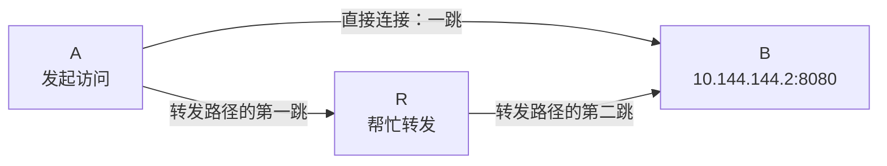
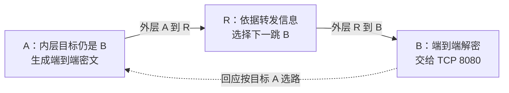

## 这一章要解决的问题

A、B 不能直接连接，但它们都能连接 R。A 还可能访问 B 的网页吗？如果可以，请求的目标应该写 B 还是 R？

**中继**是由中间节点继续转发发往最终目标的数据。它给不能直连的两端提供另一条运输路径。读完本章，你要能画出两种路径，说明 R 在做什么，并正确读取“目标 B”的状态。

## 先回顾两件事

- [第 9 章](/chapters/09-membership)：帮助第一次相遇的引导职责，与实际转发业务的职责不同。
- [第 12 章](/chapters/12-security)：能否读取业务内容，要看安全模式和信任关系，不能只看谁在搬运。

## 一步一步看

### 第一步：直接关系不成立，还可能有经过别人的完整路径

A 要访问 `10.144.144.2:8080`，A 自己是 `10.144.144.1`。直接连接可用时，A 的 EasyTier 把数据送给 B 的 EasyTier。直接连接不可用，但 A 到 R、R 到 B 都可用并允许转发时，数据也可能走完整的 A → R → B 路径。

这里的“直接”描述两个 EasyTier 节点之间的一段连接。它不表示互联网没有路由器，也不表示两台电脑之间真的只有一根网线。

图中的两条路线是对照，不是说每个包都同时走两条。“跳”在这里表示跨过一段 EasyTier 节点连接；经过 R 是两跳，一个中间节点。

### 第二步：业务目标与下一位搬运者分开

A 的浏览器仍访问 B 的虚拟地址和 8080。EasyTier 决定先把数据交给 R 时，改变的是下一位搬运者。R 的虚拟 IP `10.144.144.254` 不因此变成网页服务地址。

**下一跳**就是本节点当前首先交包的节点。A 经 R 到 B 时，A 的下一跳是 R；R 再按目标和自己的连接继续交给 B。每段底层隧道的端点可以不同，最终业务目的却一直是 B。

可以把 R 比作途中接力运输的人，但真实软件不是简单把所有收到的东西转发出去。它处理目标节点信息，并按相应转发与安全规则发送；没有连接或不允许转发时，图上画线也没有用。

### 第三步：到 B 后，才交给 B 的服务

B 的 EasyTier 收到发给本节点的业务数据，处理并交回 B 的系统。系统再根据目标协议和端口，把数据交给 8080 服务。R 不需要代替 B 回答网页，也通常无需理解 HTTP 页面路径。

回复也需要一条返回 A 的可用路径。它同样可能经过中间节点；网络变化后，去程与回程也不一定使用完全相同的路线。因此只看“请求能够送到”，还不足以解释完整访问。

普通中继不应与后面的子网代理混为一谈。子网代理可能继续访问另一台 LAN 设备并改变来源关系；本章只讨论最终目标为 B 节点本机的访问。

### 第四步：状态标签要找对对象

GUI 或查询结果中，`p2p` 表示目标的相关显示路径为一跳，`relay(2)` 表示相关路径为两跳。它不是“经过两个中继节点”；A → R → B 有两段连接，通常只有一个中间节点 R。

最容易看错的是 R 行显示 `p2p`，就宣称 A、B 已直连。R 行说明 A 到 R 的关系，B 行才是要访问的目标。先认清目标虚拟 IP 和设备归属，再读标签。

v2.6.4 的简短标签来自相应路径代价的显示转换。实际采用的路径还受选路配置影响；如果启用延迟优先策略，存在直接路径也不必然表示业务每次都选直接路径。结合目标路由和策略读状态，别把一行标签当作逐包录像。

### 第五步：路径改变不需要应用更换目标

后台尝试成功后，A、B 可以增加直接连接，路由随之更新；直接连接失效后，如果允许的转发路径还在，也可能恢复经 R 的运输。应用访问的仍是 B 的虚拟 IP。

真实变化需要检测和更新，期间可能出现丢包或短暂中断。中继还依赖自身带宽、负载和在线状态。因此它是实际资源，不是永远可用、无限容量的抽象箭头。

## 图解：中继换下一跳，不换业务目标

**图：中继换下一跳，不换业务目标。** 安全模式已建立端到端会话时，A 的密文经 R 转到 B，R 读取转发所需信息而不读取内层业务。

**读图顺序：**从左到右区分最终目标与每段外层收件人。这里限定为 secure mode 的端到端会话已经建立；R 可观察转发头、端点、包长与时序，并承担带宽和计算成本，但不能据此读取端到端业务明文。普通共享密钥成员的信任边界不同，不能套用完全相同的保证。

**这张图的结论：**中继是网络搬运节点，不是自动成为网页服务器，也不等于任何模式下都具备相同隐私边界。 更多分层细节见[协议与核心原理进阶篇](/internals/security)。

## 先预测，再观察

**预测：** 改为 A → R → B 后，业务包的最终目标会不会变成 R？`relay(2)` 里有几段连接、几个中间节点？

**观察：** 在[数据包旅程模型](/labs)选择“经过 R 中继”，逐步推进到 R 转发，再走到 B 收到请求和 A 收到回应。观察业务目标和外层端点分别在哪些步骤变化。模型假定会话已建立、外层用 UDP，不访问真实节点。

**解释：** 内层业务目标仍是 B；每段外层端点回答“这段运输先发给谁”。R 转发与 B 处理网页是不同工作，模型把它们分步显示。

**不能证明：** 模型不证明本机正在中继、某次连接用了特定打洞算法或能够瞬时切换。[历史 GUI 案例](/cases/local-gui)实际记录的是目标 `p2p` / UDP，没有人为制造中继切换。自己只读 GUI 时也应找目标行，不启停现有链路做对照。

## 常见误解

“用公共入口加入，所以所有业务都经过它”混淆了引导与转发。“中继在中间，所以必然能读所有明文”忽略了安全模式和信任边界。

“中继一定慢，直连一定快”也不能成立。中继常增加路径和资源依赖，但直接互联网路径也可能拥塞或绕行。实际延迟、带宽、丢包需要分别观察，不能用跳数代替测速。

“有一个节点叫 R，它就一定愿意转发”同样不正确。连接、允许转发的政策及可用资源缺一不可；去中心化不等于所有节点无条件开放带宽。

## 两道练习

**练习 1：** A 经 R 访问 B 网页，浏览器应访问 `10.144.144.254:8080`，还是 `10.144.144.2:8080`？

查看练习 1 的答案

访问 B 的 `10.144.144.2:8080`。R 是路径上的转发节点，下一跳与最终业务目标不同。普通中继不把 B 的网页服务搬到 R。

**练习 2：** R 行为 `p2p`，B 行为 `relay(2)`。能否说 A、B 已直连？两跳通常包含几个中间节点？

查看练习 2 的答案

不能。目标 B 的相关显示路径是两跳，通常包含一个中间节点。R 的一跳关系不能代替 B 的状态；还应结合路由和实际策略判断。

## 进阶阅读

选读：共享节点、路由输出与只允许 P2P

本章 R 是同网普通节点。公共共享节点可以为其他网络提供发现与转发，网络身份与业务网络分开，也可能实施白名单、限流或其他资源政策。多跳转发不必只经过唯一指定的 R，但需要允许的完整连接路径。

v2.6.4 显示规则把 `cost == 1` 转为 `p2p`，其他情况转为 `relay(n)`。`easytier-cli route` 有最少跳数和延迟优先的相应字段；最少跳数一跳时，下一跳可显示 `DIRECT`。读取时不能把两组策略列拼成一条实际不存在的路径。

`--p2p-only` 表达只允许直接路径的偏好；没有直连时相应数据会被丢弃，不会自动使用中继。它不会提高打洞成功率或让防火墙更宽松。本章不要求在既有 GUI 中切换这项配置。

## 来源与下一章

- [v2.6.4 README：P2P 失败时中继](https://github.com/EasyTier/EasyTier/blob/v2.6.4/README_CN.md)
- [v2.6.4 中继转发实现](https://github.com/EasyTier/EasyTier/blob/v2.6.4/easytier/src/peers/relay_peer_map.rs)
- [v2.6.4 peer 路径标签显示规则](https://github.com/EasyTier/EasyTier/blob/v2.6.4/easytier/src/utils/string.rs#L1)
- [v2.6.4 route 输出与两组路径字段](https://github.com/EasyTier/EasyTier/blob/v2.6.4/easytier/src/easytier-cli.rs#L1704)

下一章：[14 · 同时有几条路径，应该选哪一条？](/chapters/14-topology)
