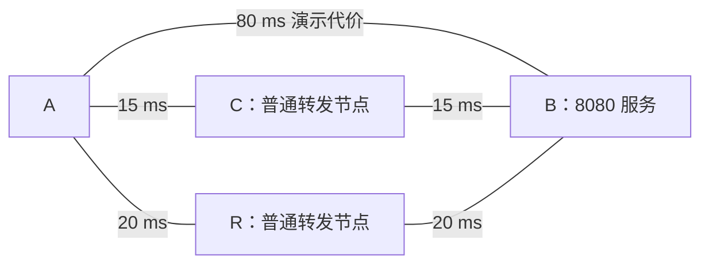

## 这一章要解决的问题

A 可以直接到 B，也可以经 R，或者经另一个节点 C 到 B。既然不止一条路都能到，EasyTier 应先把包交给谁？

本章先在一张小图里比较路径，不要求先学图算法。读完后，你能区分“存在可用路径”和“按某个目标选路径”，并解释为什么改一个选路指标不能修复完全断开的网络。

## 先回顾两件事

- [第 13 章](/chapters/13-relay)：最终业务目标是 B，中间转发节点只是路径上的下一位搬运者。
- [第 5 章](/chapters/05-routing)：系统先选择出站接口；进入虚拟接口后，EasyTier 还需要自己的节点路径选择。

## 一步一步看

### 第一步：把实际可用联系画成线

**拓扑**就是哪些节点之间存在可用连接。我们用点表示 A、B、C、R，用连线表示这些 EasyTier 节点之间的可用联系。它不是家中网线的接法，也不是运营商全部路由器的地图。

A、B 的虚拟 IP 仍是 `10.144.144.1`、`10.144.144.2`，服务目标仍是 B 的 8080。R 使用 `10.144.144.254`，本章额外增加 C，虚拟 IP 为 `10.144.144.3`。这些地址帮助区分业务目标与普通节点，选路时先看图上的连接，不需要为每个点都记一套公网数字。

### 第二步：给“更合适”定一个目标

A → B 用一段连接，叫一跳。A → C → B 用两段，叫两跳。如果只想少经过中间节点，优先选择较少跳数的路径。

但每段连接也有不同等待时间。**延迟**描述数据运输或回应需要等待多久，必须说明实际测量口径；本章先用固定的“演示延迟代价”帮助比较。图中的数字只是教学假设，不是实时测量或性能承诺。

按最少跳数，直接 A → B 只有一跳；另外两条需要两跳。按演示数字相加，经 C 是 `15 + 15 = 30 ms`，经 R 是 `20 + 20 = 40 ms`，直接路径为 `80 ms`。因此两种目标可以选出不同路径。

这种把数字作为比较依据的做法叫使用路径**代价**。代价不一定等于应用的实际耗时；真实延迟会有方向、抖动、排队和测量误差。最低演示延迟也不自动意味着最高带宽或最低丢包。

### 第三步：本节点决定先交给谁

选 A → C → B 时，A 的**下一跳**是 C。C 收到之后还要根据自己所知的路径继续交给 B。A 不必让应用填写整条节点名单，应用的目标仍是 B。

系统路由与这里的节点路由是两个决定。系统先把发往 B 虚拟 IP 的包交给 TUN；EasyTier 再把业务目标对应到目标节点，并决定下一跳。修改一层不能自动修好另一层，排查也需要分别看。

### 第四步：路径依据需要传播和更新

节点通过已有联系交换成员与连接信息，各自维护所知道的连接图。增加连接、连接失效或测量改变后，相应信息需要传播，再更新路径选择。

不同节点在变化刚发生时可能知道得不一样。A 还认为 C 能到 B，C 却已发现链路失效，就可能出现短暂失败。节点逐渐得到一致、可用路径的更新过程叫**收敛**。这个词不表示永远会成功；若根本没有剩余路径，再多计算也不能生成一条连接。

### 第五步：恢复网络不等于所有应用瞬时恢复

有替代路径时，更新之后可能恢复运输，但检测、传播和计算需要时间；应用还可能等待重传、超时或重新连接。不能仅凭“有备用节点”就保证无感切换。

去中心化也不要求所有节点在任何时刻两两直连。网络可能只有部分连接，只要存在完整、允许转发的路径仍可能到达。反过来，配置很多入口，如果它们都依赖同一处断开的连接，也不能认为已经消除了共同故障点。

## 先预测，再观察

**预测：** 最少跳数应选哪条？最低演示延迟应选哪条？选最低演示延迟后，C—B 断开会怎样？A 的所有连接都断开时，换指标还有用吗？

<TopologyLab />

**观察：** 这是浏览器本地模型。先切换指标，再只取消 C—B，观察所选路径。最后取消 A—B、A—C、A—R，让 A 与其他节点分开；完成后点击“重置拓扑”。只操作网页，不断开实际 EasyTier 网络。

**解释：** 默认少跳数选 A → B；最低演示延迟选 A → C → B；C—B 失效后，剩余较低代价路径是 A → R → B；A 没有任何连接时不可达。指标只在现有完整路径中作选择。

**不能证明：** 面板用静态数字简单相加，并立即重新计算，没有模拟真实探测、同步时序、安全政策或全部路由代价。结果不是本机故障切换证据，也不能用历史 `p2p` / UDP 快照还原具体打洞算法。真实路径要结合目标路由和当前配置读取。

## 常见误解

“一跳一定比两跳快”忽略了每段网络质量。“延迟优先保证下载最快”把不同指标混在一起。“算法够聪明就能绕过所有断线”忽略了至少需要一条真实可用连接路径。

“图上有线就说明节点一定允许转发”也不成立。本模型中的 C、R 是允许转发的普通节点；真实网络还需要相应权限和策略。

EasyTier 的一跳不等于互联网中的一个路由器。两台节点之间的一段隧道可以跨过许多底层路由器；`relay(2)` 也不表示物理网络恰好两跳或延迟恰好翻倍。

## 两道练习

**练习 1：** 直接路径演示代价 80，经 C 两段各 15，经 R 两段各 20。最少跳数与最低演示延迟分别选什么？

查看练习 1 的答案

在模型的既定条件下，最少跳数选一跳 A → B；最低演示延迟选 A → C → B，总代价 30。这些是模型比较，不是实际 HTTP 请求耗时。

**练习 2：** C—B 失效后还有经 R 的路，为什么真实访问仍可能暂时失败？若所有路径都断开呢？

查看练习 2 的答案

真实故障检测、信息传播和路径更新需要时间，应用也可能等待重传或重连。如果没有任何完整剩余路径，改变指标不能恢复连接，必须先恢复实际可用路径。

## 进阶阅读

选读：图算法、两组路由字段与模型取舍

图上的连接可以称作边，比较数字称作权重。v2.6.4 包含最少跳数与最小代价两类路径计算，使用 Dijkstra 等算法。Dijkstra 可以理解为逐步找出累计非负代价更小的可达路径，并记下第一步，不需要先学习它的证明才能读懂本章。

最少跳数策略通常先比较跳数，再比较相同跳数候选的内部代价；避开某些中继节点的政策也可能影响选择。`easytier-cli route` 展示两组相关路径字段，读取时要与配置策略对应，不能混用不同列的下一跳与延迟。

`peer_ospf_route` 的文件名不能解释成 EasyTier 把家庭路由器加入了标准运营商 OSPF 域。这里的状态传播属于覆盖网络。面板简化了测量、代价及同步，相等结果的固定取舍也不是对真实实现的通用承诺。

## 来源与下一章

- [v2.6.4 拓扑同步与两类路由表](https://github.com/EasyTier/EasyTier/blob/v2.6.4/easytier/src/peers/peer_ospf_route.rs)
- [v2.6.4 Dijkstra 与第一跳计算](https://github.com/EasyTier/EasyTier/blob/v2.6.4/easytier/src/peers/graph_algo.rs)
- [v2.6.4 下一跳策略接口](https://github.com/EasyTier/EasyTier/blob/v2.6.4/easytier/src/peers/route_trait.rs)
- [v2.6.4 route 输出字段](https://github.com/EasyTier/EasyTier/blob/v2.6.4/easytier/src/easytier-cli.rs#L1704)

下一章：[15 · 把接口、路径与服务拼成一次完整请求和回复。](/chapters/15-journey)
