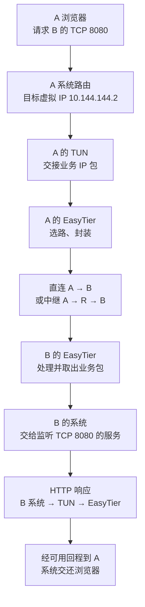

## 这一章要解决的问题

你在 A 的浏览器输入 `http://10.144.144.2:8080/`，B 的网页出现在屏幕上。我们要把“打开了”拆成能说清楚的过程：浏览器把请求交给谁，为什么走虚拟网卡，是否经过 R，B 又怎样把回答送回来。

这里 A 的虚拟 IP 是 `10.144.144.1`，B 是 `10.144.144.2`，R 是 `10.144.144.254`。A、B 的原有网络 IP 分别是 `192.168.10.20`、`192.168.20.30`。这些都是教学地址，不是你的设备读数。`198.51.100.10`、`203.0.113.20`、`192.0.2.10` 用来画公网隧道端点，属于文档保留地址，也不能照着连接。

本章先假定 EasyTier 已运行、A 能找到 B、B 上确有接受 TCP 8080 的网页服务。没有这几个前提，图里的一条箭头不代表实际访问成功。你已经做过的本机 Python 实验使用 `127.0.0.1:8877`；现在的 B `8080` 是另一台电脑上的假定服务，两个实验不要混记。

## 先回顾两件事

第一，URL 中的主机和端口共同说明你想联系的服务。主机写数字 IP 时，这一步不需要先把域名查成 IP。还分不清各部分，可以先回到[读一个网址](/basics/read-a-url)。网页文件的路径 `/` 是到达服务以后才使用的，不能拿它替代网络地址。

第二，操作系统根据目标 IP 选择出站接口。`127.0.0.1` 通常走本机回环，EasyTier 虚拟 IP 则需要匹配到虚拟网卡的路由。复习[我电脑里的网络](/basics/my-network)时，请把原有网络 IP、虚拟 IP、隧道端点分列；一台电脑同时有多个地址很正常。

需要回查时，可读[虚拟接口怎样交接](/chapters/07-tun)和[怎样选路径](/chapters/14-topology)，再继续下面的观察。

## 一步一步看

### 1. 浏览器请操作系统联系 B

浏览器不是直接控制家庭路由器。它告诉 A 的操作系统：“我要向 B 的 TCP 8080 建立连接。”系统为 A 这次连接分配临时源端口，例如 `50000`。于是业务的两个端点是 `10.144.144.1:50000` 和 `10.144.144.2:8080`。临时端口是本次示例，下次可能变化。

TCP 通常先完成建立连接的握手，再传 HTTP 请求。一个网页也可能产生多次请求，单个请求又可能拆成多个包。为看清职责，我们只跟随其中一个包，不把“一次点击”画成世界上只存在一个网络包。

### 2. 路由把包交给 TUN，EasyTier 再接手

系统查询目标 `10.144.144.2`，找到通往虚拟网卡的路由，把 IP 包交给 TUN。TUN 是让系统与隧道程序交接 IP 包的接口；它不会自己在互联网上找 B。A 的 EasyTier 读取包，找到目标节点和可用路径，再把业务包放进隧道传输中。

此时要分清两套端点。内层是业务端点 `A:50000 → B:8080`；外层是正在搬运这个业务包的隧道端点。外层可以使用 UDP，内层仍然是 TCP。像“把信装进运输袋”这个类比一样，袋子外面写的是这一段运输目的地，里面的信仍寄给最终收件者；真实协议还包含控制信息、加密和校验，并不只是一层纸袋。

### 3. 如果经 R，中途换的是运输段

直连时，A 发往 B 当前可用的隧道端点。中继时，A 先发往 R，R 再发往 B，每段外层端点可以不同。家庭 NAT 还可能修改外层源地址和端口，所以虚拟 IP 和实际互联网端点不能混用。

业务最终目标仍是 `10.144.144.2:8080`，不会改成 R 的 `8080`。R 是搬运节点，不是这份网页的服务器。曾经通过 R 入网，也不能证明这次业务必经 R；要看目标 B 的当前路径。

### 4. B 收到包，还要交给正确的服务

B 的 EasyTier 把属于本机的业务包交回系统。系统再根据协议和端口交给应用。若 B 的服务只监听 `127.0.0.1:8080`，它只接受 B 本机回环的访问；A 发往 B 虚拟 IP 的连接不会自动转到那个监听地址。这是“隧道通，网页仍打不开”的一个常见原因。

当服务接受连接、读取 HTTP 请求并生成回答后，响应的源端点变为 `10.144.144.2:8080`，目标端点变为 `10.144.144.1:50000`。B 的系统也要选路，交给 TUN、EasyTier，最后由 A 的系统把响应送回浏览器。

回程需要自己的有效路由和允许规则，不是图上的去程箭头自动倒放。真实去程和回程也可能不同。TCP 会处理确认、排序和重传，因此页面完成还涉及多个包和两端状态。你只需先记牢三个交接：应用到系统、系统到隧道程序、目的端再回到系统与应用。

## 先预测，再观察

**预测：**切换为中继以后，浏览器的最终目标地址会不会变成 R？B 的响应里谁是源、谁是目标？先把答案写在纸上。

<PacketJourney />

**观察：**先选直连，点击“下一步”走到 B 的服务，再继续走回 A。先看内层地址与业务端口，需要比较运输段时展开“外层端点与安全细节”。然后切换中继，用“上一步”与“下一步”比较 R 前后的运输段，最后重置。

**解释：**中继增加搬运步骤，不接管 B 的业务服务。去程与回程的内层端点对调，外层端点按照当前运输段显示。若你能分别说出“服务在哪里”和“这一段送给谁”，两层地址就已经分开了。

**边界：**这是浏览器里的教学模型，省略握手、重传、加密细节和真实时序，不发送实验包。Network 面板只能显示浏览器相关请求；仅凭它看不到 EasyTier 的逐包隧道路径。要对照真实证据，可读[已有 GUI 实例](/cases/local-gui)，那里验证的是 ICMP，未验证 B 的 HTTP 8080。

## 常见误解

“虚拟 IP 就不需要互联网”不成立。应用用虚拟 IP 选目标，封装后的数据仍需原有网络搬运。原有网络 IP、虚拟 IP、隧道端点是三个位置不同的读数，不是互相替换的名字。

“UDP 隧道让 HTTP 变成 UDP 应用”也不成立。外层运输协议与内层应用通信可以不同，B 的 HTTP 服务仍按它原本的 TCP 端口接收。

“收到 ping 回应就证明网页正常”忽略了应用交接。ICMP 成功不能证明 TCP 8080 有监听、允许访问和正确内容。看到服务日志、具体 HTTP 回答，才获得应用层证据。

## 两道练习

1. A 经 R 访问 B，URL 应写 B 的虚拟 IP 还是 R 的虚拟 IP？

第 1 题参考答案

写 B 的 `10.144.144.2:8080`。R 只是隧道路径中的搬运节点；某段外层发给 R，不改变内层服务目标。

2. 响应从 B 回 A 时，示例内层源端口和目标端口分别是多少？还需要路由吗？

第 2 题参考答案

源为 B 的 8080，目标为 A 本次临时端口 50000。B 和途中节点仍需要有效回程，不能因为去程成功就省去这一条件。

## 进阶阅读

读懂虚拟接口、原有接口与服务日志的不同证据

A 的虚拟接口主要用于观察业务 IP 包；A 的原有网络接口可能看到实际隧道端点和加密后的数据；B 的服务日志说明应用收到什么请求。三处读数不同是职责不同。看到隧道字节增长还可能是控制信息，不能直接归到本次 HTTP 请求；抓包也必须关联时间、目标和接口。

一次访问成功只证明这次目标、协议和条件下的请求完成，不代表所有协议、网段和包大小都正常。封装与安全边界继续参见[第 12 章](/chapters/12-security)和[第 13 章](/chapters/13-relay)。

## 来源与下一章

- [EasyTier v2.6.4 README：组网与节点查询](https://github.com/EasyTier/EasyTier/blob/v2.6.4/README.md)：固定版本的操作依据。
- [v2.6.4 虚拟网卡实现](https://github.com/EasyTier/EasyTier/blob/v2.6.4/easytier/src/instance/virtual_nic.rs)与[节点实例](https://github.com/EasyTier/EasyTier/blob/v2.6.4/easytier/src/instance/instance.rs)：TUN 与节点处理的实现入口。
- [RFC 9293：TCP](https://www.rfc-editor.org/rfc/rfc9293)及[RFC 5737：文档 IPv4 地址](https://www.rfc-editor.org/rfc/rfc5737)：通用原理与教学地址约束。

下一章把目标从 B 本机扩展到[远端局域网设备](/chapters/16-subnet-proxy)。
