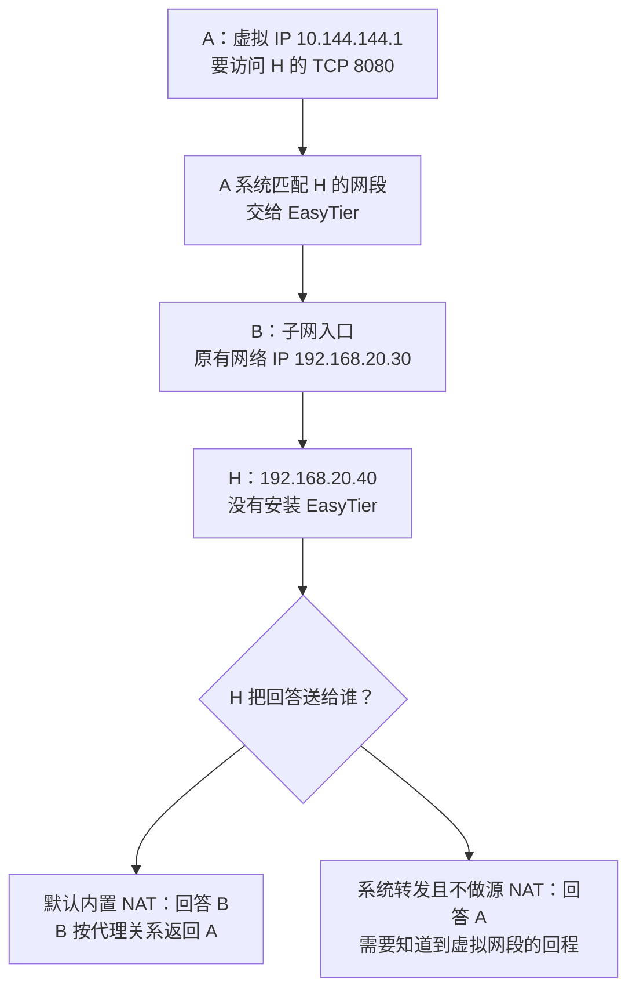

## 这一章要解决的问题

A 能访问 B 的虚拟 IP，不代表 A 能访问 B 家里所有设备。假设 B 家中还有打印机或网页设备 H，原有网络 IP 是 `192.168.20.40`，没有安装 EasyTier。A 想访问 H 的 TCP 8080，B 则已经能从家里访问 H。

这比访问 B 本机多出一段：业务先通过虚拟网络到 B，再由 B 帮忙进入它的局域网。局域网简称 LAN，指这里的同一处本地网络。**子网代理**就是把 B 能访问的一段地址，通过 B 提供给虚拟网络的其他节点。

教学中 A 的原有网络 IP 是 `192.168.10.20`、虚拟 IP 是 `10.144.144.1`；B 分别是 `192.168.20.30`、`10.144.144.2`。R 的虚拟 IP 是 `10.144.144.254`。本章只推演，不要求给既有 GUI 增加代理配置，也不要求修改路由器。

## 先回顾两件事

第一，路由回答“这个目标交给哪个接口或下一站”。目标 H 是 `192.168.20.40`，与目标 B 的 `10.144.144.2` 不同；会去 B 的路由不自动涵盖会去 H 的路由。基础读数可先看[我电脑里的网络](/basics/my-network)与[第 5 章](/chapters/05-routing)。

第二，请求必须有回程。H 收到了请求，还要知道回答送给谁、怎么走回来。类比寄信时留回邮地址很有帮助，但真实网络还会使用路由与连接状态，不能靠“曾从这扇门进来”决定所有回复。

需要回查时，可读[完整请求与回程](/chapters/15-journey)，再继续下面的观察。

## 一步一步看

### 1. 先确认 B 能到 H

B 是入口，不是让 H 凭空出现的设备。B 自己必须能到达 H，H 的服务也必须在合适地址上接受 TCP 8080。若 B 本机都访问不到 H，先检查 B 到 H 的本地服务、地址和规则；A 的隧道不能替这一段修好。

### 2. 发布的是目标网段，不是整个互联网

v2.6.4 可用 `-n 192.168.20.0/24` 声明 B 能代理这个子网。`/24` 表示这一段地址范围，详见[第 3 章](/chapters/03-addresses)。其他节点获知发布信息后，还要有相应系统路由，使发给 H 的包进入虚拟网络，再送到 B。

A 到 B 可能直连，也可能经 R 中继，这不会改变 B 仍要访问 H 的职责。隧道端点用于把数据搬到 B；H 的原有网络 IP 才是本次业务最终目标。文档公网端点 `198.51.100.10`、`203.0.113.20`、`192.0.2.10` 不能用于真实连接。

### 3. 默认内置 NAT：B 管理两边的对应关系

v2.6.4 默认使用内置子网代理/NAT。以 TCP 为例，B 处理来自虚拟网络的流量，再从自己的本地网络连接 H，并记住哪一份结果应该交回 A。NAT 在这里描述地址转换和关系维护，不是说 H 安装了 EasyTier。

H 通常看到请求来自 B 的原有网络 IP，比如 `192.168.20.30`，实际源地址取决于 B 的本地选路。H 回答 B 就能把结果交回来，通常不用额外认识 A 的虚拟网段。B 再按照代理状态把数据返回 A。

便利也有边界：H 的访问日志可能把不同访客都记成 B，单靠源 IP 难以区分他们。应用登录和权限仍有作用。内置代理为 TCP、UDP、ICMP 提供相应处理，不等于所有 IP 协议和局域网广播都原样通过；自动发现设备的功能也需要另行验证。

### 4. 系统转发：把后半段交给操作系统

`--proxy-forward-by-system` 是另一种模式。在普通 TUN 场景中，它把子网转发交给系统内核，并关闭该模式下的内置 NAT。系统内核就是操作系统处理底层网络的部分。开启转发、允许规则、去程和回程，都要由部署者明确设计。

假设没有另外配置系统源 NAT，H 看到源是 A 的虚拟 IP `10.144.144.1`。这不属于 H 的本地网段，H 可能把回复交给默认网关。但普通家庭网关通常只知道自己的 LAN 和互联网，不知道虚拟网段要经 B 返回。于是请求能到 H，回答却走错方向，A 仍然等待超时。

解决这类问题，需要在合适的位置明确到虚拟网段的回程路由，或按设计使用系统 NAT；这两种方式的来源地址效果不同。不是把 A 的去程重装几遍就能修好。初学阶段先理解缺哪一段，不照抄全局转发命令，也不改变现有 GUI 配置。

## 先预测，再观察

**预测：**画 A、B、H、H 的默认网关四个框。默认代理时，H 会把回答寄给 B 还是 A？系统转发且没有源 NAT 时又是谁？

**观察：**在纸上用两种颜色分别画去程与回程。第一轮在 H 旁写“看到 B 的原有网络 IP”；第二轮改成“看到 A 的虚拟 IP”。当回程到普通网关时暂停，检查图上是否有指向 B 的规则。

**解释：**内置 NAT 没有消除回程，而是由 B 的代理关系和本地连接承接回程。系统转发也不是“自动更高级”，只是责任从 EasyTier 的内置代理转到操作系统和 LAN 路由设计。

**边界：**这是一份图上推演，没有访问真实 H。GUI 中看见 B 在线，只能作为 A 到 B 的证据，不能代替 B 到 H、代理发布和 H 回程的验证。

## 常见误解

“共享子网就是共享所有流量”不正确。明确发布某一网段与把默认互联网出口改到 B，是不同用途。发布范围应按实际需要设计，出口节点不会因为子网代理就自动开启。

“本地都有 `192.168.20.0/24` 就更方便”反而可能产生地址冲突。若 A 自己的 LAN 与 B 的 LAN 使用相同范围，相同数字可以指向两处设备，需要重新规划或使用版本支持的映射方案；自动选路不会自动理解你想去哪个家。

“没有回程配置就没有回程”也要分模式。默认代理可能已承担这项工作；系统转发则不能继续套用默认代理的假设。只说“子网代理开了”不够，应记录采用哪一种方式。

## 两道练习

1. 默认内置 NAT 下，H 的日志为什么可能把多个虚拟网络访客都写成 B？

第 1 题参考答案

B 从本地网络访问 H，并维护两边对应关系。H 通常看到 B 的来源地址，因此网络层日志未必能区分 A 和其他访问者。应用账号仍可提供身份信息。

2. 系统转发且没有源 NAT 时，H 收到 A 的请求但回复去了普通网关。你应检查 A 的去程还是 H 一侧的回程？

第 2 题参考答案

优先检查 H 或其网关到虚拟网段的回程是否经 B，再检查 B 的系统转发与允许规则。请求已到 H 是去程证据，不能靠反复改变 A 的路由解决错误回程。

## 进阶阅读

部署时才需要看的发布参数与检查项

`-n 192.168.20.0/24` 只是参数片段，应加入 B 的完整配置，保留成员配置、虚拟地址与初始连接。选读 CLI 时可查看 `easytier-cli route` 的 `proxy_cidrs`，并与系统实际路由交叉核对。这不是要求重启正在使用的 GUI。

系统转发具体配置随 macOS、Windows、Linux 和网络环境变化，不能套用一组全局命令。发布前明确设备归属、来源限制和目标范围；需要一台 H 时可研究 `/32` 的单地址发布。记录原有配置，日后只撤销自己添加的规则。

## 来源与下一章

- [v2.6.4 README：Subnet Proxy](https://github.com/EasyTier/EasyTier/blob/v2.6.4/README.md)：`-n` 与路由查询。
- [v2.6.4 参数定义](https://github.com/EasyTier/EasyTier/blob/v2.6.4/easytier/src/core.rs)、[参数说明](https://github.com/EasyTier/EasyTier/blob/v2.6.4/easytier/locales/app.yml)与[IpProxy 实例](https://github.com/EasyTier/EasyTier/blob/v2.6.4/easytier/src/instance/instance.rs)：系统转发开关与默认代理。
- [v2.6.4 TCP 子网代理](https://github.com/EasyTier/EasyTier/blob/v2.6.4/easytier/src/gateway/tcp_proxy.rs)：本地目标连接的实现。
- [当前官方子网代理指南](https://easytier.cn/guide/network/point-to-networking.html)：补充阅读，可能随新版更新。

接着学习[服务监听、DNS 与权限](/chapters/17-apps-dns)，把“网络可达”落实到“应用可用”。
