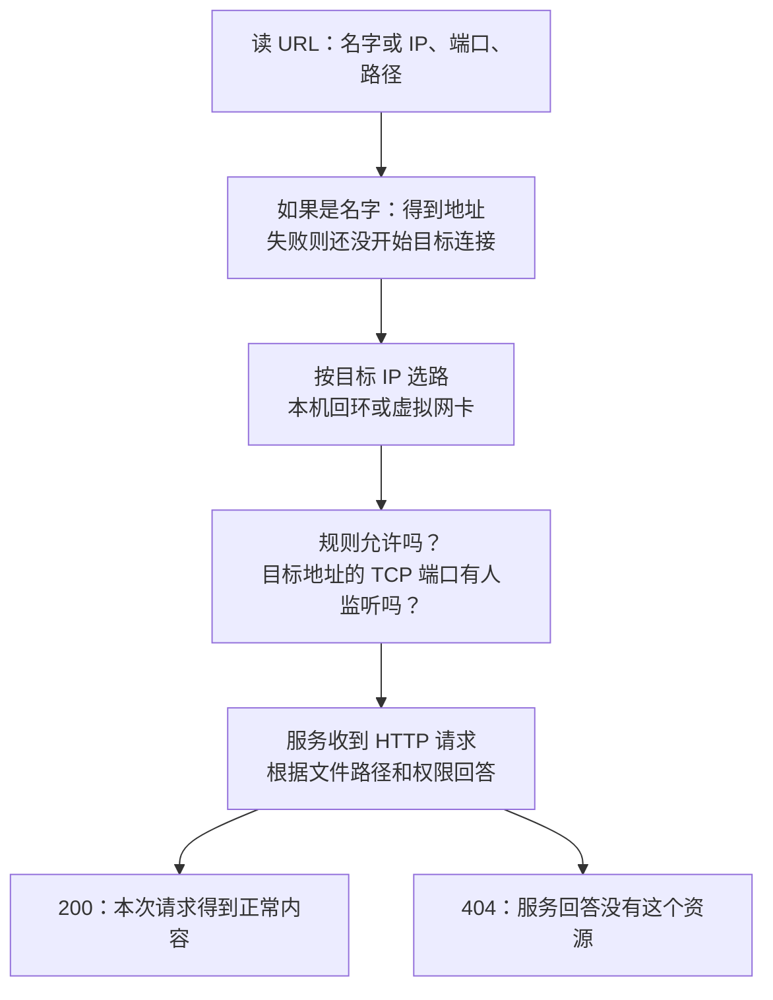
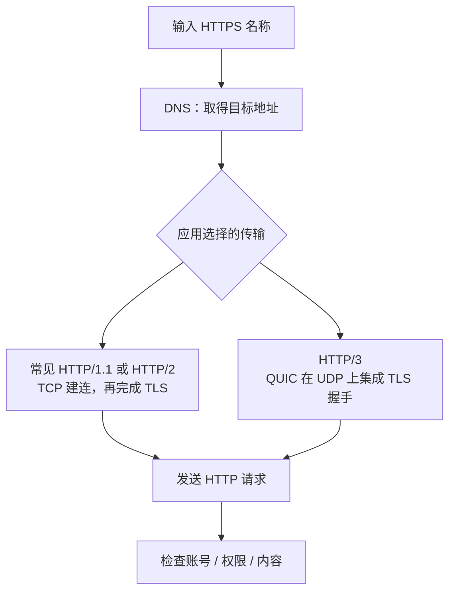

## 这一章要解决的问题

浏览器打不开网页，可能是名字没找到地址，也可能是地址到了却没有程序接收，还可能是服务器已经回答了“没有这个文件”。这些都可以显示为“不成功”，检查方法却不一样。

先用你能摸到的本机实验理解区别：Python 服务只监听 `127.0.0.1:8877`，浏览器向它请求文件。确认这一小段以后，再把目标换成教学中的 B `10.144.144.2:8080`。本章不会把你的本机实验说成远端 HTTP 已经验证，也不要求修改现有 EasyTier GUI。

A 的虚拟 IP 为 `10.144.144.1`，B 为 `10.144.144.2`，R 为 `10.144.144.254`。A、B 的原有网络 IP 是 `192.168.10.20`、`192.168.20.30`。这些教学数字帮你分层，真实操作应使用自己确认的地址。

## 先回顾两件事

第一，网址要拆开读。`http://127.0.0.1:8877/message.txt` 中，地址找到电脑，端口找到那台电脑上愿意接收的服务，文件路径交给服务处理。[读一个网址](/basics/read-a-url)中可以先练习指出这三个位置。

第二，网页显示在浏览器里，不代表服务也运行在浏览器里。Python 进程可以在另一个终端等待请求；关闭它以后浏览器还在，但接收请求的程序已经不在了。先修实验见[自己电脑上的网页](/basics/local-webpage)与[观察一次请求](/basics/observe-a-request)。

需要回查时，可读[完整请求与回程](/chapters/15-journey)，再继续下面的观察。

## 一步一步看

### 1. 名字先找到地址

输入数字 IP，可以直接使用这个目标。输入 `localhost` 或其他主机名时，系统或应用先把名字解析为地址。DNS 是用于查询名称与地址等记录的系统；`localhost` 是代表本机的特殊名称，系统可能直接处理它，不必每次向外部 DNS 请求。

本机的 `localhost` 可以同时对应 IPv4 `127.0.0.1` 和 IPv6 `::1`。只监听 IPv4 的 Python 服务，不等于也监听 IPv6。浏览器如何选择和回退取决于实现。因此初次实验先用数字 `127.0.0.1`，让地址族这个变量不干扰观察。

名字查不到、名字查成了错误地址、正确地址不能连接，是三种不同现象。更换 DNS 不能启动一台根本没有监听的服务器；解析正确也不会自动修复路由、端口或权限。

### 2. 系统按地址选路，服务按地址和端口监听

“监听”就是程序向系统登记：“我在这个地址、这个协议、这个端口等新连接。”Python 监听 `127.0.0.1:8877`，接收的是本机回环 IPv4 的 TCP 请求。浏览器输错成 8878，不会因此找到 8877 的服务。

同样，B 的服务若只监听 `127.0.0.1:8080`，它能在 B 本机打开，A 发往 B 虚拟 IP 的连接却不匹配这个监听地址。要从虚拟网络访问，应确认服务监听包含 B 的虚拟地址，而不是因为 B 本机回环自测成功就跳过这一项。

端口也要连同协议一起说。HTTP 实验用 TCP，UDP 8877 的监听不能接收这类连接；EasyTier 外层用 UDP 也不会改变 HTTP 内层用 TCP。`0.0.0.0` 是监听中的 IPv4 通配地址，可能扩大到原有 LAN 等接口，初学实验不需要把监听改成它。

### 3. 收到 HTTP 答复以后再看应用问题

本机访问 `/message.txt` 能收到内容，再访问不存在的 `/not-here.txt`，服务可以回答 HTTP 404。404 说明某个 HTTP 服务已经回答“没有这个资源”，不是“网络一包都没送到”。还需确认回答来自预期服务，避免地址、反向代理或内容认错。

HTTP 401 常涉及登录，403 常涉及拒绝访问，200 是本次请求的正常答复。这些状态不同于连接被拒绝或等待超时。被拒绝表示收到了拒绝信号，原因可能是无监听或规则主动拒绝；超时表示在期限内没有完成，可能涉及丢包、过滤、路由和应用等待，不能仅凭一个词确定全部根因。

### 4. 放行隧道和放行业务是两件事

主机防火墙与 ACL（访问控制列表）按规则允许或拒绝访问。EasyTier 隧道的端口允许通信，不表示 B 的 TCP 8080 也被允许。应用登录和服务权限又是下一层条件，虚拟网络密钥不是网页登录密码。

先固定数字 IP、端口和一种服务，观察最小证据，再加回域名、HTTPS、代理和登录。一次同时改变 DNS、监听、防火墙和网络配置，就难以知道哪一步使结果变化。

## 图解：HTTPS 的几个独立阶段

**图：HTTPS 的几个独立阶段。** 先DNS解析，再依据传输方式连接；常见HTTP1/2建立TCP与TLS，HTTP3用QUIC，再发送HTTP请求并检查权限。

**读图顺序：**先看名称，再看传输与安全阶段。这是 HTTPS 应用流程，不是 EasyTier 启动必须依次执行的任务。TLS（传输层安全协议）保护应用会话并校验相应身份；EasyTier 加密保护隧道载荷，两者可叠加且不会自动替对方完成身份或权限检查。DNS 查到地址，也不说明该地址当前可达。

**这张图的结论：**定位失败需要明确在哪个阶段：解析失败、连接失败、证书失败和HTTP错误分别要求不同证据。 更多分层细节见[协议与核心原理进阶篇](/internals/protocol-map)。

## 先预测，再观察

**预测：**本机 Python 服务开着时，请求不存在的文件，会得到“连接失败”还是“404”？把服务正常停止后再打开正确文件，会不会仍然是 404？

**观察：**按[本机实验](/basics/local-webpage)操作，并在[Network 面板](/basics/observe-a-request)分别记录 URL、状态和响应。只停止自己实验的 Python 终端，不停止原有 EasyTier GUI。使用 8877 或实验中已确认的替代端口，不碰其他进程。

**解释：**404 已经进入应用答复阶段；停止服务后，原来的文件名再正确也无法由这个服务回答。把“地址是否对、端口是否有监听、HTTP 回答是什么”写成三行，比一句“打不开”更能说明问题。

**边界：**这证明你本机这次 HTTP 行为，不证明 A 能访问 B，也不检验公网 DNS。服务器日志、浏览器缓存和实际请求时间要一起看；缓存中的内容不等于刚发出了一次新请求。

## 常见误解

“能 ping 就能开网页”忽略协议、端口、监听和应用权限。ping 通只提供 ICMP 往返证据，继续检查真正需要的 TCP 服务。

“网页回答 403，所以要重新打洞”通常检查错层。应先核对是哪一个 HTTP 服务回答，以及它的访问规则；连通性和应用授权不是同一个问题。

“名字一定只对应一个 IPv4 地址”也不成立。名字可以有多个结果，应用实际采用哪个结果影响访问。localhost 的双地址就是身边的例子，不需要先研究公网 DNS 才能看到。

## 两道练习

1. B 只能在本机用 `127.0.0.1:8080` 打开服务，A 访问 B 的虚拟 IP 失败。能直接认定 EasyTier 隧道坏了吗？

第 1 题参考答案

不能。先检查服务监听是否包含 B 的虚拟地址，再检查业务端口和允许规则。回环成功只说明 B 内部的这次访问工作了。

2. 浏览器访问不存在的文件得到 404，停止实验 Python 后访问原文件得到连接失败。这两次失败在同一层吗？

第 2 题参考答案

不同。前一次有 HTTP 服务回答资源不存在；后一次没有由该服务完成连接和回应。文件路径再正确，也不能替代运行中的监听服务。

## 进阶阅读

EasyTier DNS、自动发现与监听范围

v2.6.4 的 `--accept-dns` 提供魔法 DNS 入口，参数说明用 `<hostname>.et.net` 访问节点。这不是任意域名自动生效，也不表示每个系统无需配置就有相同解析结果。启用前应阅读对应平台说明，记录原有 DNS，不为本章本机实验改动它。

LAN 自动发现可能依赖广播、组播或专用协议。TUN 的三层可达不保证应用自动发现；初次排障先手工填写地址。IPv4 通配监听 `0.0.0.0` 与 IPv6 `::` 的关系也取决于应用和系统，不能仅看到端口号就确定覆盖范围。

公网教学端点 `198.51.100.10`、`203.0.113.20`、`192.0.2.10` 不能连接。`b.lab.test` 只是保留测试域名的假定映射，不会因为网站写了它就进入你的系统 DNS。

## 来源与下一章

- [v2.6.4 参数说明：accept_dns](https://github.com/EasyTier/EasyTier/blob/v2.6.4/easytier/locales/app.yml)与[DNS 实现目录](https://github.com/EasyTier/EasyTier/tree/v2.6.4/easytier/src/instance/dns_server)：固定版本的名称解析入口。
- [v2.6.4 ACL 处理](https://github.com/EasyTier/EasyTier/blob/v2.6.4/easytier/src/common/acl_processor.rs)：访问控制实现依据。
- [RFC 1034：DNS 概念](https://www.rfc-editor.org/rfc/rfc1034)、[RFC 2606：保留测试域名](https://www.rfc-editor.org/rfc/rfc2606)及[RFC 9110：HTTP 语义](https://www.rfc-editor.org/rfc/rfc9110)：通用协议原理。
- [当前官方魔法 DNS 指南](https://easytier.cn/guide/network/magic-dns.html)与[ACL 指南](https://easytier.cn/guide/config/acl.html)：补充阅读，系统支持和配置可能随新版变化。

下一章解释[连接成功却不够快](/chapters/18-performance)的问题。
