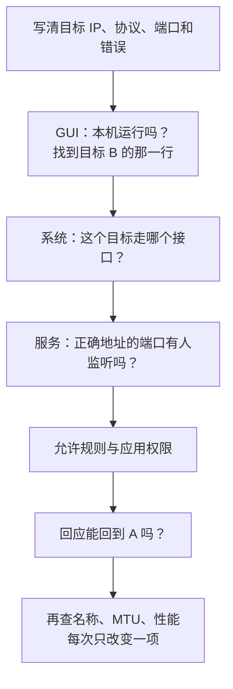
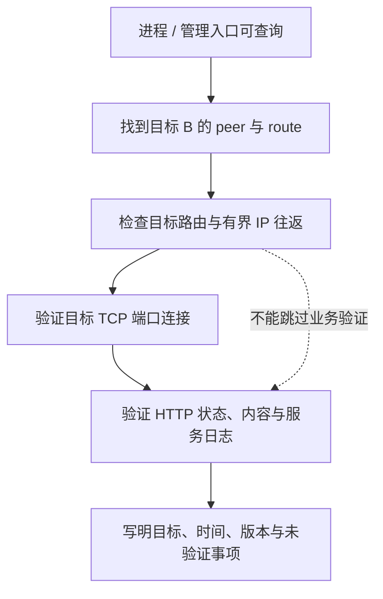

## 这一章要解决的问题

你已经有运行中的 EasyTier GUI，但某个目标打不开。现在最需要的不是重装，而是把一句“不通”改成别人也能判断的问题：我在哪台电脑，访问哪个地址、哪种协议和哪个端口，什么时候看见什么结果。

本章默认从现有 GUI 阅读，不要求安装 CLI、重启节点或改变网络。先把单个目标 B 找准，再结合系统路由和实际应用结果。公共节点在线不代表 B 在线，B 在线又不代表它的 TCP 8080 服务正常。

教学中的 A、B 虚拟 IP 是 `10.144.144.1`、`10.144.144.2`，R 是 `10.144.144.254`；A、B 原有网络 IP 是 `192.168.10.20`、`192.168.20.30`。真实记录请使用自己确认的地址，公开时替换姓名、网络名、标识和端点，不贴完整私人配置。

## 先回顾两件事

第一，失败阶段不同，证据不同。名称解析失败、连接被拒绝、等待超时、HTTP 404，不能用一个“网络坏了”解释。[观察一次请求](/basics/observe-a-request)让你先从本机服务认识这些区别。

第二，三种地址分别记录：原有网络 IP 是电脑原来所在网络的地址；虚拟 IP 是应用在 EasyTier 内使用的目标；隧道端点是 EasyTier 在底层搬运数据时联系的位置。对照[我电脑里的网络](/basics/my-network)，不要拿外层端口去代替网页的 8080。

需要回查时，可读[应用故障](/chapters/17-apps-dns)和[性能读数](/chapters/18-performance)，再继续下面的观察。

## 一步一步看

### 1. 写一个足够小的目标

先写“我要从 A 访问 B 的虚拟 IP，TCP 8080，得到网页”，而不是“整个组网都不行”。若目标是 B 身后的 LAN 设备 H，就明确写 H 的 IP；子网代理是额外一层条件。

记录时间、版本、目标与原始错误。先不改设置，因为重启可能改变 NAT 映射和路径，也可能抹掉线索。保留失败现场，才能发现最早的一处证据缺口。

### 2. 在 GUI 中只看目标 B 那一行

确认网络处于运行状态、本机有预期虚拟 IP，再找到 B 的虚拟 IP及对应设备。不同版本界面位置可能变化，列名也可能不同；先识别“这是哪个目标”，再读路径、连接协议、延迟和丢包。

v2.6.4 把路径 cost 为 1 显示成 `p2p`，其他 cost 显示为 `relay(n)`。在本教程普通跳数选路语境下，`relay(2)` 是两跳路径，通常有一台中间节点，不是两台中继。更复杂指标仍应结合实际路径理解。公共节点的 `p2p` 只证明到那个节点的关系，不能代替目标 B。

| 你看见什么         | 先问哪件事               | 暂时不能证明什么             |
| ------------------ | ------------------------ | ---------------------------- |
| B 的行不存在或离线 | 是否找对网络、地址与设备 | 不能只从名称判断打洞算法失败 |
| B 显示 `p2p` / UDP | 是否是当前目标 B 的快照  | 不证明 HTTP 8080 有服务      |
| B 显示 `relay(2)`  | 当前是否通过两跳路径可达 | 不等于整个网络故障           |
| GUI 显示延迟与丢包 | 测量窗口与对象是什么     | 不等于本次浏览器请求的统计   |



### 3. 把系统路由证据和 GUI 证据并排

在[本机网络读数](/basics/my-network)中，你已经看到 `127.0.0.1` 走 `lo0`，虚拟目标则需要相应虚拟接口。对一个已确认的远端虚拟 IP 查询路由，观察它到底走哪个接口，而不是一次输出整张表后猜。

系统选择虚拟接口，说明目标包被交给这个入口，不说明互联网外层具体怎样打洞。GUI 的目标路径补充另一层信息，两者一起才能描述现场。历史[实机案例](/cases/local-gui)中，目标路由经 `utun6`，GUI 的 B 显示 `p2p` / UDP，它们是各自独立读数。

### 4. 用应用结果继续缩小范围

若有人管理 B 的服务，先让 B 自测：服务是否运行，是否监听 B 的虚拟地址和 TCP 8080，日志是否看到请求。本机回环成功只证明本机这一段，不能跳过虚拟地址监听和允许规则。

A 用数字 IP访问成功、域名失败，再查名称解析；已经收到 404、403，先查资源、服务身份和权限；小请求正常而大响应停住，再研究 MTU等假设。顺序不是说其他层永远没问题，而是先解释已看到的明确现象。

如果是 H，另加三项：B 自己能否访问 H，代理网段是否发布，H 的回复怎样返回。系统转发模式尤其需要回程设计，详见[第 16 章](/chapters/16-subnet-proxy)。

## 图解：让证据停留在它能证明的层

**图：让证据停留在它能证明的层。** 进程运行只证明进程，目标peer和route支持路径判断，ICMP支持该类往返，TCP连接和HTTP回应分别支持更高层业务结论。



**读图顺序：**从上到下选择与问题对应的最小证据，这不是要求每次都先 ping：如果 ICMP 被禁止，应直接验证所关心的业务。GUI某个公共节点显示p2p，不能代替目标B的状态；管理RPC不通，也不能直接证明远端隧道失败。抓包时先选择内层或外层接口，否则看到的协议可能完全不同。

**这张图的结论：**把观察和推断分开记录，才能在重试或换路径后比较变化，而不是用“网络坏了”概括所有层。 更多分层细节见[协议与核心原理进阶篇](/internals/observability)。

## 先预测，再观察

**预测：**B 显示中继，还能不能用？另一行公共节点显示直连，能不能因此把 B 写成直连？

**观察：**打开[拓扑实验](/labs)，关掉 A—B，只保留经 R 的路径。先记录“路径变了，仍可达”，再断开所有到 B 的路径，记录“不可达”。然后对照历史 GUI 案例，圈出证据确实来自 B 的项目。

**解释：**中继是可用路径的一种，不等于失败。不可达才说明模型中没有有效路径。真实报告应写“对哪个目标、什么时刻、哪种证据”，而不是把节点列表中任意一条成功信息拿来解释整网。

**边界：**模型不会改变本机路由，也不模拟实际收敛。GUI 快照不等于连续监测。这里不扫描未知地址、不关闭防火墙，不通过重装来代替定位。

## 常见误解

“NAT 类型难，所以必然不能直连”把分类当成结果。标签是诊断线索，要与目标实际状态一起读；不能保证未来结果，也不自动证明某个算法已执行。

“有公网 IP 就一定可连”忽略监听、端口与允许规则；“没有公网 IP 就不能组网”忽略打洞和中继。一个地址条件不能概括整条业务链。

“重启后好了就找到根因了”也不充分。重启可能同时改变进程、映射和路径；没有修改前后对照，只能说现象变化，不能确定最初原因。

## 两道练习

1. 公共节点显示 p2p，B 显示 relay(2)。该如何报告 B 的路径？

<details class="answer">
<summary>第 1 题参考答案</summary>

按目标 B 报告两跳中继路径，普通跳数语境中通常有一个中间节点。公共节点的一跳关系不能替代 A 到 B 的结论，也不能单从中继判断应用不可用。

</details>

2. B 行 p2p，小 ping 有回应，TCP 8080 却连接被拒绝。下一项优先检查什么？

<details class="answer">
<summary>第 2 题参考答案</summary>

检查 B 的服务是否运行、是否监听正确地址的 TCP 8080，以及是否有规则主动拒绝。已有 ICMP 和路径证据不能代替业务监听。结合日志确认，不能把拒绝一律等同于无监听。

</details>

## 进阶阅读

<details class="advanced">
<summary>已经会用终端时，再选读 CLI 和管理入口</summary>

匹配版本的 CLI 能读更多状态。Linux/macOS 示例，Windows 分别使用 `.\easytier-core.exe` 与 `.\easytier-cli.exe`：

```bash
./easytier-core --version
./easytier-cli node
./easytier-cli peer
./easytier-cli route
```

`node` 看本机；`peer` 看节点及关系；`route` 看目标路径和下一跳等信息。v2.6.4 CLI 默认管理地址为 `127.0.0.1:15888`。GUI 可能使用不同管理配置，查询前确认正在运行的正确实例；CLI 无法连接管理 RPC，不自动证明远端隧道已断。

管理 RPC 是 CLI 向 core 查询的本机接口，不是业务端口。不要为排查查询问题把它开放到公网，也不要为得到输出重启现有 GUI。短时抓包需明确接口、目标和权限，文件可能包含敏感内容，不能直接公开。

公网教学端点 `198.51.100.10`、`203.0.113.20`、`192.0.2.10` 不用于实际诊断。

</details>

## 来源与下一章

- [v2.6.4 CLI](https://github.com/EasyTier/EasyTier/blob/v2.6.4/easytier/src/easytier-cli.rs)：默认管理地址、peer 与 route 输出。
- [v2.6.4 cost 显示转换](https://github.com/EasyTier/EasyTier/blob/v2.6.4/easytier/src/utils/string.rs)：p2p 和 relay(n) 的直接依据。
- [v2.6.4 README](https://github.com/EasyTier/EasyTier/blob/v2.6.4/README.md)：node、peer、route 查询与组网方法。
- [当前官方 P2P 优化指南](https://easytier.cn/guide/network/p2p-optimize.html)：补充诊断建议，可能随新版变化。

想先看现成网络的证据，可以读[实机案例：读懂已有 GUI 组网](/cases/local-gui)。它把目标节点状态、TUN 路由和一次有界 ICMP 验证放在一起，逐项说明能得出什么结论。

最后进入[模拟复习与可选两机实践](/chapters/20-practice)。
