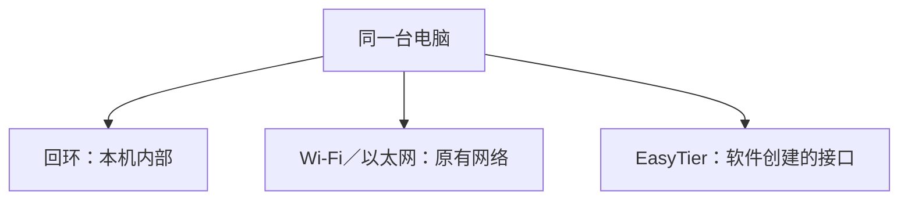

# 预备 4：找到自己电脑的网络地址

## 这一章要解决的问题

刚才用的是 `127.0.0.1`，系统设置里却可能写 `192.168…`，EasyTier 又有 `10.…`。到底哪个才是“我的 IP”？一台电脑可以有多个网络入口，各自有地址。先在界面里找到它们，再决定访问时需要哪个。

## 先回顾两件事

[上一节](/basics/read-a-url)解释了回环地址指当前机器；[本机实验](/basics/local-webpage)的网页服务只在这个地址上等待。现在做的是读取现状，不是更改配置。

## 一步一步看

### 在系统设置里看原有网络

macOS 打开“系统设置 → 网络”，选择正在连接的 Wi-Fi 或以太网；点击“详细信息”，在“TCP/IP”里找“IP 地址”和“路由器”。不同系统版本也可能从“Wi-Fi → 当前网络 → 详细信息”进入同一信息页。记下字段名称及你看到的值，随后关闭窗口，不保存任何修改。

**网卡**原本是让电脑连接网络的硬件，例如以太网卡；Wi-Fi 也有对应的网络设备。操作系统把这些网络入口称为**接口**。本教程说“原有网络 IP”，指你在 Wi-Fi、以太网等现有接口上看到的 IP，避免与 MAC 混淆。设置里的“物理地址”或 MAC 地址是另一类标识，不是这里要找的 IP。

“路由器”字段通常指当前网络通向其他网络的设备地址。先理解它是下一位帮忙交付的人，不必在此背路由规则；第 5 章会详细说明。一个设备可以有多个接口，接口也可以拥有多个 IP，不能把某个地址当成电脑永久唯一的名字。

<details class="advanced"><summary>Windows 与 Linux 的界面入口</summary>

Windows 打开“设置 → 网络和 Internet”，选择当前 Wi-Fi 或以太网的属性，寻找 IPv4 地址；默认网关可能需要打开“硬件和连接属性”查看。Linux 以 GNOME 为例，打开“设置 → Wi-Fi／网络”，点击当前连接旁的齿轮，在详情中查看 IPv4 和默认路由。各桌面名称可能不同，读取当前连接详情即可，不切换自动/手动地址、不保存配置。

</details>

### 在 EasyTier GUI 里看虚拟地址

已有 EasyTier GUI 时，打开当前运行中的组网实例，找本机虚拟 IPv4、连接状态和节点列表。**虚拟**表示这个网络入口由软件创建，并非新插了一根网线。EasyTier 虚拟 IP 是这套组网里用来定位节点的地址。

系统设置不一定列出所有虚拟接口，所以不要因为 Wi-Fi 详情里没有 EasyTier IP 就判断它没工作。把两个窗口并列看：系统设置提供原有网络 IP；GUI 提供组网虚拟 IP。暂时跳过 GUI 中的 NAT、延迟、节点 ID，它们在后文逐项解释。没有安装 GUI 时，用下面的示例对照即可，无需现在安装。

| 你看的位置             | 教学示例，非你的实际读数 | 用途                      |
| ---------------------- | ------------------------ | ------------------------- |
| 本机实验网址           | `127.0.0.1`              | 本机内部交接              |
| Wi-Fi 的 IP 字段       | `192.168.10.20`          | 当前家庭网络里的接口地址  |
| EasyTier GUI 虚拟 IPv4 | `10.144.144.1`           | EasyTier 网络里的接口地址 |

地址的数字开头不是软件身份标签。`10.…` 也可以是普通家庭或公司网络地址；这里认定它为虚拟 IP，是因为它来自 GUI 的对应字段，而不是因为它以 10 开头。



这三个入口不意味着每个程序都会在三个入口同时接待。本机网页绑定了回环，不能把网址里的 IP 随意替换为 GUI 虚拟 IP。想让其他电脑访问，需要专门安排监听与访问条件，那是后面的可选两机实验。

## 先预测，再观察

先预测：系统设置与 GUI 一定显示同一个 IP 吗？打开两个界面，给你看到的地址贴上“原有网络”和“虚拟”标签。记录可以只放在自己的笔记中，不要把完整配置或公网端点发到公开仓库。

看见地址只证明界面报告了该地址，不证明远端一定可达。已有[真实 GUI 附录](/cases/local-gui)还检查目标路由并发了四包 ICMP，证据比单看一个字段更完整。

## 常见误解

“地址越多越混乱，删掉一个就好了。”先理解用途，不调整正在使用的网络。“utun6 是所有 Mac 的 EasyTier 网卡。”接口编号由本机状态决定，其他机器或另一次运行可能不同。“知道虚拟 IP 就能打开网页。”服务还必须在合适地址与端口监听，网络也需要可达。

## 两道练习

**练习 1：** Wi-Fi 和 EasyTier GUI 显示不同 IP，这说明配置错误吗？

<details class="answer"><summary>答案 1：看各自属于哪个入口</summary>

不一定。它们属于不同接口、用于不同通信范围，是常见现象。判断错误需要结合目标、路由、连接状态和实际请求，不能只比较两个数字。

</details>

**练习 2：** 本机网页在 127.0.0.1 成功，改为虚拟 IP 失败。能认定 EasyTier 打洞失败吗？

<details class="answer"><summary>答案 2：先看服务绑定</summary>

不能。演示服务明确只绑定回环，虚拟 IP 上没有这次服务的监听。失败可能发生在应用入口，尚不足以判断 EasyTier 通道。

</details>

## 进阶阅读

<details class="advanced"><summary>选做：在 macOS 确认某个目标走哪个接口</summary>

先执行本机目标查询：

```sh
route -n get 127.0.0.1
```

关注输出的 `interface: lo0`，这是常见的**示例字段**，表示本机回环接口。若要看已有 EasyTier 目标，将命令末尾换成你 GUI 里选定节点的实际虚拟 IP，只查询这一明确目标。输出中的 `interface` 指系统选择的出口，不是网页服务，也不能单独证明包真的到达。Windows 可用 `Find-NetRoute -RemoteIPAddress 127.0.0.1`，Linux 可用 `ip route get 127.0.0.1`；输出结构不同，同样只找选定接口和下一步。

EasyTier 虚拟接口的三层工作方式留到[第 7 章](/chapters/07-tun)。教程不会从网页自动读取你的实际路由或接口。

</details>

## 来源与下一章

界面字段参考 [Apple TCP/IP 设置说明](https://support.apple.com/guide/mac-help/change-tcpip-settings-on-mac-mchlp2718/mac)。EasyTier 相关说明固定参考 [v2.6.4 README](https://github.com/EasyTier/EasyTier/blob/v2.6.4/README.md)及[官方文档](https://easytier.cn/)。下一节：[亲眼看请求和回应](/basics/observe-a-request)。
