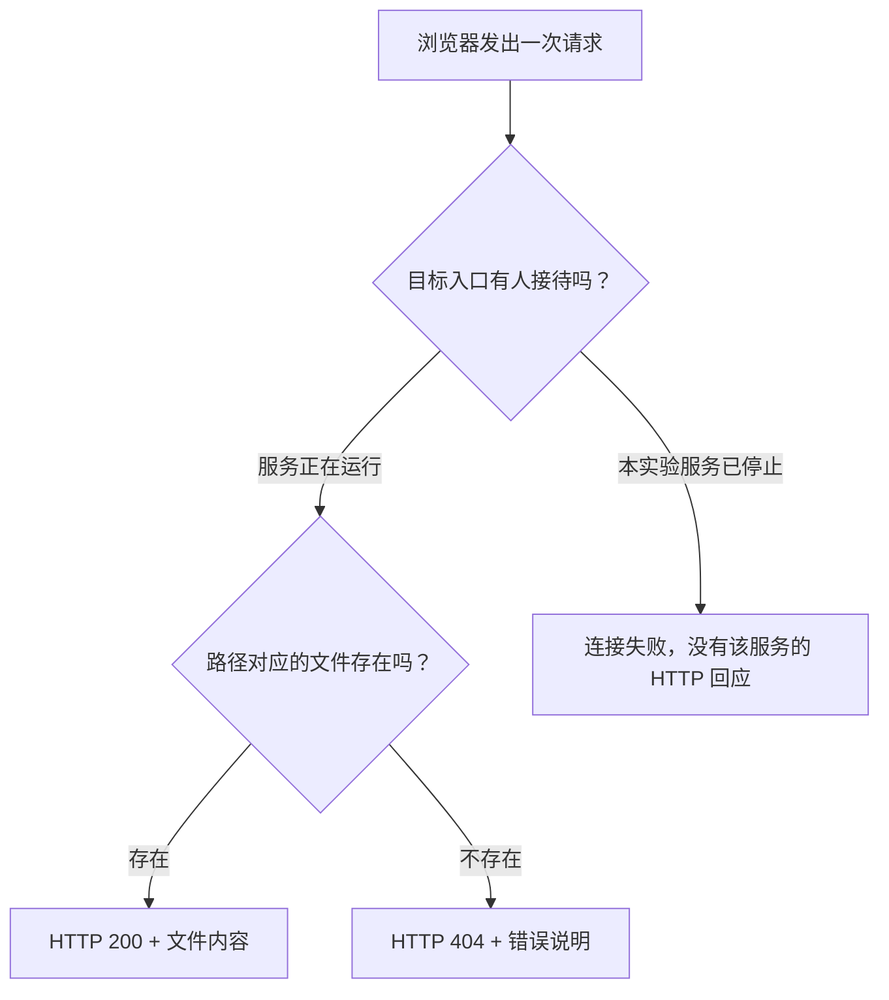

# 预备 5：亲眼看请求和回应

## 这一章要解决的问题

“网页打不开”可能有很多原因：服务回答没有这个内容，或者压根没有程序回答。我们用同一个演示服务，让这两种失败在界面上变得可区分。

## 先回顾两件事

[本机网页](/basics/local-webpage)由终端里的 Python 提供；[网址](/basics/read-a-url)中的地址、端口、路径作用不同。先在实验目录启动服务，正常打开 `http://127.0.0.1:8877/`。如果你选择了 8878，下面统一替换。

## 一步一步看

### 打开能看见请求的窗口

Chrome 右上角“三个点 → 更多工具 → 开发者工具”，选择“网络 / Network”标签。也可在 macOS 按 `⌘ Option I`，Windows/Linux 按 `Ctrl Shift I`。开发者工具是浏览器自带的观察窗口；我们不在 Console 执行代码。

确认录制按钮是红色，点击“清空”图标，再勾选“停用缓存 / Disable cache”。**缓存**是保存之前收到的内容，可能让浏览器省去重新请求。停用缓存选项通常只在开发者工具打开时有效。先清空，再访问一个指定网址，就不必在很多图标和其他请求之间猜。

下面界面示意用于认字段，**不是你的真实截图**：

| 网络面板字段             | 你要找的值                          | 用人话说                         |
| ------------------------ | ----------------------------------- | -------------------------------- |
| Name / 名称              | `message.txt`                       | 这次要的内容                     |
| Status / 状态            | `200` 或 `404`                      | 服务如何回答                     |
| Headers → Request URL    | `http://127.0.0.1:8877/message.txt` | 完整目标                         |
| Headers → Remote Address | `127.0.0.1:8877`                    | 浏览器实际连接的服务端地址与端口 |
| Response / 响应          | 文本或错误说明                      | 对方送回的内容                   |

### 第一次：成功回应

在地址栏打开 `http://127.0.0.1:8877/message.txt`。点网络列表的 `message.txt` 这一行，查看 Headers 和 Response。应看到 200，以及“你看见了浏览器向本机服务发出的一次请求。”

**HTTP** 是浏览器和网页服务交换请求、回应的一套规则。服务的回答包含**状态码**，即表示处理结果的数字；200 表示这次处理成功。我们由页面文字、网络面板和终端记录三处交叉确认同一个请求。

### 第二次：找不到内容，但服务回答了

先清空网络列表，再打开 `http://127.0.0.1:8877/not-here.txt`。这次通常显示 404 和文件不存在的错误页面。404 是服务说“没有你要的内容”。服务已经收到请求并回应，所以不能把这个 404 当成“网络完全不通”或“端口没开”。

### 第三次：服务停止，没有 HTTP 回应

回到专门运行 Python 的终端，按 Control+C。清空网络面板，再访问 `http://127.0.0.1:8877/message.txt?after-stop=1`。浏览器通常显示连接被拒绝，网络列表可能显示 `(failed)` 或 `net::ERR_CONNECTION_REFUSED`。此时没有来自演示服务的 HTTP 状态码，不要把浏览器错误页面误认为服务器发来的 404。



图仅描述本次本机实验。现实里的连接失败还可能与路径、网络或防火墙有关，不能看到一条错误就断言服务停止。我们能这样解释，是因为亲手控制了同一个服务的启停，并核对终端。

## 先预测，再观察

在做每一步前先预测，再填自己的记录：

| 动作                      | 我的预测 | 实际状态／错误 | 这说明什么                   |
| ------------------------- | -------- | -------------- | ---------------------------- |
| 请求存在的 message.txt    | 自己填写 | 自己填写       | 有没有收到服务回应？         |
| 请求不存在的 not-here.txt | 自己填写 | 自己填写       | 失败发生在连接还是内容选择？ |
| 停止服务后重新请求        | 自己填写 | 自己填写       | 有没有 HTTP 状态码？         |

记录实际值，不照抄示例。最后重新启动一次，确认恢复 200，然后停止实验服务、关闭专门的开发者工具。文件夹可以保留，已有 EasyTier 网络继续运行。

本节证明的是本机 HTTP 请求的几种状态，没有测远端服务、打洞成功率、长期丢包或带宽。接下来[第一章](/chapters/01-why)把服务放到另一台电脑上，解释为什么“它自己能打开”仍然不够。

## 常见误解

“红色的一行一定是断网。”404 也可能是红色，但已经收到服务回答。“ping 成功意味着网页成功。”ping 使用 ICMP，网页还需要对应服务接待 HTTP 请求。“Remote Address 是浏览器的地址。”这是浏览器连接的对方入口，本例恰好也在同一台电脑上。

## 两道练习

**练习 1：** 请求明确返回 404。你应先重装 EasyTier，还是检查请求路径和服务内容？为什么？

<details class="answer"><summary>答案 1：根据已有回应定位</summary>

先检查路径和服务内容。已有 404 说明这次请求抵达一个能回答 HTTP 的服务。还要核对是不是预期服务，但证据不支持先重装网络软件。

</details>

**练习 2：** 停止服务后，旧页面还显示原来的文字。怎样确认它还能不能回答？

<details class="answer"><summary>答案 2：发出新的请求</summary>

在网络面板停用缓存并清空列表，访问新的查询 URL，观察指定请求是否有 HTTP 回应；同时核对服务终端已回到输入提示。原来显示的文字本身不是一次新测量。

</details>

## 进阶阅读

<details class="advanced"><summary>选做：用命令得到同样的 HTTP 状态</summary>

macOS/Linux 可在另一个终端执行下面一行；Windows 使用 `curl.exe`，避免旧 PowerShell 的同名别名：

```sh
curl --noproxy '*' --connect-timeout 2 --max-time 5 -i http://127.0.0.1:8877/message.txt
```

`--noproxy '*'` 表示这次请求不经过代理；两个时间参数限制等待时间；`-i` 同时显示 HTTP 回应头和内容。服务运行时应看到含 200 的状态行；请求不存在路径时会有 404；服务停止后会出现 curl 连接错误，而非来自该服务的 HTTP 状态行。命令同样只访问指定回环服务，没有扫描其他端口。

</details>

## 来源与下一章

操作依据 [Chrome 网络面板文档](https://developer.chrome.com/docs/devtools/network/)，HTTP 状态依据 [RFC 9110](https://www.rfc-editor.org/rfc/rfc9110.html)，服务行为依据 [Python http.server](https://docs.python.org/3/library/http.server.html)。下一章：[EasyTier 解决什么问题](/chapters/01-why)。
