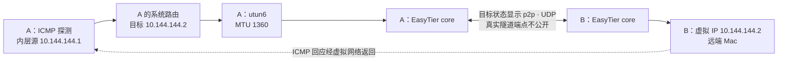

# 实机案例 · 读懂已有 GUI 组网

## 这次具体想知道什么

前 20 章从教学地址和模拟走到了可选两机实验。这一页换成一台已经使用 EasyTier GUI 组网的真实 Mac：先观察现状，再针对一台已确认归属的远端 Mac 做一次小范围连通性验证。问题是：“本机去往这台远端设备的包进入了哪个接口？目标节点当前显示什么路径？这次请求是否收到了回应？”

这是 **2026 年 10 月 13 日的真实观测案例**。为了能公开讲解，本机称 A，远端 Mac 称 B；地址统一替换成教程地址。下表中的 IP **不是设备的实际地址，不能据此探测**。版本、接口名称、MTU 和随后记录的测量结果保持实际观测值。

| 角色         | 公开讲解使用的地址                                  | 这次观察的职责               |
| ------------ | --------------------------------------------------- | ---------------------------- |
| A，本机 Mac  | 原有网络 IP `192.168.10.20`；虚拟 IP `10.144.144.1` | 已运行 GUI，发起一次有界验证 |
| B，远端 Mac  | 虚拟 IP `10.144.144.2`；原有网络 IP 省略            | 已确认归属的目标设备         |
| 其他网络节点 | 名称、地址和节点 ID 省略                            | 不把它们的状态代替 B 的状态  |

公开记录不包含网络名称、共享密钥、真实公网端点、设备名称和原始 GUI 截图。我们通过重绘图和脱敏摘要解释现场，保留足够的证据，也避免把一整张私人组网清单写进教程。

## 先把自己电脑上的网页与这个案例分开

如果这些名字还是抽象，先按[本机网页实验](/basics/local-webpage)在自己的电脑启动 Python，监听 `127.0.0.1:8877`，再在[观察一次请求](/basics/observe-a-request)里看浏览器和终端如何对应。这里是给读者的操作说明，**不是本页新增的 HTTP 实测**；本页保留的历史网络测量仍只有下文四次 ICMP 请求。

| 比较什么          | 本机网页练习的预期路径                     | 本页历史 ICMP 的实际观测                    |
| ----------------- | ------------------------------------------ | ------------------------------------------- |
| 目标              | 本机回环 `127.0.0.1:8877`                  | 远端 B 的虚拟 IP，公开替换为 `10.144.144.2` |
| 接收的服务或协议  | Python 接收 TCP 上的 HTTP                  | 远端回应 ICMP Echo；没有测试业务端口        |
| 系统接口          | macOS 回环 `lo0`                           | 到 B 的系统路由选择 `utun6`                 |
| 是否借助 EasyTier | 本机回环练习不需要 EasyTier                | 目标 GUI 显示 `p2p` / UDP，虚拟接口参与     |
| 能看到的证据      | 按步骤观察网页、Network 和实验 Python 日志 | 历史 GUI 快照、接口、目标路由与四包结果     |
| 正确收尾          | 只停止自己新开的 Python                    | 原有 EasyTier GUI 保持运行，不因读教程关闭  |

`lo0` 和 `utun6` 都是系统中的接口，但职责不同：前者把数据留在本机内部，后者在这个现场把虚拟网络 IP 包交给 EasyTier。地址栏都能写数字 IP，不表示所有访问都经过同一张网卡。`8877` 是先修实验端口，贯穿教学中的远端 HTTP `8080` 仍是另一项待验证服务。

用这个对照读下文：先问目标是自己的回环还是远端虚拟地址，再问系统交给谁，最后问得到的是网页答复还是 ICMP 回应。不要由本机网页成功补出本案例没有记录的远端 HTTP 结论。

## 先固定版本，再读状态

| 项目                            | 本次确认值                   | 为什么需要记录                                                            |
| ------------------------------- | ---------------------------- | ------------------------------------------------------------------------- |
| 本机系统                        | macOS `27.0.1`               | 接口和路由查询采用 macOS 的实际行为                                       |
| 本机 GUI 应用                   | `2.6.4`                      | GUI 版本单独记录，不能用它替代 core 版本                                  |
| A、B 状态所显示的 EasyTier core | `2.6.4`，提交标记 `8428a89d` | 与全书固定版本相符；GUI 应用版本与 core 版本是不同信息                    |
| EasyTier CLI                    | 本次未安装、未使用           | 节点状态依据运行中 GUI，系统路由依据系统查询                              |
| 本机虚拟接口                    | `utun6`                      | 本次创建的接口名称；其他 Mac 不一定相同                                   |
| 接口 MTU                        | `1360`                       | 与本版本默认加密配置下的 TUN MTU 一致；单凭数值不能证明全部加密或身份配置 |
| 到 B 虚拟 IP 的系统路由         | 经 `utun6`                   | 系统将这个目标的业务包交给虚拟接口                                        |

macOS 的 `utun` 是隧道接口。这里记录的是用于此组网的三层虚拟接口，交给 EasyTier 的是 IP 包，而不是一整个以太网广播域。`utun6` 的数字取决于运行环境，照抄接口名并不能在另一台机器找到相同网络。对应基础见[第 7 章：TUN](/chapters/07-tun)。

路由查询需要针对 **B 的虚拟 IP**。确认 `utun6` 只能说明系统选择的出站接口；它不会在操作系统路由表里直接写出“打洞成功”“经过哪个公网 NAT”。这些信息属于 EasyTier 隧道和底层网络，要与目标节点状态结合看。

这次系统路由输出还包含 `hopcount: 7` 字段。它是操作系统路由信息，不能当成 EasyTier 的七跳路径，也不能据此说经过了六台中继。下面的目标 `p2p` 来自 EasyTier 自己的连接状态，两者要分别读。

本次未安装、未使用 EasyTier CLI，没有进行管理 RPC 查询。如果读者之后用 CLI 复现节点状态，应先确认它与运行中的 core 版本匹配，并查询 GUI 使用的正确管理入口。本案例以运行中 GUI 的目标状态和系统路由交叉核对，不为获得查询结果升级或重启现有网络。

## 把业务路径与隧道路径叠起来看



图中的内层地址已经替换。去程是 A 的系统把目标 B 的 IP 包送入 `utun6`，由 EasyTier 通过当前可用连接送往 B。UDP 描述的是观察到的外层隧道传输，ICMP 描述的是我们用来验证往返的内层业务协议；它们可以同时成立。协议分层见[第 4 章](/chapters/04-protocols)，完整去程与回程见[第 15 章](/chapters/15-journey)。

本次目标 B 的 GUI 状态显示 **`p2p`，连接协议为 UDP**。在本版本显示中，`p2p` 对应一跳关系。这是对目标 B 的状态判断，而不是因为某个公共节点也显示 `p2p`。它说明这个快照中的目标连接信息；不能只靠这一行反推出实际采用了哪种端口预测、多少次探测，或每一个业务包的逐包捕获路径。

在 ICMP 探测前后各读一次状态，得到下面的实际摘要：

| 观察项目          | 探测前                                     | 探测后              |
| ----------------- | ------------------------------------------ | ------------------- |
| 目标 B 的路径显示 | `p2p`                                      | `p2p`               |
| 目标连接协议      | UDP                                        | UDP                 |
| GUI 显示的延迟    | `20 ms`                                    | `36 ms`             |
| GUI 显示的丢包    | `4%`                                       | `4%`                |
| 到 B 的系统路由   | `utun6`，MTU `1360`                        | `utun6`，MTU `1360` |
| 本机虚拟接口状态  | `UP`、`POINTOPOINT`、`RUNNING`，前缀 `/24` | 相同                |

这些是两个时间点的观测，不能证明中间每一瞬间都没有变化。GUI 的网络在整个验证期间持续运行，本次没有重建接口或切换网络。

如果另一个目标显示中转，就应为那个目标单独画图。图里也没有把某台设备强行叫作 R：引导节点和转发节点的职责需要分别确认，不能凭“列表里还有一台机器”推断它正在搬运这次数据。

## NAT 标签为什么不能代替验证

| GUI 中观察到的标签      | 这次的读法                             | 不据此断言的内容                                 |
| ----------------------- | -------------------------------------- | ------------------------------------------------ |
| A：`Port Restricted`    | 本次探测给本地网络的分类线索           | 永远不变的硬件属性，或任何协议都具有同样过滤规则 |
| B：`Symmetric Easy Inc` | 本次探测给远端网络的分类线索           | “一定无法直连”，或确定已采用某个具体打洞算法     |
| B 的连接：`p2p` / UDP   | 与上述分类同时观察到的实际目标连接状态 | 以后换网络、映射过期或重启仍一定直连             |

NAT 的映射规则回答“出去以后源地址与端口怎样变化”，过滤规则回答“什么回来会被允许”。产品显示的类型是探测结果的概括，不能替代全部映射表和过滤规则。`Symmetric Easy Inc` 包含该版本对探测特征的判断，我们没有额外抓取打洞过程，因此不将名称解释为确定的逐步算法证据。

这个现场很适合纠正一个误解：“看到 Symmetric 一词，就可以判定这两台机器绝对不能 UDP 直连。”这里应优先记录目标当前真实状态，再将 NAT 标签作为解释条件。也不能反过来把本次 `p2p` 写成“EasyTier 保证打洞成功”。规则、地址和端口会随网络条件改变；[第 11 章](/chapters/11-hole-punch)讲解的失败条件仍然成立。

## 四次 ICMP 验证怎么读

这次只对 B 的虚拟 IP 发出 **4 次 ICMP Echo 请求**。Echo 请求与回应就是 `ping` 的基础：收到回应意味着本次目标和返回路径能够搬运这类包。次数固定，目标已确认，没有遍历其他地址或扫描业务端口。

探测开始于 **2026-10-13 11:43:36（UTC+8）**。下面保留实际执行的命令形式，目标已替换成教程地址。读者应在自己的网络里替换为已确认的设备地址：

```bash
# macOS：只验证你已经确认的目标
ping -n -c 4 -W 1000 10.144.144.2
```

这里 `-n` 使用数字地址，`-c 4` 固定请求次数，macOS 的 `-W 1000` 设置单次等待为 1000 毫秒。执行脚本还为整个 ping 子进程设置了 **10 秒整体超时**；这项整体限制不属于上面 ping 参数。本次正常结束，两种超时限制均未触发。

发送的数据载荷为 56 字节。下面是 **真实结果的脱敏摘录**，省略实际设备地址；每次回应的 TTL 均为 64：

```text
icmp_seq=0 ttl=64 time=118.798 ms
icmp_seq=1 ttl=64 time=17.790 ms
icmp_seq=2 ttl=64 time=31.675 ms
icmp_seq=3 ttl=64 time=25.961 ms

4 packets transmitted, 4 packets received, 0.0% packet loss
round-trip min/avg/max/stddev = 17.790/48.556/118.798/40.853 ms
```

命令正常结束，退出码为 0，没有发生超时。四个请求都收到回应，证明这一次有界 ICMP 验证成功。**4 发 4 收不等于长期丢包率为零**：样本很少，也没有在不同时间或负载下重复测量。回应的 TTL 还会受远端初始值与协议处理方式影响，不据此计算物理互联网的跳数。

ICMP 的往返时间叫 RTT，测量范围是发出请求到收到回应的整个往返。它不是下载带宽，也不能直接等同于 GUI 显示的连接延迟。测量窗口和统计口径不同，GUI 的丢包统计同样不能拿来替换这四次请求的计数。

因此，GUI 的 `4%` 与这次 ping 的 `0.0%` 可以同时记录。它们是不同观察，不能把两个值拼成一次实验的统一丢包率，也不能仅因不同就判定工具错误。第一包 `118.798 ms` 明显高于后面三包，但这次没有足够证据确定原因，不能把它直接归因于“正在打洞”“路由收敛”或某台中继。

## 这份证据可以得出哪些结论

| 证据                      | 可以得出的结论                       | 还需要什么才能进一步判断                   |
| ------------------------- | ------------------------------------ | ------------------------------------------ |
| 到 B 的系统路由经 `utun6` | 该目标业务包的系统出站接口是虚拟接口 | 结合 EasyTier 的目标连接了解隧道路径       |
| B 行显示 `p2p` / UDP      | 该快照的目标连接显示一跳 UDP 关系    | 打洞日志或有界抓包才能讨论具体建连过程     |
| 本次收到 ICMP 回应        | 本次 ICMP 请求与回应有往返连通性     | TCP 服务需要单独验证监听、端口、权限及回应 |
| NAT 类型与当前连接并列    | 分类线索需要与实际目标状态一起解释   | 换网络或未来时刻需要重新观察               |

本次没有向 B 的 `8080` 发 HTTP 请求，也没有测试吞吐量、切换链路或关停节点。因此不把结果写成“网页服务已经通过”“测出了最大带宽”或“完成了故障切换”。也没有据此宣称验证了两台机器处于两个独立家庭宽带：虚拟地址与 RTT 不能证明设备的物理位置或底层网络归属。

这次观察使用了既有组网，不需要新增 core 实例、改动路由、防火墙或密钥，也没有停止用户原有 GUI。四次请求结束后，组网继续运行。这与[第 20 章的临时双机 HTTP 实验](/chapters/20-practice)属于两种实践条件；不要把那个实验的 Ctrl+C 收尾步骤用来终止正在使用的现有网络。

## 用自己的话解释这个现场

1. `p2p` / UDP 和 `ping` 用 ICMP 是否矛盾？

<details class="answer">
<summary>参考答案</summary>

不矛盾。ICMP 是内层 IP 包的业务协议，UDP 是观察到的外层 EasyTier 连接传输。业务包进入 TUN 后可以通过 UDP 隧道送往 B，再获得 ICMP 回应。

</details>

2. 目标 B 的 NAT 标签含有 Symmetric，而状态显示 `p2p`。应该否定其中一项吗？

<details class="answer">
<summary>参考答案</summary>

不用。NAT 标签是本次探测分类，目标连接是另一个层次的实际状态。先如实记录二者，不把分类词当成直连成败的绝对规则，也不凭连接状态断定具体打洞算法。

</details>

3. 四次 ping 有回应，能否保证 B 的网页 `8080` 可用？

<details class="answer">
<summary>参考答案</summary>

不能。网页还需要 TCP、服务监听、业务端口、访问控制和应用回应。应参考第 17、19 章针对具体应用验证；本案例没有做这项测试。

</details>

## 来源与复现边界

- 本机运行中 GUI、指定目标的系统路由及一次四包 ICMP 探测：本页的现场依据，公开内容为脱敏摘要。
- [EasyTier v2.6.4](https://github.com/EasyTier/EasyTier/releases/tag/v2.6.4)：与现场 core 版本交叉核对。
- [v2.6.4 显示转换](https://github.com/EasyTier/EasyTier/blob/v2.6.4/easytier/src/utils/string.rs)：`p2p` 与路径 cost 的显示含义。
- [v2.6.4 虚拟网卡实现](https://github.com/EasyTier/EasyTier/blob/v2.6.4/easytier/src/instance/virtual_nic.rs)：虚拟接口与默认加密配置下的 MTU 调整。
- [RFC 792](https://www.rfc-editor.org/rfc/rfc792)：ICMP Echo 请求与回应。

这份记录的用途是把[第 19 章的逐层排查](/chapters/19-diagnostics)落到实际证据。要访问远端网页，再执行针对已知服务的应用验证；要证明故障切换，再设计有明确归属、可恢复的链路实验。每增加一种结论，都需要增加与它对应的证据。
