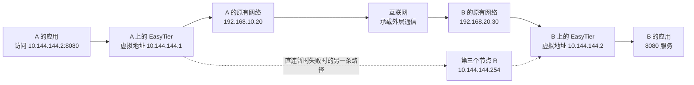

# 为什么隔着两台路由器就连不上

## 具体问题：B 明明开着服务，A 为什么访问不到

假设你在家使用电脑 A，朋友在另一个地方使用电脑 B。B 上运行一个网页服务，端口是 `8080`。在 B 自己的浏览器里，网页可以打开；你在 A 上输入 B 的地址，却一直等不到结果。服务没有坏，网络也并非完全断开：两台电脑都能浏览互联网。问题在于，“都能上网”和“能够互相访问”是两件不同的事。

我们用一组固定地址贯穿整个教程，免得每讲都重新认人物。**物理地址**是设备在现有网络接口上的地址；**虚拟地址**是后面给 EasyTier 虚拟接口使用的地址。

| 设备 | 物理网络中的地址   | EasyTier 虚拟地址 | 本教程中的角色                   |
| ---- | ------------------ | ----------------- | -------------------------------- |
| A    | `192.168.10.20/24` | `10.144.144.1`    | 发起访问的电脑                   |
| B    | `192.168.20.30/24` | `10.144.144.2`    | 提供 `8080` 服务的电脑           |
| R    | 不展开其内网地址   | `10.144.144.254`  | 必要时帮助连接或转发的第三个节点 |

先不要担心 `/24`，第 3 章会把它算清楚。A 所在网络的外侧地址记作 `198.51.100.10`，B 的外侧地址记作 `203.0.113.20`，R 的外侧地址记作 `192.0.2.10`。这里的三个外侧地址属于 RFC 5737 的文档保留网段，**只用于画图，不能拿去进行真实联网实验**。它们表示家庭路由器或公网节点的外侧位置，并不意味着 A、B 的物理网卡直接拥有这些地址。

## 概念解释：地址相同的写法，不代表有一条可走的路

A 的 `192.168.10.20` 和 B 的 `192.168.20.30` 都是私有地址。**私有地址**指允许在内部网络重复使用、不会作为普通公网目的地址被全球路由的地址。别人的家里也可能有一台 `192.168.20.30`。因此，你不能仅凭这个数字，要求互联网把数据送到朋友的电脑。

**路由**是为数据选择下一步去哪里的规则。A 想访问 B，需要有一套规则能把发往 B 的数据交到正确的出口，并且沿途每一步都有相应的转发能力。如果只是把 B 的私有地址输入浏览器，A 通常会把它交给默认网关，也就是负责通向其他网络的路由器。路由器并不会因此知道“这其实是你朋友家里的 B”。

家庭路由器还经常使用 **NAT，网络地址转换**：把内网设备的地址和端口换成外侧可用的地址和端口，再把返回数据交回原来的设备。它可以帮助多台设备共享上网地址，却不能凭空让所有外部设备主动找进来。NAT 的具体规则留到第 6 章，现在只要记住：出去的请求有机会留下返回线索，陌生的进来请求通常没有这条线索。

EasyTier 提供的是另一条可辨认的路径。你让应用访问 `10.144.144.2:8080`，电脑把相应数据送给 EasyTier。EasyTier 利用 A、B 原本能使用的互联网连接，把数据交给 B，再交给 B 的操作系统。应用看到的是虚拟地址之间的通信。

**覆盖网络，也叫 Overlay**，就是在已有网络上建立的一套地址和转发关系。承载它的原有网络叫 **底层网络，Underlay**。这里的虚拟地址属于覆盖网络；家庭网卡、路由器和互联网连接构成底层网络。新的一层仍然依赖原来的网络，没有互联网或其他可用底层链路，虚拟地址本身不会产生通信能力。

## 图解与逐步过程：让应用和运输各看各的地址

第一步，A 的应用产生一份发往 B 虚拟地址的数据。第二步，A 的系统根据路由把它送进虚拟接口，EasyTier 取得这份数据。第三步，EasyTier 把它封装进底层可运输的通信中，尝试交给 B。**封装**就是把原来的数据连同必要信息装入另一种数据格式，不是把目的应用改成第三个服务。

第四步，B 的 EasyTier 取出原来的数据，交给 B 的系统。第五步，系统根据其中的协议和端口，把数据交给 `8080` 服务。回复也要经过对应的返回过程。整个过程至少需要两种“知道去哪”：操作系统知道虚拟目的地址应走哪个接口；EasyTier 知道那个目的地址对应哪个节点，以及怎样到达它。

如果 A 与 B 能直接建立底层连接，这叫 **P2P 直连**，即节点之间直接通信。如果暂时只能经 R 到达 B，这叫 **中继**，即第三个节点帮助转发。图里的 R 是教学中的普通第三个节点；官方“公共共享节点”还涉及不同网络之间的连接机制，不能仅凭同一个虚拟地址就当作同一种配置。后面的章节会分别解释发现、打洞和中继。

## 小实验：在纸上区分三种访问

不安装软件，也不修改网络。画三张小卡片，分别写上 `192.168.20.30:8080`、`10.144.144.2:8080`、`203.0.113.20:8080`，依次问：“谁知道这个地址在哪里？谁负责把请求交到服务？”

第一张卡片需要一条能到 B 私有网段的路径，通常不会由普通互联网提供。第二张卡片需要虚拟接口、虚拟路由、EasyTier 节点连接和 B 的服务配合。第三张卡片指向 B 网络的外侧位置，还需要外侧监听或端口映射等安排，不能因为 B 内部开了 `8080` 就自动成功。三张卡片的端口相同，进入网络的入口却不同。

再遮住图中的互联网。你会发现，A、B 仍然“拥有”虚拟地址，图里的运输通道却消失了。这个动作说明了为什么虚拟网络能补充连接关系，却无法替代底层网络的可达性。

## 常见误解：装上软件之后，一切应该自动通

“虚拟网络”容易让人想到把两台电脑插进同一台交换机。这个类比只能帮助理解应用可以使用统一的地址；它不能保证广播、设备自动发现或所有局域网协议都有同样表现。EasyTier 的常规虚拟接口工作在 IP 层，第 7 章会专门解释这个边界。

另一个误解是“节点已连接，服务就一定能打开”。节点之间有通道，只解决了部分运输问题。B 的服务仍需监听允许访问的地址，防火墙仍可能拒绝 `8080`，回复也必须有路可回。还有，“去中心化”描述节点组织方式，不表示每个节点在任何时刻都能绕过 NAT 直接到达所有节点。

## 两个练习与折叠答案

**练习 1：** A 和 B 都能访问网页，是否足以证明 A 能主动连接 B 的 `8080` 服务？请说出还缺少的两类条件。

查看答案

不足以。还需要 A 到 B 的有效网络路径，例如可用的虚拟网络通道；也需要 B 的服务监听和防火墙允许这次访问，以及可用的回程。访问公共网站证明的是各自对那个网站的通信，不是 A、B 互相可达。

**练习 2：** A 使用 `10.144.144.2:8080` 访问 B，途中经过 R。应用的目标是否应改成 `10.144.144.254:8080`？

查看答案

不需要。应用目标仍然是 B。R 在这个例子里帮助运输数据，不承担 B 的业务服务。目的节点和运输过程中经过的节点是两个不同的问题。

## 来源与下一章

本教程的 EasyTier 行为以 [v2.6.4 官方 README](https://github.com/EasyTier/EasyTier/blob/v2.6.4/README.md) 为版本依据，尤其是共享节点组网、直连失败后中继和去中心化说明。私有地址范围见 [RFC 1918](https://www.rfc-editor.org/rfc/rfc1918.html)，教学外侧地址的用途见 [RFC 5737](https://www.rfc-editor.org/rfc/rfc5737.html)。前面的流程是便于入门的结构说明，后续会逐步补齐真实协议过程。

下一章：[02 · 一次网页请求怎样变成数据包](/chapters/02-packets)。我们沿着 A 到 B 的请求，打开每一层的包装，看系统实际交接的是什么。
