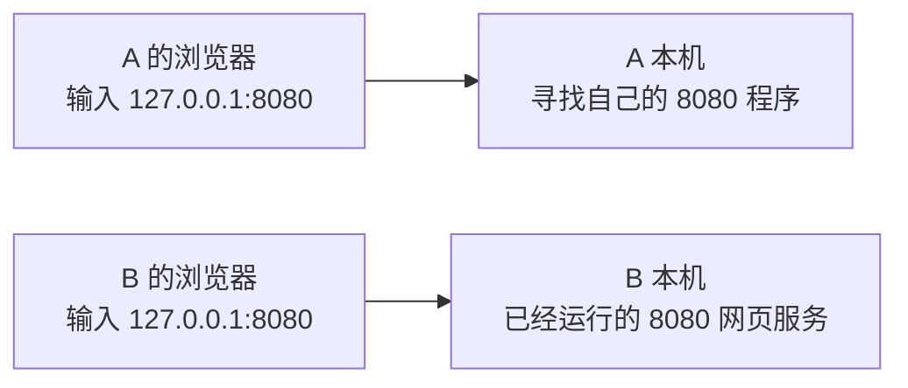

# 01 · B 能打开自己的网页，为什么 A 不一定能

## 这一章要解决的问题

朋友的电脑叫 B，你的电脑叫 A。朋友说：“我在 B 上开了一个小网页，自己已经能看到了。”你想在 A 上看同一个网页。这两句话看起来只差“换一台电脑”，实际多了几个条件。

我们先不讲打洞，也不摆出一桌子地址。先解决一个最小问题：**B 自己能打开的地址，复制到 A 上，为什么可能找的已经不是 B？**

这一章中的 B 提供一个端口为 `8080` 的网页服务。网页服务是运行中的程序，负责收到请求后给出网页；端口是系统用来区分接收程序的编号。这两个词在预备课里都可以通过本机小网页观察。本教程的预备课使用 `8877`，贯穿 A、B 案例使用 `8080`，它们是两个示例，不能混着照抄。

## 先回顾两件事

第一，浏览器和网页服务是两个角色。浏览器发出“请给我这个页面”的请求，服务处理请求并返回内容。浏览器窗口里看见网页，不表示网页服务就在浏览器里面。忘记这两个角色时，先读[浏览器与正在运行的程序](/basics/browser-and-programs)。

第二，`127.0.0.1` 表示**当前这台电脑自己**，常叫回环地址。“回环”在这里指通信留在本机内部。`localhost` 这个名字通常也指向本机回环地址；为了避免名字解析的差异，本教程的小实验直接使用 `127.0.0.1`。先读[打开自己的小网页](/basics/local-webpage)，再用[读懂浏览器地址栏](/basics/read-a-url)确认地址的各部分。

读完这两件事，你应该能指着 `http://127.0.0.1:8877/` 说：“浏览器要找这台电脑上的 8877 服务。”暂时不用知道它怎样把请求分成数据包。

## 一步一步看

### 第一步：B 打开自己的网页

B 上有一个已经运行的 `8080` 服务。B 的浏览器访问 `http://127.0.0.1:8080/`。这里的 `127.0.0.1` 指 B，`8080` 指它要找的服务编号。所以请求是在 B 内部交给 B 的程序。

### 第二步：A 复制这个地址

A 的浏览器也输入 `http://127.0.0.1:8080/`。地址文字没有变，**“当前这台电脑”却变成了 A**。浏览器现在找的是 A 自己的 `8080`，没有让互联网去找 B。

如果 A 没有相应服务，就可能出现无法连接。如果 A 恰好也有一个 `8080` 服务，甚至可能打开另一个页面。无论是哪种结果，都不能说明它访问到了 B。

这张图中的两条箭头分别留在 A 和 B 内部。它们不是 A 到 B 的网络路径。最先需要改正的是“请求在找谁”，而不是立刻怀疑 EasyTier。

### 第三步：给 A 一个确实指向 B 的目标

要让 A 访问 B，目标必须能代表 B 在某个可用网络上的接收地址。**IP 地址**是网络用来标识接口和选择目的地的地址；接口是电脑与一张网络交接数据的位置。它们会在[第 3 章](/chapters/03-addresses)展开。

EasyTier 是运行在设备上的组网程序。它可以为参加同一个虚拟网络的设备提供**虚拟 IP**，也就是由这个虚拟网络接口承担的 IP 地址。在全书的教学案例中，我们给 B 写 `10.144.144.2`，A 写 `10.144.144.1`。这些是教学标记，不是你电脑当前的实际地址。

准备好相应网络之后，A 的应用可以把 B 的虚拟 IP 当作目标，例如 `http://10.144.144.2:8080/`。此时目标表达的是“B 的 8080 服务”，而不是“A 自己的 8080 服务”。**写上虚拟 IP 只是正确地指明目标，不能单凭这串数字产生一条连接。**

### 第四步：目标正确，还要有路和接收程序

这次访问至少还需要两类条件。

一类是运输条件：A 的请求能进入 EasyTier，节点之间存在可用路径，B 的回应也能回来。EasyTier 利用已有的网络运输这些数据；原有网络断开，并不会因为保留一个虚拟 IP 就恢复通信。

另一类是服务条件：B 的 `8080` 程序仍在运行，准备接受来自这个地址上的请求，而且相关访问规则允许这次通信。程序只接受 B 本机内部的请求时，B 自己成功、A 失败可以同时发生。具体的“监听哪些地址”会在[第 4 章](/chapters/04-protocols)讲清楚。

节点之间可能直接运输数据，也可能请第三个节点帮助转发。现在只需知道“能送到 B”有不同的路径；第 13、14 章再比较它们。不要把图上画的一条线当成已经测量出的真实连接。

## 先预测，再观察

这一步可以在你自己的电脑上做，不需要 B，也不访问陌生设备。

**先预测。** 按[本机小网页预备课](/basics/local-webpage)准备好服务，再看 `http://127.0.0.1:8877/`。它寻找的是这台电脑的程序，还是某个远端节点？如果把这串文字发给别人，对方的 `127.0.0.1` 会不会仍指你的电脑？先写下答案。

**再观察。** 在服务运行时打开这个地址，找出页面内容和服务所在的终端窗口。你看到的是本机程序提供的页面。此处 `8877` 属于预备课，不是在测试贯穿案例中 B 的 `8080`。

**解释。** 页面能够打开，与服务正在本机运行相互对应。别人使用同一串回环地址，会去找对方自己的电脑；文字相同不代表目标机器相同。

**边界。** 这个观察只建立“本机浏览器找本机服务”的概念，没有验证 A 到 B，没有证明虚拟网络连通，也不要求停止现有 EasyTier GUI。没有准备本机服务时，就对照预备课的明确示范理解，不把假设结果写成自己的实测。

## 常见误解

“两台电脑都能浏览网站，所以一定能互访”把不同目标的访问混在一起。A 能访问某个公共网站，说明 A 与那个网站之间的一次访问可用；它没有验证 B 的地址、程序和路径。

“B 在自己电脑打开成功，别人一定能打开”忽略了接收地址和访问规则。最简单的反例就是回环地址：它明确面向当前机器，不替其他电脑提供入口。

“把地址换成虚拟 IP 就完成了组网”也不成立。地址告诉系统要找谁，可用路径负责送达，服务负责回答。这三个问题要逐个有答案。

## 两道练习

1. B 的浏览器打开 `http://127.0.0.1:8080/` 成功。A 输入同一地址时，请求首先在找谁？

第 1 题：目标是哪台电脑

在找 A 自己。`127.0.0.1` 在哪台电脑上使用，就代表那台电脑本机。如果 A 没有对应服务会失败；如果 A 有自己的服务，可能看到 A 的页面。两种结果都不能当作访问 B 的证据。

2. A 已经正确使用 B 的虚拟 IP。为什么仍不能仅凭地址判定网页可以打开？

第 2 题：还有哪些条件

还需要可用的去程与回程，以及 B 正在运行且允许此次访问的网页服务。正确目标、可用运输路径、服务能够回答，是不同条件。EasyTier 节点状态和网页结果也应分别观察。

## 进阶阅读

已经分清目标之后，再看虚拟网络的位置

虚拟网络常称覆盖网络或 Overlay，承载它的原有网络称底层网络或 Underlay。EasyTier 将原来的 IP 数据放到自己的节点连接中运输，这类“用一条连接搬运另一层通信”的安排称隧道。封装指为被运输的数据加上外层格式，不等同于加密。

虚拟地址、原有网络 IP、隧道端点属于不同层次。隧道端点包括底层地址、协议和端口；它不等于网页的 `8080`。常规 EasyTier TUN 接口交接三层 IP 包，并不把所有电脑变成共享以太网广播的一组设备。这里先知道这些词的关系，[第 7 章](/chapters/07-tun)会从接口开始解释，[第 15 章](/chapters/15-journey)再完整追踪数据。

v2.6.4 支持节点直连以及经过其他节点的转发。帮助最初加入网络的节点称引导节点；实际搬运业务数据的节点承担中继职责。这两种职责可以在同一设备上发生，也可以分开，不能把“连接过它”解释为“所有网页始终经过它”。

## 来源与下一章

- [EasyTier v2.6.4 README](https://github.com/EasyTier/EasyTier/blob/v2.6.4/README.md)：虚拟地址组网、节点直连和中继能力；不是任意网络都成功的承诺。
- [RFC 1122](https://www.rfc-editor.org/rfc/rfc1122.html)：IPv4 本机回环地址的用途。
- [第 7 章：TUN 接口](/chapters/07-tun)：继续解释虚拟地址如何接到程序。

下一章：[02 · 一次请求怎样交到另一个程序](/chapters/02-packets)。先沿着请求和回应看交接，不急着背所有协议名。
