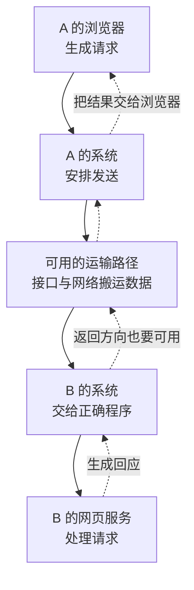

# 02 · 一次请求怎样交到另一个程序

## 这一章要解决的问题

你在浏览器输入地址，按下回车，网页出现了。这个动作已经包含发送、接收、处理和回答。浏览器不是直接把屏幕伸到 B 的电脑里，也不是把一整张网页原样塞进网线。

这一章要回答：**请求从浏览器出来以后，谁把它送走？B 收到以后，谁把它交给网页服务？回答怎样回来？** 先把角色连起来，下一章再读各自使用的地址。

## 先回顾两件事

第一，浏览器发请求，网页服务处理请求并返回内容。请回看[浏览器与程序](/basics/browser-and-programs)，确认你能分别指出浏览器窗口和服务运行的位置。

第二，同一个地址要先问“它指谁”。`127.0.0.1` 是当前机器自己，B 的虚拟 IP 才可能指向虚拟网络里的 B。这是[第 1 章](/chapters/01-why)刚解决的问题。

本章仍然假设 A 访问 B 的 `8080` 网页服务。教学地址只是标记；我们先假设去程、回程和服务条件都已准备好，观察一次成功访问应该有哪些交接。

## 一步一步看

### 第一步：浏览器形成请求

请求可以理解为浏览器给服务的一段明确问题，例如“请给我首页”。浏览器要按照双方约定的格式表达。**协议**就是通信双方共同遵守的格式和处理规则。网页请求常用的应用协议叫 HTTP；它规定怎样表达请求、怎样表达回应。

输入地址和按回车，是人在操作浏览器；真正发送的是程序生成的数据。网页上显示的文字、图片，以及服务收到的请求，并不都长得像屏幕。

### 第二步：操作系统接手运输

操作系统是管理这台电脑资源、协调程序运行的软件，例如 macOS、Windows 或 Linux。浏览器通常通过操作系统提供的通信功能发数据，而不是自己操作每一根网线。

系统需要知道数据送向哪个地址、交给哪一种接收服务。还要按照使用的通信规则安排发送与接收。一个较大的网页回应通常要分成许多块运输，不能假设一次网页访问就恰好对应一个网络包。

**数据包**是运输中的一块数据以及必要说明。说明中可以包含来自哪里、送往哪里等信息。我们现在只需把它看成系统要交接的“小块数据加说明”，不要求背每个字段名称。

### 第三步：交给合适的接口

**接口**是系统与某张网络交接数据的位置。Wi-Fi 接口利用无线网络，以太网接口通过相应有线连接；它们需要实际的网络设施继续搬运数据。

本机回环通信没有去远端的这一段：系统把通信在本机内部交接，不需要经家庭路由器绕一圈。因此预备课的 `127.0.0.1:8877` 页面，可以帮助观察程序之间的请求，却不能作为网络包已经发出 Wi-Fi 的证据。

访问 EasyTier 虚拟 IP 时，相应包可以先交给虚拟接口。虚拟接口不是一块新插入的无线网卡，它让系统把数据交给组网程序。EasyTier 再利用原有网络运输。具体怎样选择接口，留给[第 5 章](/chapters/05-routing)。

### 第四步：B 接收，再交给服务

B 上的系统接到发给本机的数据后，要找到正确的接收程序。在我们的例子中，它最终交给准备接收的 `8080` 网页服务，而不是交给 B 屏幕上任意一个窗口。

如果使用虚拟网络，B 的 EasyTier 先完成它负责的运输交接，再把原来的 IP 数据交回 B 的系统。网页服务处理的是网页请求，不需要自己实现 EasyTier 的节点发现和打洞。

图中把运输路径暂时画成一个框，为的是先看清程序交接。它不是一条真实测量出的直连线路，也没有表明是否经过中继。后面的章节再逐步打开这个框。

### 第五步：回应也需要运输

B 的服务形成回应，例如网页内容或“这个页面不存在”。B 的系统把回应送向 A，A 的系统再交给发起这次请求的浏览器。浏览器收到内容后，才把它显示成页面。

因此，“请求到了 B”与“A 看到了结果”之间还隔着处理与返回。**回程**就是回应返回发起者的路径。去程成功，不能自动证明回程成功；双方各自的规则都要允许这次交接。

## 先预测，再观察

这次观察留在本机，不需要找远端设备。按[观察一次浏览器请求](/basics/observe-a-request)打开开发者工具中的“网络”面板。这个面板列出浏览器发起的请求，不是操作系统里所有网络包的总清单。

**先预测。** 在本机 `8877` 服务运行时刷新页面，你预计会看到“请求”和“回应的结果”，还是直接看到每一个底层数据包？写下你的判断。

**再观察。** 对照预备课找到页面请求，查看它的目标地址和结果。若页面有多个资源，面板也可能有多个请求。只选中预备课指定的请求，不拿其他网站或插件的通信混作证据。

**解释。** 面板能帮助你看到“浏览器向哪里请求、得到什么结果”。它把程序层的一次动作展示出来。一个请求在底层可能分成多个包，面板上的一行不代表只有一个包。

**边界。** 这个结果证明的是本机程序之间的这次访问，没有验证 Wi-Fi 传输，没有验证 EasyTier，也没有得到原始抓包。若没有运行本机服务，先完成预备课；不要把页面缓存或别的成功请求当成同一个实验的结果。

## 常见误解

“一个请求就是一个包”把应用动作与运输单位混在一起。一次请求和一个大回应都可能由多个包承载；多个包到达后，程序才获得它能处理的内容。

“在网络面板里看到请求，所以它一定经过路由器”也不成立。本机回环访问同样是浏览器通信，实际仍留在电脑内部。

“B 收到就完成了”忽略了服务处理和回程。收到后可能没有符合条件的程序，也可能得到错误回应，或者回应无法回到 A。应该说清楚当前已经验证到哪一环节。

## 两道练习

1. 浏览器的网络面板显示一行网页请求，能否判定这次访问只发送了一个数据包？

第 1 题：面板中的一行代表什么

不能。这一行描述浏览器层的请求。系统运输请求和回应时可以形成多个数据包，面板没有逐个展示全部底层包。请求、包和屏幕上的网页是不同层次的对象。

2. B 已收到 A 的请求，还缺哪两段过程，A 才可能看到正确页面？

第 2 题：接收以后还有什么

B 的服务需要正确处理并生成回应；回应需要沿可用的返回路径到 A，再由 A 的系统交给浏览器。单独的“到达 B”不足以证明整个访问完成。

## 进阶阅读

把“数据包”再拆成几层，暂时不要求背诵

采用 HTTP over TCP 的例子里，浏览器的请求由 TCP 运输。TCP 给应用提供可靠、有序的字节流；字节流是连续字节，不保证程序每次写入的数据块恰好对应对端的一次读取。TCP 报文段带有端口和顺序等说明，再成为 IP 包的负载。“负载”指这一层搬运的内容。

IP 包携带源 IP 与目标 IP。物理以太网发送时，还会放进本段链路的帧，帧是链路上的发送单位。无线链路使用相应格式。链路帧负责眼前这段交接，不会把 A 的以太网帧一路原样搬到 B。

EasyTier 常规 TUN 取得的是原来的 IP 包，可以称内层包；EasyTier 用自己的连接运输它，形成外层通信。外层可以使用 UDP，而内层网页仍使用 TCP，两者并不冲突。原有网络 IP 与隧道端点属于外层；虚拟 IP 与业务 `8080` 属于内层例子。

这种包装关系叫封装。封装不是加密；加密是让内容需要相应密钥才能恢复的另一个过程。包装增加的字节也影响可用的包大小，包大小限制称 MTU。这些细节将在[第 12 章](/chapters/12-security)和[第 18 章](/chapters/18-performance)分别展开。现代网页也可能使用 HTTP/3，这里选择 HTTP over TCP 只是教学条件。

## 来源与下一章

- [RFC 9110](https://www.rfc-editor.org/rfc/rfc9110.html)：HTTP 请求与回应的应用语义。
- [RFC 791](https://www.rfc-editor.org/rfc/rfc791.html)、[RFC 9293](https://www.rfc-editor.org/rfc/rfc9293.html)：IP 包与 TCP 运输的基础。
- [EasyTier v2.6.4 virtual_nic.rs](https://github.com/EasyTier/EasyTier/blob/v2.6.4/easytier/src/instance/virtual_nic.rs)：虚拟接口与原始 IP 包的交接。
- [v2.6.4 packet_def.rs](https://github.com/EasyTier/EasyTier/blob/v2.6.4/easytier/src/tunnel/packet_def.rs)：EasyTier 自己的运输包结构。

下一章：[03 · 电脑上的地址和地址范围](/chapters/03-addresses)。我们先看你能在系统界面找到的地址，再理解同一网络与不同网络。
