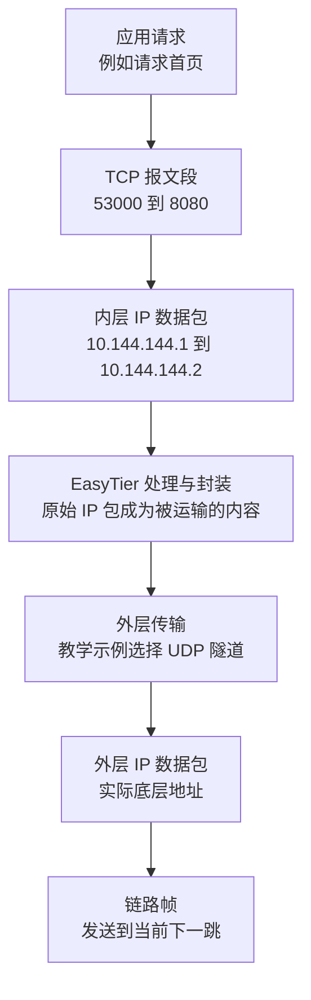

# 一次网页请求怎样变成数据包

## 具体问题：浏览器发送的是一整个网页吗

A 准备访问 B 的 `10.144.144.2:8080`。你在浏览器里输入地址，看到的只是一个动作，操作系统却需要完成一连串交接。网页可能很大，网络一次能够运输的数据有限；途中也可能丢失、乱序或延迟。应用交出的内容不能直接作为“一个网页”塞进网线。

本章先假设 B 的 `8080` 服务使用 HTTP，即浏览器和网页服务之间交换请求与响应的应用协议，并且它使用 TCP 运输。本教程不会声称所有网页都使用同一种传输方式；现代 HTTP/3 使用 QUIC，后面会讲协议层之间可以怎样组合。我们选 HTTP over TCP，只为把这一份请求看清楚。

## 概念解释：每一层都给下一层留下交接信息

**协议**是通信双方共同遵守的数据格式和处理规则。应用协议说明“请求哪个页面、响应是什么”；传输协议说明“怎样交给正确的进程、怎样处理传输”；IP 协议说明“从哪台设备去往哪台设备”；链路协议说明“在眼前这段连接上怎样发送”。

**TCP** 是为应用提供可靠、有序字节流的传输协议。**字节流**意味着应用看到的是连续的字节，而不是网络中的每个分包。应用写入两次数据，接收端不一定读到两块对应的数据；TCP 负责让可交付的字节按顺序到达，应用仍要用长度、分隔符等方法理解内容边界。

TCP 在需要传输时形成带有首部的 **TCP 报文段**。**首部**就是用于说明身份、顺序或处理方式的一组字段。TCP 首部含有源端口、目的端口等信息。A 的应用可能使用临时端口 `53000`，B 的服务使用 `8080`。端口不是设备上另一个 IP 地址，而是帮助系统分辨通信端点的编号。

TCP 报文段放进 **IP 数据包**。IP 首部写明源 IP 和目的 IP。在本例的虚拟网络中，源地址是 `10.144.144.1`，目的地址是 `10.144.144.2`。**负载**是某一层承载的内容：TCP 报文段是 IP 的负载，而应用字节是 TCP 的负载。同一份内容，站在不同层观察，名称会改变。

如果实际发送接口是以太网接口，IP 数据包还会放进 **以太网帧**。帧是链路层在一次链路发送中使用的数据单位，包含本段链路需要的地址等信息。无线网络使用相应的无线链路格式。这里不要求你背首部字段，只需要能区分“应用内容”“IP 的目的地”和“这一跳如何运输”。

## 图解与逐步过程：包装可以有两套

第一步，浏览器把请求交给 TCP。TCP 可能等待或拆分应用数据，再形成报文段；它与对端连接有关，不是简单按每个应用写入动作生成一个包。第二步，IP 层给它加上 A、B 的虚拟地址，并通过路由选择虚拟接口。

第三步，EasyTier 取得内层 IP 包，按自己的节点转发和隧道格式运输它。**隧道**是把一种通信装入另一条连接中，让原来的通信跨过原本不直接相连的网络。这里假设选用 UDP 隧道；UDP 是按一份份数据报交付的传输协议，本身不提供 TCP 那样的有序可靠字节流。

第四步，外层 IP 包进入 A 的物理网络。在离开家庭 NAT 之前，外层可能使用 A 的物理地址 `192.168.10.20`；转换之后，公网观察者可能看到 A 网络的外侧地址 `198.51.100.10`。到 B 网络时，外层再根据那边的 NAT 规则交给物理地址 `192.168.20.30`。`198.51.100.10`、`203.0.113.20` 和 R 的 `192.0.2.10` 都是 RFC 文档保留地址，本章只是推演。

第五步，B 的 EasyTier 去掉自己的运输包装，把内层 IP 包交回 B 的系统。系统发现目的地址属于本机，再把其中的 TCP 数据交给 `8080` 服务。**解封装**就是把外面的运输格式取掉，继续处理里面的内容。B 的应用不需要理解 A 在公网这一侧使用了什么端口。

如果经 R 中继，外层会沿实际的节点连接分段运输，内层业务目标仍是 B。链路帧也随着每一段实际链路重新组织，不会把 A 的以太网帧一路原样带到 B。图里各层是教学上的包装关系，具体首部大小与处理步骤会随隧道、加密和配置而变化。

## 小实验：给一份请求做两张身份证

取一张纸，画两个框。内框写：`TCP，10.144.144.1:53000 → 10.144.144.2:8080`。外框写：`UDP，A 当前外侧端点 → B 当前外侧端点`。先别填实际外侧端口，因为它们要根据监听、NAT 和连接过程确定，不能把内层 `8080` 直接抄过来。

现在假设 NAT 把外框中的源端口换成另一个端口，问内框的 `53000` 是否必须跟着变化。答案是不需要：这两套端点属于不同层。再把“直达 B”改成“先送给 R”，内框依然指向 B。你已经能够区分应用的通信身份和负责运输的连接身份。

最后，写入一个比单包容量更大的响应。A 可能要接收许多数据包，TCP 再把字节还原成连续流。**MTU，最大传输单元**，是接口通常能够发送的单个网络层数据单位的大小限制。封装会增加额外字节，因此虚拟接口的可用 MTU 通常需要考虑外层开销；“小请求成功，大响应卡住”可能与这类限制有关，但也要排查丢包和应用行为。

## 常见误解：一个包就是一次请求

一次请求可能跨多个 TCP 报文段，一个报文段也不必对应应用的一次写入。网络抓包看到的边界不能直接当成业务消息边界。也不能从“用了 UDP 隧道”推导出“HTTP 不再可靠”：如果内层仍是 TCP，内层仍执行其确认和重传规则，只是性能受到外层丢包和延迟影响。

还有人认为 NAT 改了地址，就把网页里的内容也一并改了。普通地址转换主要处理外层地址、端口与相关校验，并不等于应用内容编辑器。类似地，IP 封装本身不等于加密。加密会把内容变成需要密钥才能恢复的数据；封装只是改变承载方式。EasyTier 的实际加密方式和配置将在安全章节独立解释。

## 两个练习与折叠答案

**练习 1：** 本例使用 UDP 隧道运输 TCP 网页请求。B 的网页服务看到的目的端口应该是隧道端口，还是 `8080`？

查看答案

是内层 TCP 的 `8080`。隧道端口由 EasyTier 的外层通信处理。B 的 EasyTier 还原内层 IP 包后，操作系统根据内层协议及端口交给网页服务。

**练习 2：** 一个响应在网络上被拆成十个 TCP 报文段，接收应用是否一定执行十次读取，每次恰好读一个报文段？

查看答案

不一定。TCP 对应用提供字节流，读取次数和每次返回长度取决于缓冲区、时序和应用调用。应用需要依据自己的协议识别消息边界。

## 来源与下一章

IP 的基本结构见 [RFC 791](https://www.rfc-editor.org/rfc/rfc791.html)，TCP 字节流与报文处理见 [RFC 9293](https://www.rfc-editor.org/rfc/rfc9293.html)，UDP 见 [RFC 768](https://www.rfc-editor.org/rfc/rfc768.html)。EasyTier 的包格式可对照 [v2.6.4 packet_def.rs](https://github.com/EasyTier/EasyTier/blob/v2.6.4/easytier/src/tunnel/packet_def.rs)，虚拟网卡交接见 [virtual_nic.rs](https://github.com/EasyTier/EasyTier/blob/v2.6.4/easytier/src/instance/virtual_nic.rs)。

下一章：[03 · IP 地址和 CIDR 怎样划分网络](/chapters/03-addresses)。我们会把 `/24` 和 `/26` 变成能够亲手计算的地址范围。
