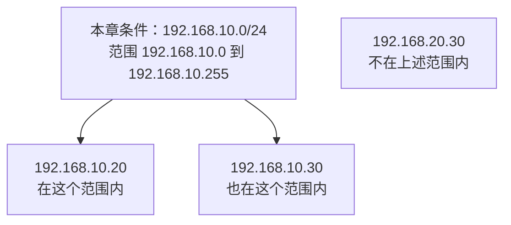

# 03 · 电脑上的地址和地址范围

## 这一章要解决的问题

你刚学会 `127.0.0.1` 是自己，又在网络设置里看见一个 `192.168` 开头的地址。打开 EasyTier，还可能出现一个 `10` 开头的地址。它们为什么能同时存在？哪一个拿来找远端设备？

这一章先回答：**一台电脑为什么会有几个 IP 地址，以及系统怎样用地址范围区别“本地这张网络”和“其他地方”。** 不要求你先会二进制，也不让你修改网络配置。

## 先回顾两件事

第一，IP 地址标识的是网络接口上的通信位置。一台电脑能通过多个接口交接数据，地址也就不一定只有一个。接口的角色在[第 2 章](/chapters/02-packets)解释过。

第二，地址里的端口与 IP 做不同工作。`http://127.0.0.1:8877/` 中，`127.0.0.1` 指接收位置，`8877` 指接收程序使用的编号。需要再分辨时回到[读懂地址栏](/basics/read-a-url)。本章读 IP，不把 `:8080` 当成地址的一部分来算网段。

## 一步一步看

### 第一步：先指出地址属于哪个接口

连上家中 Wi-Fi 后，电脑的 Wi-Fi 接口通常会得到一个地址。全书教学中，A 的原有网络 IP 写作 `192.168.10.20`，B 的原有网络 IP 写作 `192.168.20.30`。它们是示例，不要求你自己的网络长得一样。

这个地址可以由网络自动分配，也可以由管理员配置。换一个网络，地址可能改变；所以它不是这台电脑永远不变的姓名。我们用“原有网络 IP”描述 EasyTier 之前就用于联网的那个地址，而不把它叫作 MAC 物理地址。

本机回环地址 `127.0.0.1` 则代表内部通信。EasyTier 运行后还可以出现虚拟接口及虚拟 IP。不同接口上的地址有不同用途，不能只因为都写在同一台电脑上，就认为任何目标都能通过其中任意一个到达。

| 教学中的 A                  | 用途                               | 不从这一项推断什么         |
| --------------------------- | ---------------------------------- | -------------------------- |
| `127.0.0.1`                 | 找 A 自己的本机服务                | 别人也能通过它找到 A       |
| 原有网络 IP `192.168.10.20` | 在相应家庭网络上通信               | 普通互联网知道它是哪一家   |
| 虚拟 IP `10.144.144.1`      | 在配置好的 EasyTier 虚拟网络里通信 | 写上数字就已经拥有可用路径 |

### 第二步：家庭地址为什么会重复

`192.168` 开头的一些地址属于**私有地址**，也就是留给内部网络使用的地址。许多家庭都能有自己的 `192.168.1.20`，正如不同公司的内部工号可以重复；编号只在相应环境里有意义。

因此，A 得知朋友家某台设备叫 `192.168.20.30`，不能单凭这个数字让普通互联网定位朋友。互联网没有“朋友家”这个附带线索。这不是服务端口写错，而是地址在什么网络里有意义的问题。

**公网地址**是可以用于公共网络的地址。家庭网络对外通信时可能使用路由器外侧的公网地址，它不必直接配置在 A 的 Wi-Fi 接口上。有公网地址仍需要可用路径、正确服务和允许规则；它不是“所有程序都能被外部访问”的保证。第 6 章会讲家庭内外地址之间怎样转换。

虚拟 IP 和私有地址也不冲突。“虚拟”说明由哪种接口承担，“私有”说明地址怎样使用。EasyTier 的教学 `10.144.144.1` 属于私有地址范围；公司自己的物理网络也可以使用 `10` 开头的私有地址。

### 第三步：再看地址范围

**网段**是用共同前缀表示的一组地址。“前缀”是判断一个地址是否属于这组时，需要匹配的开头部分。它帮助系统决定哪些目标按本地网络处理，哪些目标要交给另一个出口。

先只看最常见的一个教学条件：`192.168.10.20/24`。斜杠后面的 `/24` 表示这个地址使用的前缀长度；在这个特定例子里，范围是 `192.168.10.0` 到 `192.168.10.255`，前三组固定，最后一组变化。它是范围信息，不是端口，也不是“这台电脑只有 24 个地址”。

通常写整段范围时，用 `192.168.10.0/24`；写接口时，可以写 `192.168.10.20/24`。前者描述一组地址，后者说明接口在其中使用 `.20`。这种“地址/前缀长度”的写法叫 **CIDR**。先能读这个例子，再决定要不要展开下面的计算。

图只是数值范围判断，没有画实际网线，也没有证明图中设备真的存在。对 `/24` 可以按前三组判断，但不能把这个方法原样用于任意前缀；例如 `/16` 固定的部分不同。更通用的算法留在进阶阅读。

### 第四步：在同一个范围，不等于已经相连

“地址在同一范围”是数值关系，“设备能够直接交接数据”是网络条件。普通家庭网络里，它们经常一起配置，所以很容易混为一谈。

跨两个家庭把地址写成同一网段，不会铺出一条连接。EasyTier 可以在虚拟网络里搬运同一虚拟范围内的 IP 包，但仍依赖实际节点连接。这也是为什么你应该观察接口和路径，而不是为了让表格好看去修改地址。

## 先预测，再观察

**先预测。** 你在 Wi-Fi 设置里发现一个 IP，又在 EasyTier GUI 里发现另一个。它们一定是重复或冲突吗？是否应该把其中一个删掉？先用“属于哪个接口”来回答。

**再观察。** 按[认识自己的网络](/basics/my-network)只读查看当前连接的地址。记录“Wi-Fi 或有线接口的 IP”和“系统显示的路由器地址”，有现成 EasyTier GUI 时再记录其虚拟 IP。仅给自己看，不公开网络名称或完整节点列表；没有 GUI 时无需安装来凑齐表格。

**解释。** 不同接口可以承担不同地址。路由器地址是这张网络上另一个设备的地址，不是你的网页服务端口；虚拟 IP 则属于虚拟网络接口。读懂字段，比把所有数字都叫作“我的 IP”更有用。

**边界。** 这些界面显示配置，没有证明某个远端地址能到达。地址是否冲突还要看范围与选路，不是仅凭“看见两个地址”判断。观察时不改 IP、前缀或路由器设置，也不用实际公网 IP 配合教学图。

## 常见误解

“一台电脑只有一个 IP”忽略了回环、Wi-Fi、有线、虚拟接口等不同位置。一个接口也可能有多个地址，但这一步先认清接口与用途即可。

“10 开头都是 EasyTier 地址”不对。它是一大块私有地址空间，公司、容器和其他组网软件也可能使用。虚拟网段应避免与既有网络重叠，具体判断看实际路由。

“前三组相同就一定同网段”只在本章 `/24` 条件下成立。判断范围需要同时知道地址和前缀。“同网段就一定互通”则又把范围与实际连通混为一谈。

## 两道练习

1. 在 `192.168.10.0/24` 这个给定范围中，`192.168.10.30` 与 `192.168.20.30` 哪一个属于它？这能证明设备已经互通吗？

第 1 题：先判断范围，再判断证据

`192.168.10.30` 属于它；`192.168.20.30` 的第三组不同，不属于这个 `/24` 范围。这个判断只说明数值范围，没有验证设备、链路、服务或访问规则，所以不能证明互通。

2. A 的 Wi-Fi 有原有网络 IP，EasyTier 又显示虚拟 IP。为什么不能马上说发生了地址冲突？

第 2 题：地址要放回接口看

它们可以属于不同接口、承担不同网络用途。需要检查实际地址范围是否重叠以及系统怎样选路。多个地址本身很正常，冲突不能靠地址数量判断。

## 进阶阅读

从 /24 继续读 CIDR、子网掩码与其他前缀

IPv4 地址有 32 位，每一位是 0 或 1。日常分成四组十进制数，每组对应 8 位，所以每组为 0 到 255。`/24` 固定前 24 位，剩下 8 位可变化，共有 `2^8 = 256` 个地址。子网掩码是把固定位置写成 1、其他位置写成 0 的另一种表示；`/24` 对应 `255.255.255.0`。

`192.168.20.150/26` 固定 26 位，还剩 6 位，范围大小为 `2^6 = 64`。最后一组按 0、64、128、192 分段；150 落在 128 到 191，因此整段是 `192.168.20.128/26`。掩码为 `255.255.255.192`，二进制最后一组的计算是 `10010110` 与 `11000000` 逐位相与，得到 `10000000`，也就是 128。逐位相与的规则是只有两边都为 1，结果才为 1。

传统 IPv4 广播子网把范围首地址用于网络编号、末地址用于广播，因此上述传统主机范围为 129 到 190。`/31` 点到点网络有专门规则，`/32` 表示单个 IPv4 地址，不能对所有前缀机械套用“总数减二”。IPv6 有 128 位地址，也用前缀，但地址写法和邻居发现不同，不能照搬 IPv4 广播规则。

私有 IPv4 范围是 `10.0.0.0/8`、`172.16.0.0/12`、`192.168.0.0/16`。`127.0.0.0/8` 是回环用途，不是其中一个私有网段。MAC 地址是以太网等链路上使用的接口地址，不是本章说的原有网络 IP；[第 5 章](/chapters/05-routing)选读会把它与 IP 分开。

## 来源与下一章

- [RFC 1918](https://www.rfc-editor.org/rfc/rfc1918.html)：私有 IPv4 地址范围。
- [RFC 4632](https://www.rfc-editor.org/rfc/rfc4632.html)：CIDR 和前缀表示。
- [RFC 3021](https://www.rfc-editor.org/rfc/rfc3021.html)：`/31` 点到点例外。
- [EasyTier v2.6.4 README](https://github.com/EasyTier/EasyTier/blob/v2.6.4/README.md)：虚拟 IP 的配置和组网用途。

下一章：[04 · 到了这台电脑，怎样找到正确程序](/chapters/04-protocols)。地址之后，我们继续看端口和服务。
