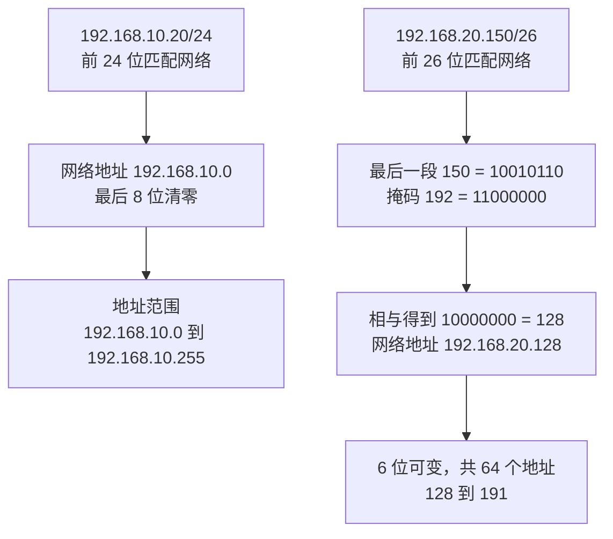

# IP 地址和 CIDR 怎样划分网络

## 具体问题：地址后面的 /24 到底改变了什么

A 的物理地址是 `192.168.10.20/24`，B 的物理地址是 `192.168.20.30/24`。你可能已经知道前三段相同的地址“像是一个网段”，但如果把 `/24` 改成 `/16`，这个判断就会改变。地址本身告诉我们设备使用哪个编号，斜杠后的数字告诉我们如何划分这个编号所属的地址范围。

这很像写街道地址时同时标注配送区域：区域范围改变，分拣规则也改变。不过网络里的划分由精确的二进制位决定，不是由地理距离决定；两台电脑物理上离得很近，地址仍可能属于不同网络。反过来，把两地电脑写成同一个前缀，也不会自动在两地之间铺出一根线。

## 概念解释：32 位地址中，哪些位描述网络

**IPv4** 是使用 32 位地址的 IP 协议版本。**位**就是一个只能取 `0` 或 `1` 的位置。日常写法把 32 位分成四组，每组 8 位，再将每组写成十进制数，所以每一段的范围都是 `0` 到 `255`。点号只是方便阅读，并不参与路由计算。

**CIDR，无类别域间路由表示法**，使用“地址/前缀长度”表示网络范围。`/24` 的意思是前 24 位属于网络前缀，余下 8 位区分范围内的地址。**网络前缀**就是判断某个目的地址是否落入这个范围时，需要匹配的前面一段位。`/16` 匹配前 16 位，`/26` 匹配前 26 位，位数越多，范围越小。

**子网掩码**是另一种写法：网络部分写成 `1`，其余写成 `0`。`/24` 对应 `255.255.255.0`，`/26` 对应 `255.255.255.192`。拿地址和掩码做逐位的“与”运算，只有两边都是 `1` 才留下 `1`，得到的就是网络地址。它不是神秘公式，而是把主机部分清零。

`192.168.0.0/16` 属于私有地址范围，`10.0.0.0/8` 也属于私有地址范围，所以物理地址和 EasyTier 的 `10.144.144.x` 虚拟地址都可以是私有地址。私有与虚拟描述的是不同性质：前者说地址怎样分配和使用，后者说它由哪一层网络接口承担。物理网卡也能使用私有地址。

还要区分“接口地址”和“网络范围”的写法。`192.168.10.20/24` 可以表示某个接口拥有 `.20`，并按 `/24` 理解相应前缀；讨论整段地址范围时，一般写成 `192.168.10.0/24`，把主机部分清零。路由匹配的是整个范围，不是只匹配网络地址那一个数字。改变前缀长度也不会自动把接口上的 `.20` 改成其他主机编号。

## 图解与逐步过程：先算 /24，再算 /26

先计算 A 的地址。`/24` 固定前三组，共 24 位，最后一组有 8 位可变，因此范围里有 `2^8 = 256` 个地址。网络地址是 `192.168.10.0`，最高地址是 `192.168.10.255`。在传统 IPv4 广播子网里，前者表示网络，后者用于该子网的广播，普通主机通常使用 `.1` 到 `.254`。

B 的 `192.168.20.30/24` 属于 `192.168.20.0/24`。两个网络的第三组不同，因此 A、B 不属于同一个 `/24` 范围。如果只看 `/16`，两者都落在 `192.168.0.0/16` 里。但这只是前缀计算结果，不表示你应修改配置；把跨路由器的两台机器都改成 `/16`，可能让它们误以为对方在眼前链路上，反而找不到正确出口。

再看一个辅助算例：`192.168.20.150/26`。32 减 26 剩 6 位，所以每个范围有 `2^6 = 64` 个地址，最后一段的边界依次是 `0、64、128、192`。150 落在 128 到 191 之间，因此网络地址是 `192.168.20.128`，广播地址是 `192.168.20.191`，传统主机可用范围是 129 到 190，共 62 个。

B 的实际物理地址 `.30` 落在 0 到 63 的范围，不在这个 `.128/26` 范围里。由此你可以看出，判断网段需要同时看地址和前缀，不能只看前三组。前缀还可以精确到 `/32`，代表一个具体 IPv4 地址；点到点 `/31` 有专门规则，所以“地址数减二”不能机械应用到所有前缀。

你也可以反向检查结果：把网络地址加上这段范围的地址数，再减一，就得到最高地址。`.128/26` 共有 64 个地址，`128 + 64 - 1 = 191`，与逐位计算相符。范围最后一位是 191，不是 192；192 已经是下一段的起点。用这种检查法，很容易发现少算一个地址的错误。

## 小实验：不联网也能划分地址范围

在纸上写出 `192.168.20.0/26`、`192.168.20.64/26`、`192.168.20.128/26`、`192.168.20.192/26` 四行。给每行写上最后一段的起止范围，再把 `.30`、`.70`、`.150`、`.230` 放进对应行。你得到的四个范围不重叠，合起来恰好覆盖原来的一个 `/24`。

接着把 A、B、R 的虚拟地址 `10.144.144.1`、`10.144.144.2`、`10.144.144.254` 放进假设的 `10.144.144.0/24`。它们在数值上属于同一个前缀。本教程后面的纸面路由用这个前缀举例；实际程序使用多大范围，必须以配置和路由表为准。

最后，故意让一张物理网卡也使用 `10.144.144.0/24`。现在相同范围同时指向物理接口和虚拟接口，系统需要选择出口，选择错了就会发生冲突。这说明选虚拟地址时，应避免与已经存在的本地网络或其他 VPN 重叠，而不是看到私有地址就觉得都能随便使用。

## 常见误解：同一个前缀就一定是同一个局域网

前缀是地址范围；**链路**是设备能够在某段连接上直接交接数据的关系。普通以太网中，两者常常一起配置，于是容易混成一件事。EasyTier 则可以让相同虚拟前缀里的 IP 包通过隧道交接，实际底层并不共享一段以太网。第 7 章会解释为什么它不自动成为完整的二层局域网。

还有，“10 开头的地址是 VPN 专用”并不正确。企业内部网络、容器网络和家庭设备都可能使用它。虚拟地址也不能在同一虚拟网络里随意重复，两个节点宣称自己都叫 `10.144.144.2` 会让目的地址对应关系产生歧义。

IPv6 是另一种 IP 版本，地址长度为 128 位，同样使用前缀表达范围。它的地址写法、邻居发现和广播行为与 IPv4 不同。本教程先以 IPv4 建立基本模型，不能把本章的广播地址规则原样套给 IPv6。

## 两个练习与折叠答案

**练习 1：** `192.168.20.70/26` 的网络地址、广播地址和传统主机可用范围分别是什么？

查看答案

70 落在 64 到 127 的范围。网络地址是 `192.168.20.64`，广播地址是 `192.168.20.127`，通常的主机可用范围是 `.65` 到 `.126`，共有 62 个。

**练习 2：** A、B 虚拟地址属于同一个 `/24`，能否由此推断两台电脑共享以太网广播、可以直接用 ARP 找到彼此？

查看答案

不能。前缀描述 IP 地址范围，不证明共享一段二层链路。EasyTier 的常规 TUN 接口交接的是 IP 包，实际如何送达对端由虚拟网络负责，不等于以太网广播域。

## 来源与下一章

CIDR 与前缀见 [RFC 4632](https://www.rfc-editor.org/rfc/rfc4632.html)，私有地址见 [RFC 1918](https://www.rfc-editor.org/rfc/rfc1918.html)，点到点 `/31` 例外见 [RFC 3021](https://www.rfc-editor.org/rfc/rfc3021.html)。EasyTier 虚拟地址和子网代理示例见 [v2.6.4 官方 README](https://github.com/EasyTier/EasyTier/blob/v2.6.4/README.md)。

下一章：[04 · TCP、UDP、端口和 ping 分别做什么](/chapters/04-protocols)。有了设备地址，我们再看系统怎样把数据交给设备上的正确应用。
