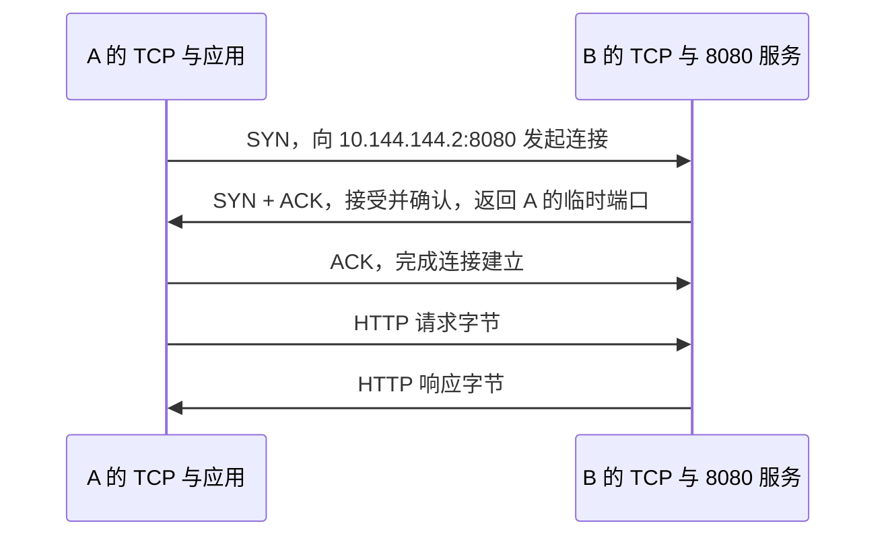

# TCP、UDP、端口和 ping 分别做什么

## 具体问题：能 ping 到 B，为什么网页仍然打不开

A 已经能收到 B 虚拟地址 `10.144.144.2` 的 ping 回复，却无法打开 B 的 `8080` 服务。你可能据此判断“网络已经全通，EasyTier 应该没有问题”，但 ping 和网页请求使用的协议、处理路径以及服务条件并不相同。

本章沿用 A 虚拟地址 `10.144.144.1`、B 虚拟地址 `10.144.144.2`。先假设 B 的网页服务使用 TCP，并正确处理 HTTP 请求。我们逐步区分：设备是否收到数据、系统是否允许这种数据、应用是否准备接收、应用有没有正确响应。

## 概念解释：设备地址之后，还有协议和端口

IP 地址用于识别网络中的通信位置，但 B 上可能同时运行网页、文件传输、游戏和聊天软件。**端口**是传输层用于区分通信端点的 16 位编号，范围是 `0` 到 `65535`。不同协议各有自己的端口空间，所以 TCP 的 `8080` 和 UDP 的 `8080` 是两种不同的端点，开放一种不会自动开放另一种。

**监听**是应用向系统声明：愿意在指定的地址、协议和端口接收新通信。若 B 的服务只监听 `127.0.0.1:8080`，它只接受通过本机回环地址访问的连接。**回环地址**用于同一台主机内部的通信，不代表其他设备能进来。A 用 B 的虚拟地址访问，不会因此命中只绑定回环地址的监听。

监听 `10.144.144.2:8080` 表示接受这个虚拟地址上的连接；只监听 `192.168.20.30:8080` 则未必接受虚拟地址上的请求。IPv4 中的 `0.0.0.0:8080` 通常表示监听本机所有 IPv4 地址，但这仍受防火墙与程序实际行为影响，也会扩大暴露面。这里解释语义，不要求你改变服务配置。

**TCP，传输控制协议**，在两端维护连接状态，给应用提供可靠、有序的字节流。**连接**指两端共同维护的通信关系，不是为你建立了一条永不丢包的专用线路。丢失的数据可以重传，顺序可以整理，但网络长期中断时仍可能超时，应用也要处理失败。

**UDP，用户数据报协议**，按独立数据报交付，不先执行 TCP 那样的连接建立过程，也不自动重传或保证顺序。程序可以在 UDP 上自行实现可靠传输；QUIC 就是建立在 UDP 上的一套具有连接、可靠流等能力的协议。因此“底层 UDP”和“应用完全不可靠”之间没有简单的等号。

**ICMP，互联网控制报文协议**，用于网络诊断和差错报告。常见 ping 使用 ICMP 回显请求和回复，不使用 TCP `8080`。它能帮助判断某类往返通信是否成功，却没有代替网页服务进行监听和处理。

## 图解与逐步过程：TCP 要先建立连接

图中每条箭头都需要经过可用的虚拟网络运输路径，只是为了突出 TCP 的交互，省略了沿途节点。

第一步，A 的 TCP 从临时端口发出 `SYN`，表示请求建立连接。第二步，B 收到后，如果存在匹配的监听并允许连接，就返回 `SYN + ACK`，表达接受并确认。第三步，A 再确认，连接进入可以正常交付应用数据的状态。实际程序可能有更多重传、确认及优化，这个“三次握手”图只呈现主干。

接下来，浏览器才把请求字节交给连接。B 的 HTTP 服务理解请求，返回响应。握手成功而应用不返回内容，和握手一开始就失败，是两个不同问题。抓住这个分界，排查时就不会把每一种等待都称作“网络不通”。

一条常见 TCP 连接可用五项识别：源 IP、源端口、目的 IP、目的端口、传输协议，合称 **五元组**。例如 `10.144.144.1:53000 → 10.144.144.2:8080，TCP`。临时端口 `53000` 只是举例，不是固定规则。另一台客户端可以使用相同源端口，因为其源 IP 不同。

EasyTier 的外层隧道也有自己的一套协议和端点。外层可能是 UDP，内层网页仍然是 TCP；外层改成 TCP，也不会让所有内层应用都改为 TCP。v2.6.4 README 列出多种隧道协议，本章只讲层次关系，不把某个外层端口当作所有业务服务的端口。

## 小实验：给三条现象分别找能支持的结论

在纸上列三条观察：“ping 回复正常”“TCP 连接被拒绝”“TCP 建立后，HTTP 一直没有响应”。这三条仅供推演，不执行安装或网络访问。

第一条说明 ICMP 回显往返成功，不能证明 `8080` 存在。第二条如果确实收到 TCP 重置等拒绝信号，说明通信中的某处明确拒绝了连接，可能没有匹配监听，也可能是安全规则主动拒绝；不要只凭一句错误就断言必然是 B 应用未启动。第三条把注意力引向应用处理、协议是否匹配，以及建立后数据是否继续正常传输。

反过来，ping 没有回复而网页可以打开，也并不矛盾：网络或主机可能禁止 ICMP 回显，却允许 TCP。你应该用与目标业务一致的观察来判断业务是否可用。

还有一个准备阶段是 **DNS，域名系统**：把名称解析为地址。若用域名访问 B，名称必须先解析到适合当前访问路径的地址。EasyTier 的网络名称用于识别虚拟网络，不等同于浏览器域名，也不能仅靠它推导出 B 的网页地址。名称解析正确之后，路由、监听和应用仍然需要逐项成立。

## 常见误解：端口开放就说明应用功能正常

系统接受 TCP 连接，不代表应用理解你发送的内容。向需要 TLS 的服务发送明文 HTTP，可能建立连接却得不到预期网页。**TLS** 是为应用通信提供加密和身份验证的一组协议，它与 TCP 的可靠运输解决不同问题。TCP 本身不会自动给网页内容加密。

“UDP 更快”也不是无条件成立。UDP 少了 TCP 的内置机制，但应用若需要可靠传输，仍要付出确认、重传和拥塞控制等成本。**拥塞控制**是调整发送速度，避免大量发送进一步压垮网络的机制。应该比较具体协议和实际路径，而不是只看 TCP、UDP 的名字。

最后，超时和拒绝不同。超时表示在规定时间内没有得到预期进展，可能发生在丢包、过滤、回程错误或应用卡住等环节；拒绝通常意味着收到明确的失败回应。两者都需要结合协议和发生阶段解释。

## 两个练习与折叠答案

**练习 1：** B 只监听 `127.0.0.1:8080`，A 能 ping 到 `10.144.144.2`。是否足以让 A 打开这个网页？

查看答案

不能。回环监听只面向 B 本机对应地址的通信，A 的请求目标是 B 的虚拟地址。ping 的 ICMP 处理也不检查 TCP `8080` 的监听状态。

**练习 2：** 两个程序分别监听 TCP `8080` 和 UDP `8080`，是否一定发生端口冲突？UDP 隧道能否运输 TCP 数据？

查看答案

不一定冲突，TCP 和 UDP 使用不同端口空间。UDP 隧道可以把包含 TCP 报文段的 IP 包作为负载运输，内层与外层是两套协议关系。

## 来源与下一章

TCP 见 [RFC 9293](https://www.rfc-editor.org/rfc/rfc9293.html)，UDP 见 [RFC 768](https://www.rfc-editor.org/rfc/rfc768.html)，ICMP 见 [RFC 792](https://www.rfc-editor.org/rfc/rfc792.html)，DNS 的基本概念见 [RFC 1034](https://www.rfc-editor.org/rfc/rfc1034.html)。EasyTier 多协议能力依据 [v2.6.4 官方 README](https://github.com/EasyTier/EasyTier/blob/v2.6.4/README.md)。

下一章：[05 · 路由怎样决定下一跳](/chapters/05-routing)。接下来回答一个更具体的问题：A 发出的包，为什么会进 EasyTier，而不是直接交给家庭路由器？
