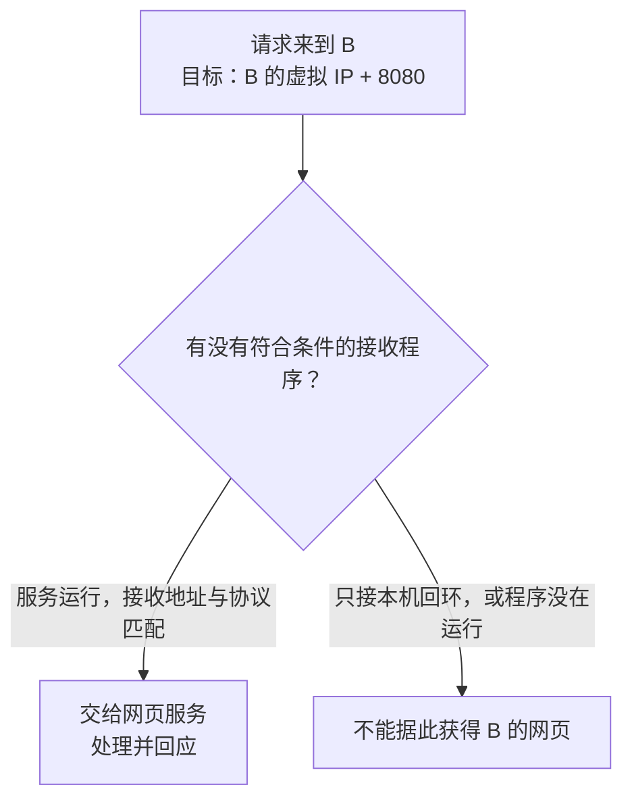

# 04 · 到了这台电脑，怎样找到正确程序

## 这一章要解决的问题

B 上可能同时有网页、聊天和文件服务。A 的数据到了 B，系统凭什么把它交给网页程序？为什么有时能 ping 到 B，却看不到网页？

本章要把两件事分开：**网络把数据送到相应接口，系统还要让正确的程序接收相应类型的通信。** 全书网页示例仍用 B 的 `8080`；你本机预备课的小网页用 `8877`。

## 先回顾两件事

第一，地址要与接口和访问路径一起看。回环地址面向本机，虚拟 IP 面向配置好的虚拟网络。这是[第 3 章](/chapters/03-addresses)的内容。

第二，网页服务是运行中的接收程序，浏览器负责发请求。若忘记服务在哪个窗口启动，可以回到[本机小网页](/basics/local-webpage)；若看不懂地址末尾的数字，先读[地址栏](/basics/read-a-url)。

## 一步一步看

### 第一步：地址之后还要有程序编号

`http://10.144.144.2:8080/` 中，`10.144.144.2` 是教学 B 的虚拟 IP，`8080` 是请求要使用的服务端口。**端口**是与地址和通信协议一起使用的编号，用来区分接收位置。它不是电脑外壳上的 USB 插口，也不是另一张网卡。

端口编号范围是 0 到 65535，但选择一个数字并不会自动创建服务。B 的程序必须真的使用相应地址、协议和端口。系统还会为发起通信的 A 一侧安排接收回应的位置，常用一个临时源端口；“临时”意味着不必与 B 的 `8080` 相同，也不固定为某个教程数字。

### 第二步：服务先告诉系统它准备接什么

**监听**是接收程序向系统登记：“我准备在这些条件下接收新通信。”这些条件包含接收地址、协议和端口。只有服务运行且成功登记，数字 `8080` 才对应这个接收程序。

例如，B 只监听 `127.0.0.1:8080`，表示服务面向 B 本机对应回环地址。A 访问 B 的虚拟 IP，目标地址不是这个回环地址，所以不能假设会命中该监听。这正是“B 自己能开，A 不一定能开”的一种原因。

服务监听 B 的虚拟 IP，可以让系统为该地址上的相应请求找到它。仍然需要运输路径和允许规则。此处先解释条件，没有要求你把本机小服务改成对所有接口开放；预备课保持回环绑定即可。

### 第三步：分清程序使用哪种运输规则

网页案例选择 **TCP**。TCP 是一种传输协议：两端先建立通信关系，再为应用交付可靠、有序的数据。“可靠”指它会处理确认、重传等工作，不能理解为网络永不失败；长期中断仍会造成失败或超时。

**UDP** 是另一种传输协议，按一份份独立数据交付，本身不保证顺序和重传。程序可以在它上面自己实现更多规则。TCP 和 UDP 有各自的端口编号空间，因此“TCP 8080”与“UDP 8080”是不同的接收条件。

先记住这件事即可：目标地址和端口相同，协议不匹配也可能找不到正确服务。不要把“某个 UDP 端口可用”当成“网页 TCP 端口可用”的证据。

### 第四步：ping 问的是另一件事

常见 `ping` 发送 **ICMP** 回显请求，收到目标的回显回应。ICMP 是网络诊断和差错报告使用的协议；这类回显不去连接网页的 TCP `8080`。

因此，ping 成功说明本次这类请求与回应能够往返，不说明 B 的网页程序已经运行。反过来，某些规则禁止 ICMP 回显，但允许网页 TCP，便可能“ping 不回应，网页仍可用”。应该让验证方式与想访问的业务对应。

### 第五步：区分没有连接与服务返回错误

浏览器等不到连接，与连接完成后收到“页面不存在”，发生在不同阶段。后者至少说明有程序回应了这次请求，但回应可能不是你想要的内容。

超时是规定时间内没有得到预期进展，可能与路径、过滤、回程或程序处理有关。明确拒绝则意味着收到相应失败信号，不能只凭“拒绝”二字就断言一定是应用没启动；安全规则也可能主动拒绝。排查时先记录观察，不急着宣布根因。

## 先预测，再观察

这次只使用你在预备课启动的 `8877` 服务，不改 EasyTier，也不去试别人的端口。

**先预测。** 本机地址和端口都没改，但接收程序停止了，浏览器下一次真正请求能不能得到原来的新回应？先说出理由。

**再观察。** 按[本机服务预备课](/basics/local-webpage)的步骤观察启动、停止和恢复。在[浏览器请求预备课](/basics/observe-a-request)中确认看到的是重新发出的指定请求，而不是停留在旧页面或读取缓存。只停止本练习启动的服务，不终止其他进程。

**解释。** 服务运行是接收条件的一部分。地址文字仍在、旧页面仍显示，都不能替代运行中的接收程序。恢复指定服务后再次获得回应，是另一条有时间点的观察。

**边界。** 它验证本机这一地址和端口上的服务生命周期，没有验证远端防火墙、网页权限或 EasyTier 连接。错误的具体文案可能随浏览器改变，应按预备课核对服务状态，不拿一条文案推断整个网络。

## 常见误解

“端口开放”不是“所有应用功能正常”。某处接受了连接，程序仍可能等待错误格式、缺少权限或返回错误内容；最终需要业务回应来验证你关心的功能。

“B 能 ping 就能打开 8080”把 ICMP 回显和 TCP 服务混成一次检查。两个协议可以有不同规则，也由不同处理逻辑接收。

“UDP 没有内置重传，所以使用 UDP 的软件必然不可靠”忽略了程序自己可以加规则。外层 EasyTier 使用 UDP 运输，也不意味着内层网页程序自动改为 UDP。这种层次关系在后面隧道章节再展开。

## 两道练习

1. B 只监听 `127.0.0.1:8080`。A 能收到 B 虚拟 IP 的 ping 回应，是否足以打开 B 的网页？

第 1 题：回显与监听不是一件事

不足以。ping 使用 ICMP，不检查 TCP 8080 的网页监听；回环监听面向 B 本机相应地址，A 的目标却是 B 的虚拟 IP。还需要匹配的服务监听、路径和允许规则。

2. 两个程序分别使用 TCP 8080 和 UDP 8080，是否仅凭这个数字就能断言端口冲突？

第 2 题：编号要连同协议读

不能。TCP 和 UDP 使用不同端口空间。“协议、接收地址、端口”等条件要一起看，不能只比较 8080 这个数字。允许其中一种通信，也不会自动允许另一种。

## 进阶阅读

接收地址、TCP 建连与更多协议细节

IPv4 的 `0.0.0.0:8080` 常表示监听本机所有 IPv4 地址，不是给客户端一个能直接访问的目的地址。它可能扩大可访问范围，但并不能越过防火墙或创建网络路径。监听单个原有网络 IP，也不等于同时监听虚拟 IP。IPv6 的绑定与双栈行为还要看系统和程序。

TCP 的常见连接建立有三次主干交互：A 发 SYN，B 发 SYN+ACK，A 再发 ACK。它们是协议中的建连与确认标记。图和抓包里看见这些阶段，可以区分“连接还没建成”与“连接之后应用不回答”。实际会话还可能有重传与其他处理。

一条常见通信关系可用源 IP、源端口、目标 IP、目标端口、协议五项描述，称五元组。B 的服务端口是 8080，A 的临时源端口可以是其他值；系统借助这组关系区分同时进行的通信。

QUIC 在 UDP 上提供连接、可靠流和拥塞控制等能力；所以比较实际软件性能，不能只看 TCP、UDP 名字。TLS 负责应用通信的加密与身份验证，与 TCP 的可靠运输做不同工作。名称先查询成地址的系统叫 DNS，详见[第 17 章](/chapters/17-apps-dns)。这些概念不要求现在一起掌握。

EasyTier v2.6.4 支持多种外层传输。内层业务端口、协议与外层隧道端点是不同条件，排查时应分别检查。外层 UDP 连接正常，不等于 B 的内层 TCP 8080 已有服务。

## 来源与下一章

- [RFC 9293](https://www.rfc-editor.org/rfc/rfc9293.html)：TCP 的可靠字节流、端口与建连过程。
- [RFC 768](https://www.rfc-editor.org/rfc/rfc768.html)：UDP 数据报和端口。
- [RFC 792](https://www.rfc-editor.org/rfc/rfc792.html)：ICMP 回显与差错报告。
- [EasyTier v2.6.4 README](https://github.com/EasyTier/EasyTier/blob/v2.6.4/README.md)：可用外层协议与组网能力。

下一章：[05 · 系统怎样选择下一步，回应怎样回来](/chapters/05-routing)。程序已找对，接着看数据怎样走向它。
