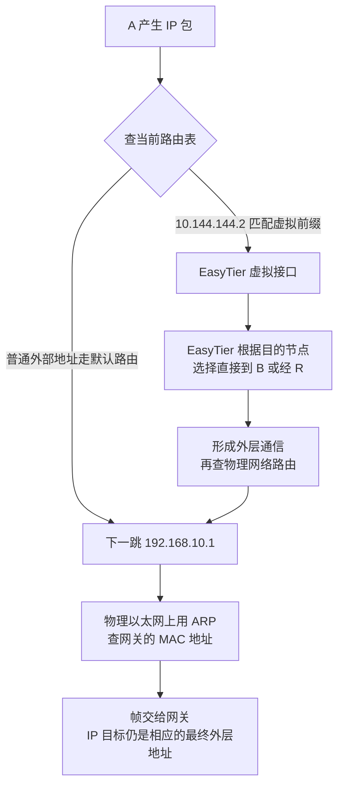

# 路由怎样决定下一跳

## 具体问题：系统怎么知道这个包应该交给 EasyTier

A 有物理地址 `192.168.10.20/24`，也有虚拟地址 `10.144.144.1`。它想访问 B 的 `10.144.144.2:8080`。系统不能把每个包同时随意扔给所有网卡，而是要判断这份数据该从哪一个出口发送。

这一判断依赖 **路由表**：记录目的地址范围、出口以及必要下一跳信息的规则表。**下一跳**是当前阶段将数据交给的下一个接收者，可能是直接相邻的路由器，也可能在另一层转发逻辑中表示某个节点。下一跳并不总等于最终目的地。

## 概念解释：先匹配目的范围，再选择出口

下面是假设的 A 路由表，用来计算，不代表 EasyTier 必然安装完全相同的表项。虚拟网络在纸面示例中使用 `10.144.144.0/24`，A 的家庭网关假设为 `192.168.10.1`。

| 目的范围          | 出口或下一跳       | 含义                 |
| ----------------- | ------------------ | -------------------- |
| `192.168.10.0/24` | 物理接口，直接连接 | A 本地的物理网段     |
| `10.144.144.0/24` | EasyTier 虚拟接口  | 交给虚拟网络处理     |
| `10.144.0.0/16`   | 另一个旧 VPN 接口  | 更大的重叠范围       |
| `0.0.0.0/0`       | 经 `192.168.10.1`  | 没有更具体规则时使用 |

**最长前缀匹配**是普通目的地址路由的关键规则：在匹配目的地址的候选项中，优先使用前缀最长、范围最具体的规则。访问 `10.144.144.2` 时，`/24`、`/16` 和 `/0` 都匹配，但 `/24` 最具体，因此选择 EasyTier 接口。这里的“最长”说的是匹配位数，不是路程远近。

如果目的改成 `10.144.145.2`，它不在 `10.144.144.0/24` 中，但仍落在 `10.144.0.0/16` 中，因此走旧 VPN。若目的不匹配其他项，就走 **默认路由**，通常写成 `0.0.0.0/0`，因为零位前缀不限制任何 IPv4 地址。

前缀相同时，系统还可能比较路由优先级、度量值等；**度量值**是用于比较候选路径的数值，具体含义取决于系统。也可能存在 **策略路由**，按源地址、标记等条件先选择另一张路由表。我们先在一张普通路由表内理解最长前缀，再认识这些扩展，不能用“度量值小就总能压过更具体前缀”来解释所有选择。

## 图解与逐步过程：IP 的目的地和链路的接收者不同

先看普通物理发送。A 要把一个外部 IP 包交给家庭网关，就需要在当前以太网链路上找到网关。**MAC 地址**是这类链路中使用的接口地址。**ARP，地址解析协议**，用于在本地 IPv4 以太网链路中询问：“谁拥有这个 IP？请告诉我对应的 MAC。”

A 询问的是 `192.168.10.1` 的 MAC，而不是让整个互联网回答 B 的 MAC。ARP 请求一般只在当前广播域内传播。**广播域**指能够收到这类链路广播的一组接口，路由器不会把普通 ARP 广播一路转发到远方。

因此，发往远处 B 网络外侧地址的 IP 包，可以装进“目的 MAC 是家庭网关”的帧里。帧负责眼前这一跳，IP 负责相应层次的最终目的地址。经过下一段链路，帧会重新组织。图中的虚拟路径则先把内层包交给 EasyTier，不需要用以太网 ARP 去寻找远方 `10.144.144.2`。

这里存在两次不同的路由决策：操作系统先决定内层虚拟包进哪个接口；EasyTier 再把目标 IP 对应到节点，选择节点之间的路径。R 的虚拟地址是 `10.144.144.254`，但经 R 转发不意味着系统必须把它写成物理网关。EasyTier 的节点路径和操作系统的 IP 路由表不是同一张表。

外层通信仍要经过操作系统的底层出口。A 网络外侧的 `198.51.100.10`、B 的 `203.0.113.20`、R 的 `192.0.2.10` 是文档保留地址，只表示图中的运输位置。正确的外层路径必须能离开物理网络，否则“隧道里的包又被送回隧道”就会形成错误循环。

## 小实验：加一条规则，再反过来走一次

在前面的纸面表里加入 `10.144.144.2/32 → 旧 VPN 接口`。再次查 B 的地址：现在 `/32` 更具体，它压过 EasyTier 的 `/24`。即使 EasyTier 节点连接正常，B 的包也可能根本没有进入 EasyTier。这个例子解释了为什么检查连接状态之外，还要检查实际路由选择。

再画 B 的回复。请求的内层源是 `10.144.144.1`，B 的服务回复时，系统需要找到去往这个源地址的路。**回程**就是回复返回请求发起者所经过的路径。A 能把请求送达 B，不自动证明 B 的回复能到达 A，因为 B 使用自己的路由与过滤规则。

把 B 去往 `10.144.144.0/24` 的路由划掉，只剩物理默认网关。现在回复可能走错出口，而 A 看到的只是等待。正向与反向分别推演，往往比反复问“到底通不通”更有用。两方向经过的节点也不一定完全相同；路径不对称本身不是错误，但两方向都必须真实可达，并符合相关状态与安全规则。

## 常见误解：有默认网关，任何地址都能找到

默认路由只是“没有更具体线索时，把包交给这里”，不代表下一跳能到达所有目的。它类似问路时先找一个信息台，信息台也可能没有目的地的有效路线。私有地址与虚拟地址尤其不能靠一条互联网默认路由自动获得正确去向。

还有，“两台电脑写同一网段后，ARP 就能找到对方”只在确实共享相应链路且配置正确时成立。跨互联网写同前缀不会扩大物理广播域。EasyTier 用 TUN 和节点转发解决的是 IP 包交接，原理与把两段以太网桥接成一段不同。

最后，看到 EasyTier 路由列表里存在 B，只能说明程序知道某种节点或地址关系；仍要确认内层包能进入虚拟接口、底层通道可用以及回程成立。不同层的状态应分别检查。

## 两个练习与折叠答案

**练习 1：** 纸面表同时有 `/16 → 旧 VPN`、`/24 → EasyTier`、`/32 → 旧 VPN`，目的为 `10.144.144.2`。普通同表查找先选哪一项？

查看答案

匹配这个地址的 `/32`，因为它最具体。不是比较两种 VPN 哪个“更新”，也不是先比较较大范围规则的度量值。

**练习 2：** A 经物理网关访问远方地址时，ARP 应查询远方 B 的 MAC，还是当前网关的 MAC？请求到达 B 又说明了什么？

查看答案

查询当前链路下一跳，也就是网关的 MAC。请求到达 B 证明正向的相应过程成功，仍需单独验证 B 到 A 的回程，不能据此认定整个会话可用。

## 来源与下一章

最长前缀与路由基础见 [RFC 1812](https://www.rfc-editor.org/rfc/rfc1812.html)，ARP 见 [RFC 826](https://www.rfc-editor.org/rfc/rfc826.html)。EasyTier 的虚拟接口与路由设置见 [v2.6.4 virtual_nic.rs](https://github.com/EasyTier/EasyTier/blob/v2.6.4/easytier/src/instance/virtual_nic.rs)，节点转发职责见 [peer_manager.rs](https://github.com/EasyTier/EasyTier/blob/v2.6.4/easytier/src/peers/peer_manager.rs)。

下一章：[06 · NAT 为什么让主动连接变困难](/chapters/06-nat)。我们会把家庭路由器内部那张地址转换表画出来，区分“能找到映射”和“允许进入”两个问题。
