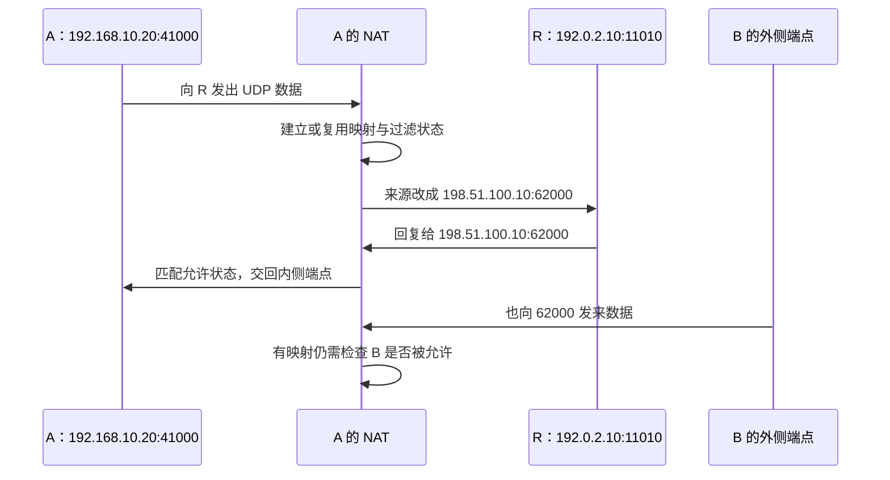

# NAT 为什么让主动连接变困难

## 具体问题：B 已经知道 A 的外侧地址，还缺什么

A 的物理地址是 `192.168.10.20/24`，它通过家庭路由器上网。B 在另一个网络，物理地址是 `192.168.20.30/24`。即使 B 知道 A 网络外侧叫 `198.51.100.10`，也不能由此直接找进 A 上的任意程序：同一个外侧地址后面可能还有手机、电视和其他电脑。

本章的外侧地址 `198.51.100.10`、`203.0.113.20`、`192.0.2.10` 均属于 RFC 5737 文档保留网段，不能用于真实联网。下面的端口也是教学假设。我们不修改路由器，只用转换表推演 NAT 怎样识别“这份数据应该交给内网的谁”。

## 概念解释：映射和过滤是两项不同工作

**NAT，网络地址转换**，在不同网络边界上改写 IP 地址。家庭上网常用的形式还会转换端口，也叫 **NAPT，网络地址和端口转换**。这样，多台内网设备可以共享一个外侧地址，通过不同端口维持各自通信关系。

假设 A 的一个 UDP 程序使用 `192.168.10.20:41000`，向 R 的教学外侧端点 `192.0.2.10:11010` 发送数据。路由器把来源改成 `198.51.100.10:62000`，同时记下一条 **映射**：内侧 `192.168.10.20:41000` 与外侧 `198.51.100.10:62000` 对应。协议也是状态的一部分，不能把 UDP 和 TCP 混成同一条映射。

R 收到的源地址是转换后的外侧端点，因此它把回复发回 `198.51.100.10:62000`。路由器找到映射，知道要改写为 A 的内侧端点。如果没有映射，它通常没有足够信息判断收到的数据属于哪台设备、哪一个程序。

但**存在映射**和**允许收到的数据通过**仍然不同。**过滤**是在有转换关系的情况下，判断哪些外部来源可以发进来的规则。例如，A 只联系过 R，路由器可能仅接受来自 R 的回复；来自 B 的数据虽然发到同一个 `62000`，仍会被丢弃。端口映射能解决寻址线索，也不自动等于所有安全策略放行。

因此，观察 NAT 要分别问两个问题：“A 联系不同目的时，外侧映射会不会变化？”以及“外部谁可以使用这条映射发回来？”旧的锥形、对称型等名称把多种行为组合成类别，容易记住，却不适合代替对实际行为的逐项判断。

## 图解与逐步过程：一条 UDP 数据怎样留下返回线索

先看映射变化。**端点**就是一组地址与端口。在某些 NAT 中，同一个内侧 UDP 端点，无论联系 R 还是 B，都可能复用同一个外侧映射，这叫 **端点无关映射**。在另一些 NAT 中，外侧映射还取决于目的地址，甚至同时取决于目的端口，称为相应的地址依赖或地址与端口依赖映射。

比如，A 联系 R 时使用外侧 `62000`，联系 B 的 `203.0.113.20:45000` 时却得到 `63000`。这时 R 看到的 `62000` 未必是 B 应该联系的正确端点。“让 R 告诉我公网地址和端口”只给出一次观察，不能保证对所有目的都适用。

再看过滤变化。**端点无关过滤**不要求外部来源与此前联系过的地址、端口一致；**地址依赖过滤**可能要求内侧先联系过那个外部 IP；**地址与端口依赖过滤**还要求先联系过确切的外部端口。其他独立的防火墙规则仍可限制入站。这样的描述比简单说“这个 NAT 很严格”更有用，因为它告诉我们必须先做哪一种通信，才可能允许对方进入。

映射和允许状态还会 **超时**：一段时间没有符合规则的流量，设备可能回收记录。UDP 没有 TCP 那样的连接关闭过程，路由器通常依据状态和计时处理。保活是定期发送小流量以维持相关状态的做法，但频率、设备行为、资源压力和网络策略都会影响结果，不能把某个固定秒数当成所有 NAT 的保证。

## 小实验：把映射表和允许名单分开写

画两张表。第一张写“UDP `192.168.10.20:41000` 对应 `198.51.100.10:62000`”；第二张写“目前仅允许 R 的 `192.0.2.10:11010` 返回”。现在让 B 向 `62000` 发送。它在第一张表上能够找到去向，却在第二张表上不满足规则，于是失败。

接着，假设 A 从同一内侧端点主动向 B 的已知外侧端点发送。根据 NAT 行为，可能增加允许名单，也可能建立另一条外侧映射。分别推演这两种情况，你就会看到：**打洞**是让两边通过主动发送，尝试形成可用于互相通信的映射和允许状态，并不是把 NAT 或防火墙关闭。

最后，在家庭路由器外面再画一层运营商 NAT。家庭路由器的外侧地址可能是 `100.64.8.9`，运营商再把它转换到图中的外侧地址。`100.64.0.0/10` 是 RFC 6598 定义的共享地址空间，常用于这类部署。**CGNAT，运营商级 NAT**，由运营商让多位用户共享外侧地址，用户通常不能直接修改它的转换规则。

现在即使你在家庭路由器上配置了入站映射，上游运营商那一层仍可能没有对应映射。两层状态都要满足，才有完整通道。看到路由器界面有一个“WAN 地址”，也不必然证明它就是独占、可接受外部主动连接的公网地址。

## 常见误解：NAT 就是防火墙，知道 NAT 类型就能保证打洞

地址转换与访问控制的职责不同。它们经常出现在同一设备上，所以 NAT 的状态限制可能表现得像一道安全门；但不能把地址转换当成完整的安全策略，也不能因为使用 IPv6、没有传统地址转换就忽略防火墙。

一次检测得到的 NAT 行为也不一定永远不变。多层 NAT、端口资源、负载均衡和网络切换都会影响外侧端点与可达性。EasyTier 官方 README 的 NAT 穿透能力描述说明它实现了相应尝试机制，不是对任意网络组合的成功承诺。直连失败时，仍要有可用的中继路径才能继续运输业务。

此外，EasyTier 虚拟地址 `10.144.144.1`、`10.144.144.2` 主要服务于内层通信。家庭 NAT 在本章处理的是 EasyTier 外层数据，不能拿 `10.144.144.2:8080` 直接当作家庭路由器的打洞目标。层次混淆会让你检查完全不相关的端口。

## 两个练习与折叠答案

**练习 1：** A 已建立外侧 `62000` 的映射，为什么 B 发到这个端口仍可能被丢弃？

查看答案

因为映射只解决返回数据对应哪一个内侧端点，过滤规则还可能限定允许的外部来源。A 先前只联系过 R，不一定已经允许 B 的地址和端口进入。

**练习 2：** R 看到 A 的外侧端口是 `62000`，A 联系 B 时被 NAT 分配成 `63000`。这说明哪一种行为需要重点检查？

查看答案

检查映射是否依赖外部目的端点，而不只是检查过滤。R 观察到的映射不能直接保证是 B 可使用的映射。同时仍需单独检查 B 来源是否被允许。

## 来源与下一章

NAT 与端口转换基础见 [RFC 3022](https://www.rfc-editor.org/rfc/rfc3022.html)，UDP 映射与过滤术语见 [RFC 4787](https://www.rfc-editor.org/rfc/rfc4787.html)，共享地址空间见 [RFC 6598](https://www.rfc-editor.org/rfc/rfc6598.html)。EasyTier 的 NAT 穿透与中继能力依据 [v2.6.4 官方 README](https://github.com/EasyTier/EasyTier/blob/v2.6.4/README.md)，详细过程将在后续打洞章节展开。

下一章：[07 · TUN 怎样把系统 IP 包交给 EasyTier](/chapters/07-tun)。你已经理解外面的网络边界，接下来回到电脑内部，看应用数据怎样进入虚拟网络。
