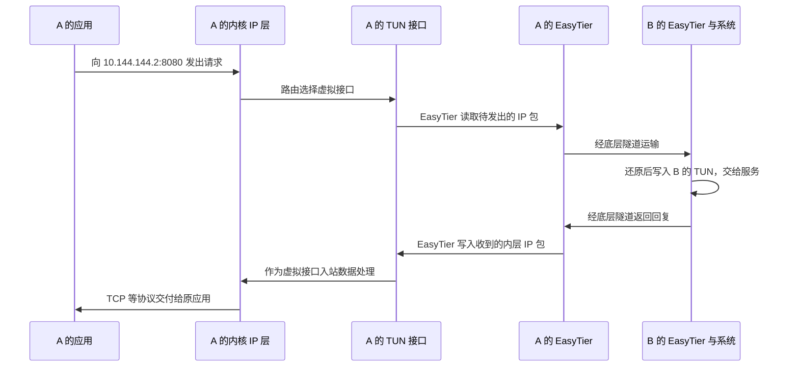

# TUN 怎样把系统 IP 包交给 EasyTier

## 具体问题：EasyTier 没改浏览器，怎么拿到浏览器的数据

A 的浏览器使用普通网络接口向 B 的 `10.144.144.2:8080` 发起请求，并不调用 EasyTier 专用的发送函数。EasyTier 却能运输这份请求。它怎样在不理解每一种应用协议的情况下，成为应用与远方设备之间的一段通道？

答案是常规工作模式中的 **TUN 虚拟网络接口**：一种让操作系统的 IP 网络层与普通程序交换 IP 包的接口。应用照常使用网络能力；路由把特定目的的包交给 TUN；EasyTier 从 TUN 读取它们，处理后通过底层连接发送。这不是逐个修改浏览器、游戏或文件共享程序，而是在 IP 层建立共同入口。

## 概念解释：TUN 连接内核和用户态，交接的是三层数据

**内核**是操作系统负责设备、内存、调度以及网络协议栈等工作的核心部分。**用户态**是普通程序运行的环境。EasyTier 的主要程序在用户态运行，不能只靠“进程正在运行”就接收到所有应用流量；系统需要提供明确的数据交接接口。

**三层**指网络层，在本教程中主要是 IP；**二层**指链路层，例如以太网帧。TUN 通常交接三层 IP 包，另一类 **TAP** 接口交接二层帧。它们在抽象层次上不同，不是两个可以随意互换的名字。EasyTier v2.6.4 的常规虚拟网卡代码明确使用 `Layer::L3`，本教程因此从 IP 包出发解释它。

A 的虚拟地址 `10.144.144.1` 赋给相应的虚拟接口，物理地址 `192.168.10.20/24` 仍由原来的物理接口承担。一个系统可以在多个接口上拥有不同 IP 地址。虚拟地址不是给外层家庭 NAT 直接寻址使用的公网位置，也不是从物理地址中自动计算出来的另一种写法。

可以把 TUN 想成操作系统为 IP 包设置的交接窗口：系统把准备沿虚拟接口发出的包放到窗口，程序领取；程序把远方收到的包交回窗口，系统按入站网络数据继续处理。这个类比只说明方向和职责，真实接口有缓冲、读写和平台机制，不是一个无限容量、永远不会失败的消息箱。

有些平台还需要附带少量包类型信息，帮助区分 IPv4、IPv6 等。这样的辅助头部不意味着 TUN 开始运输完整以太网帧，也不改变其三层接口性质。

## 图解与逐步过程：程序读 TUN 是发出，程序写 TUN 是收到

第一步，A 的应用交出请求，系统建立相应的 TCP/IP 数据。第二步，路由选择把目的 `10.144.144.2` 送到 TUN。这意味着系统认为包要从该接口发出。第三步，EasyTier **读取 TUN**，取到系统向虚拟网络发送的 IP 包。这里的读取者是 EasyTier，所以“读”不能被误解为 A 正在接收远方业务回复。

第四步，EasyTier 查看内层目的地址，交给节点转发逻辑，封装到可用的底层隧道。直接到 B，或者经第三节点 R `10.144.144.254`，由节点路径决定。物理运输依然使用 A、B 的现有网络，包含 `192.168.10.20` 和 `192.168.20.30` 这些物理地址。图解中的外侧位置可记作 `198.51.100.10`、`203.0.113.20`、`192.0.2.10`；它们是文档保留地址，不用于真实通信。

第五步，B 的 EasyTier 收到并还原内层包，然后 **写入 B 的 TUN**。相对于 B 的系统，这是一份从虚拟接口到来的入站 IP 数据。系统检查目的是否为本机地址，再按 TCP 和端口找到 `8080` 服务。第六步，服务回复；B 的路由和虚拟接口把回复交给 B 的 EasyTier，沿可用路径送回 A。

最后，A 的 EasyTier 把回复写入 A 的 TUN。A 的内核负责把其中的 TCP 字节交给原来的浏览器连接。EasyTier 不必为了运输 HTTP 请求而充当 HTTP 服务，但系统路由、隧道状态、入站规则和监听仍要分别成立。

源码中的网卡创建、IP 设置、路由设置以及两个方向的转发任务，正是在维护这些交接。TUN 只提供入口和出口，不自行发现 B，也不自行选择 R，更不自行解决 NAT。

## 小实验：把读写方向画成两种箭头

不创建虚拟网卡，取纸画三个框：“操作系统”“TUN”“EasyTier”。使用蓝箭头表示 A 发给 B 的请求：操作系统到 TUN，EasyTier 从 TUN 读走。使用红箭头表示 B 返回的回复：EasyTier 写到 TUN，操作系统继续接收处理。

接着遮住“EasyTier”框。TUN 的地址可能还在，路由可能仍把包送到接口，但没有程序把它们运输到远方，这相当于数据送到了交接窗口却无人处理。因此，看到虚拟接口存在不等于看到端到端连接可用。

再遮住“路由”这一步。即使 EasyTier 正在运行，应用包也可能从物理默认路由走掉，程序在 TUN 上根本读不到它。最后遮住 B 的 `8080` 服务：虚拟 IP 包可以到达，业务依旧不能正常响应。用这种逐层遮挡的方法，你可以准确说出每种状态只证明了哪个环节。

## 常见误解：TUN 等于加密，虚拟网段等于完整局域网

TUN 是数据交接接口，不是加密算法。程序可以从它取得明文 IP 包，再按配置执行加密和封装；也可以使用其他处理方式。私有虚拟地址本身也不是访问控制机制。虚拟网络中的其他成员是否有权访问某个服务，仍需要根据身份、网络配置、应用权限和防火墙判断。

三层虚拟网络能运输 IP 业务，却不能因此假设运输所有以太网内容。普通 ARP 是本地 IPv4 链路上的地址解析，完整以太网广播、某些设备发现以及非 IP 二层协议都需要单独考虑。把 A、B 写成同一个虚拟 `/24`，不会让它们物理共享同一台交换机。

这也不等于“任何广播相关功能都绝对不可能实现”。软件可以额外代理或转发特定的 IP/UDP 流量。v2.6.4 有 Windows UDP 广播相关实现，默认配置与平台条件另有约束；这种专门兼容能力不能推广为通用二层桥接。遇到局域网发现功能，应先确认它实际依赖什么协议，再核对对应支持。

此外，EasyTier 还有其他接入与代理模式。本章刻意描述常规 TUN 数据路径，不能用它断言每种运行选项都一定创建同样的虚拟接口。

## 两个练习与折叠答案

**练习 1：** A 的 EasyTier 从 A 的 TUN 读取一个包。对 A 的应用而言，这通常是准备发向远方的数据，还是远方刚发回的回复？

查看答案

通常是操作系统准备从虚拟接口发出的数据。远方回复经 EasyTier 还原后，通常由程序写入 TUN，再交给操作系统作为入站包处理。必须先明确是谁在读写。

**练习 2：** 两台电脑的虚拟 IP 可以互访，能否保证依赖完整二层广播的旧设备发现协议无需额外机制就正常工作？

查看答案

不能。IP 可达说明三层运输有相应能力，不证明已经建立完整二层广播域。特定 UDP 代理或广播兼容机制需要单独确认，也不能代表所有二层协议都被支持。

## 来源与下一章

TUN 与 TAP 的基本语义见 [Linux 内核 TUN/TAP 文档](https://docs.kernel.org/networking/tuntap.html)。EasyTier 的 `Layer::L3`、设备与路由操作、读写转发依据 [v2.6.4 virtual_nic.rs](https://github.com/EasyTier/EasyTier/blob/v2.6.4/easytier/src/instance/virtual_nic.rs)，程序生命周期见 [instance.rs](https://github.com/EasyTier/EasyTier/blob/v2.6.4/easytier/src/instance/instance.rs)，特定广播兼容实现见 [windows_udp_broadcast.rs](https://github.com/EasyTier/EasyTier/blob/v2.6.4/easytier/src/instance/windows_udp_broadcast.rs)。

下一章：[08 · EasyTier 启动后怎样建立虚拟网络](/chapters/08-startup)。基础部件已经齐了，接下来把地址、TUN、节点连接和后台任务放进一次实际的启动过程。
