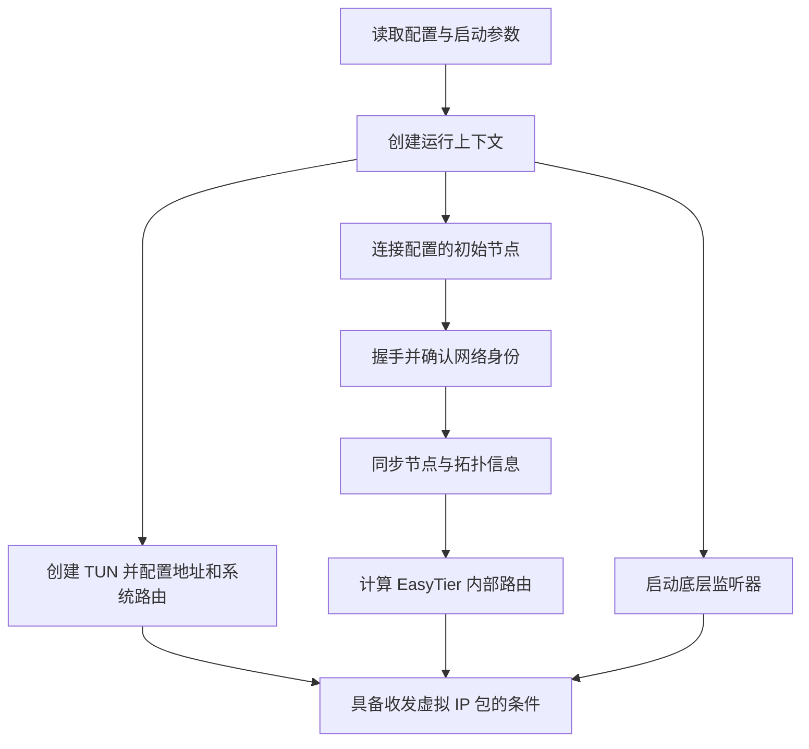

# 08 · EasyTier 启动时做了什么

## 问题：启动成功，为什么还不等于能访问对方？

假设 A 的物理地址是 `192.168.10.20`，B 的物理地址是 `192.168.20.30`。两台机器分别在不同家庭，B 上有一个监听 `8080` 的服务。我们希望 A 使用 `10.144.144.2:8080` 访问 B，而不是配置一个个应用代理。

这需要多个环节一起成立：操作系统认识虚拟网络，EasyTier 认识目标节点，底层连接能传送数据，对端操作系统允许访问服务。进程已经运行，只说明其中一部分准备好了。理解启动过程，有助于把“组网失败”拆成可以检查的具体问题。

本章将 A、B、R 的虚拟地址固定为 `10.144.144.1`、`10.144.144.2`、`10.144.144.254`。R 是我们自己管理的普通节点，同时承担初始入口和必要时的中继。它不是必须存在的中心控制器。

::: warning 地址都是教学示意
外层地址 A `198.51.100.10`、B `203.0.113.20`、R `192.0.2.10` 属于文档专用地址，不能当作真实公网服务器连接。下列命令只供理解，网站不会启动 EasyTier、修改路由或连接网络。
:::

## 概念：进程、监听器和网卡各负责什么？

**进程**是操作系统正在运行的程序。`easytier-core` 负责组网和数据处理；`easytier-cli` 用于查询、管理正在运行的核心进程。关闭查询窗口通常不会关闭核心进程，这两者的职责不同。

**监听器**是进程等待其他节点连接的入口，绑定一种传输协议、本地地址和端口。例如 TCP 监听器会等待 TCP 连接。监听 `0.0.0.0` 表示本机可用的 IPv4 接口，而不是向全世界声明“任何人都一定能连接我”：外部是否可达还取决于路由、NAT 和防火墙。

**TUN 虚拟网卡**是操作系统与 EasyTier 交换 IP 包的接口。系统把匹配虚拟网络路由的包送到它，EasyTier 读取后运输到远端；远端 EasyTier 将还原的包写入自己的 TUN，系统继续处理。它不会把物理 Wi-Fi 地址改成虚拟地址，两套地址同时存在。

**路由**也有两个层次。系统路由回答“这个 IP 包交给哪块网卡”；EasyTier 内部路由回答“虚拟目标属于哪个节点，下一跳是谁”。只检查其中一个，可能遗漏真正断掉的环节。

## 图解：从配置到可以传包



这是职责图，不是每一步严格排队的时间表。真实实现中有多个异步任务：监听、连接重试、路由同步、打洞等可以交错进行。“异步”就是某件事等待网络响应时，程序还能处理其他事情。首次连接失败，也可能由后台重试恢复。

可以把启动理解为五组工作。第一组解析配置，例如虚拟 IP、网络名、密钥和初始连接地址。第二组准备数据入口，包括监听器和虚拟网卡。第三组连接已经知道地址的节点，完成握手。第四组从已建立的连接交换网络信息。第五组根据当前信息更新路由，并继续尝试更合适的直接连接。

完成第四组后，A 可能先知道 B 通过 R 可达。此时无需等所有节点彼此打洞成功，数据就可以经 R 传输。随后若 A、B 形成直连，内部路由又会更新。因此刚启动与运行一分钟后的路径可能不同。

配置正确还不等于资源一定可用。系统可能拒绝创建网卡，监听端口可能已被其他进程占用，入口域名也可能暂时无法解析。每种失败都发生在不同边界上；先确认失败环节，再改对应配置，通常比同时改地址、密码和防火墙更容易找到原因。

## 小推演：逐个读懂参数

下面是 EasyTier **v2.6.4** 的教学命令，密钥必须替换为你自己的强密钥，公网地址也必须替换为实际可达地址：

```sh
# R：本例的入口节点，也是同网普通节点
easytier-core -i 10.144.144.254 \
  --network-name learning-net \
  --network-secret '<STRONG_NETWORK_SECRET>'

# A：通过 R 加入
easytier-core -i 10.144.144.1 \
  --network-name learning-net \
  --network-secret '<STRONG_NETWORK_SECRET>' \
  -p tcp://192.0.2.10:11010

# B：同样通过 R 加入，虚拟地址不同
easytier-core -i 10.144.144.2 \
  --network-name learning-net \
  --network-secret '<STRONG_NETWORK_SECRET>' \
  -p tcp://192.0.2.10:11010
```

`-i` 指定本机虚拟 IPv4 地址；`-p` 指定一个已知节点的外层连接地址；网络名和密钥用于网络身份与认证。A 的 `-p` 指向 R，不是在声明所有业务永远由 R 转发，也不是把 R 的物理地址设置成 A 的网关。

在真实主机上，TUN 创建可能需要管理员或相应系统权限。核心进程启动成功后，可以分别查询 `easytier-cli node`、`easytier-cli peer` 和 `easytier-cli route`。这些命令检查不同层面，不会代替对 B 的业务端口测试。

现在只在脑中推演：如果 TUN 创建失败，底层 A—R 连接仍可能存在，但普通应用无法透明使用虚拟 IP；如果 TUN 正常而初始连接失败，系统会把包交给 EasyTier，EasyTier 却未必有可达目标；如果节点和路由都正常，B 的服务只监听回环地址 `127.0.0.1:8080`，访问仍会失败。

## 常见误解：出现虚拟网卡就完成了组网

虚拟网卡是接口，不是远端存在的证明。它可以在尚未发现 B 时就创建好。反过来，无 TUN 模式仍可进行某些组网功能，但普通应用主动访问需要额外代理方式，不能把它与透明网卡模式混为一谈。

另一个误解是“启动顺序决定谁是服务器”。A、B、R 都运行核心进程，都可接受连接和发起连接。R 在本例中先启动，只是为了给另外两台提供一个已知可达入口。即使没有固定服务器角色，入口的物理可达性仍是实际需求。

最后，不要把“程序日志没有报错”理解成所有应用都可访问。路由、主机防火墙、服务监听地址是不同的检查点。后面的排障章节会沿一只数据包的路径逐层检查它们。

## 练习：定位启动后的缺口

**练习 1：** A 已经创建 `10.144.144.1` 的 TUN，但没有发现 B。向 `10.144.144.2:8080` 发包，还缺少哪一类信息？

<details>
<summary>展开练习 1 的答案</summary>

缺少虚拟目标到节点、以及节点到可用路径的映射。TUN 只负责系统与进程间交包，不能凭空生成远端和内部路由。

</details>

**练习 2：** A、B 都填写 `-p tcp://192.0.2.10:11010`。这是否强制两者一直经 R 传送业务？

<details>
<summary>展开练习 2 的答案</summary>

不会。它提供初始连接入口；经过信息同步和连接优化，A、B 可能形成直连。能否直连以及最终使用哪条路径，需要观察运行状态。

</details>

## 来源与下一章

- [v2.6.4 中文 README：基本用法](https://github.com/EasyTier/EasyTier/blob/v2.6.4/README_CN.md)
- [实例装配与生命周期](https://github.com/EasyTier/EasyTier/blob/v2.6.4/easytier/src/instance/instance.rs)
- [TUN 与系统路由实现](https://github.com/EasyTier/EasyTier/blob/v2.6.4/easytier/src/instance/virtual_nic.rs)

下一章继续回答：[A、B 通过入口相遇后，如何确认属于同一个网络？](/chapters/09-membership)
