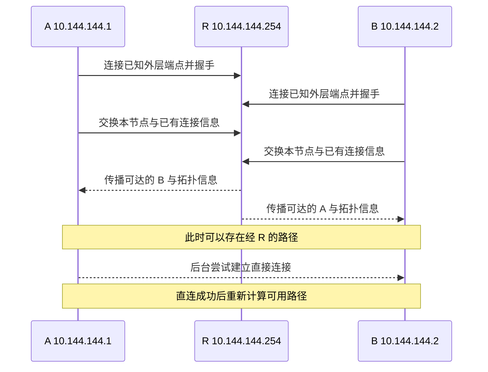

# 09 · 节点如何加入和发现彼此

## 问题：A 只认识 R，怎么知道 B 存在？

A 的物理地址是 `192.168.10.20`，虚拟地址是 `10.144.144.1`；B 的物理地址是 `192.168.20.30`，虚拟地址是 `10.144.144.2`，提供 `8080` 服务。两者第一次启动时，配置中都只有入口 R 的连接地址。它们并没有预先填写对方的公网端点。

如果软件只是把应用数据装进 TCP 连接，这两台机器只能与 R 通信。EasyTier 还需要告诉节点“网络里有谁”“谁与谁已经连上”“哪个虚拟地址属于谁”。有了这些信息，A 才能把发往 B 的包交给正确节点，并尝试更直接的路径。

本章的 R 是同网普通节点，虚拟地址为 `10.144.144.254`。A、B、R 的外层地址分别以 `198.51.100.10`、`203.0.113.20`、`192.0.2.10` 示意。这些都是文档地址，不能用于真实连接。社区公共共享节点还可以帮助其他网络组网，稍后会区分这种情况。

## 概念：网络身份不是 IP 地址

虚拟 IP 是应用使用的地址，例如 `10.144.144.2`。**节点标识**是 EasyTier 内部区别节点的编号，用于消息寻址与路由。**网络身份**则决定节点试图加入哪一个虚拟网络，以及以何种凭据参与。这三个东西解决不同问题。

在常见的共享密钥配置中，同一个网络的正式节点使用相同的 `network-name` 与 `network-secret`。名字用于区分网络，密钥参与认证和安全机制。名字不是密码，不能只用一个难猜的名字替代强密钥；虚拟 IP 也不具备入网授权能力。

**握手**是连接双方在正式通信前交换协议和身份信息的过程。物理 TCP 连接建立，只证明底层双方可以交换字节。EasyTier 仍需在这条连接上确认协议状态和网络关系，不能把“TCP 连上”与“已作为可信业务节点入网”画等号。

**节点发现**是获知其他节点的信息。**路由同步**是传播节点可达关系、地址和代理网段等信息。这些主要属于控制面：它们为业务数据准备路径，而不是 B 的网页内容本身。控制面也占带宽，但它与数据面的职责不同。

## 图解：先相遇，再传播信息



这是一幅简化职责图，真实协议包含更多请求、版本信息、重试和同步。不要把它理解为 R 保存唯一的全网名单、逐次批准每个节点。EasyTier 的正式节点交换并维护网络状态，已加入的节点可以通过可达的其他节点继续连接网络。

初始入口相当于你已知道地址的一位联系人。通过他，你认识其他成员；认识之后，不必每次说话都请联系人传话。网络中还可能存在多个入口。A 的配置可以包含多个 `-p`，从而减少某个入口临时失效时完全无法相遇的风险。

不过，“能够发现”与“能够直连”仍然分开。A 可能已经知道 B 的虚拟地址与候选外层地址，但 NAT 不允许直接访问。此时，已知拓扑可以提供经 R 的路径；直接连接会由后续 NAT 穿透机制继续尝试。

## 小推演：同网入口与公共共享节点

先考虑同网入口。A、B、R 持有相同的网络名和主密钥，R 是这个信任域内的成员。A 通过 R 连入，也可以在可达条件允许时改为连接 B。节点没有“只有服务器能接受入网”的固定协议身份。

再考虑社区公共共享节点。公共节点可以服务多个不同虚拟网络，不需要获得每个业务网络的主密钥。A、B 仍使用彼此一致的业务网络身份；公共节点使用自己的配置，为外部网络提供发现和转发能力。不能把公共节点自己的网络名与密钥复制给所有用户，然后声称大家仍在不同的私有网络。

在整个教程中给 R 分配虚拟 IP，是为了容易追踪同网三节点的路径。真实公共共享节点可以不分配业务虚拟 IP。公共节点在 peer 列表里没有业务 IP，也不一定说明它失效；应结合连接、路由和角色看待。

你可以只阅读下面的 v2.6.4 查询命令，无需在机器上运行：

```sh
easytier-cli node
easytier-cli peer
easytier-cli route
```

`node` 看本机状态，`peer` 看节点及连接关联信息，`route` 看目标与下一跳。先找 B 的 `10.144.144.2`，再看它的路径，而不是看到 R 存在就认为所有成员都已正常加入。

如果 B 消失，可能是它尚未成功连接入口，也可能是握手或身份不匹配；如果 B 已出现但访问失败，还可能是数据面、主机防火墙或服务问题。把这些现象区分开，可以避免一开始就反复重装软件。

## 常见误解：去中心化就是不需要任何已知地址

去中心化说的是节点角色和状态传播不依赖唯一中心控制器。它没有消除“第一条连接怎么建立”这个问题。如果所有机器都是互相不知道地址、外部又不能主动访问的内网主机，仍需一种相遇方式，如可达节点或公共共享基础设施。

另一个误解是“知道密钥就只允许访问一个端口”。主密钥是在共享信任域中参与网络的凭据，不是精细的业务权限配置。若要限制哪些成员可以访问 B 的 `8080`，需要结合 ACL 和服务自身的认证；不要把组网密码当成应用登录密码。

同样，虚拟 IP 与物理 IP 没有必须一一对应的数学转换。A 的 `192.168.10.20` 不会因为加入网络就变成公网地址。EasyTier 维护的是一层额外的地址与节点关系，物理网络仍负责把外层包运输到可达端点。

## 练习：把几种身份分清

**练习 1：** A、B 使用相同虚拟网段，但网络密钥不同。只因为 IP 看起来相邻，它们就能作为同网可信节点通信吗？

<details>
<summary>展开练习 1 的答案</summary>

不能。地址分配与网络身份是两层问题；必须满足实际握手、认证和路由条件。相同地址范围甚至可能形成冲突或完全独立的网络。

</details>

**练习 2：** A 只配置了 R 的 `-p`。B 出现在 A 的路由里，是否说明 R 必然是全网唯一的控制中心？

<details>
<summary>展开练习 2 的答案</summary>

不是。R 提供初次相遇与信息传播的一条路径，其他成员同样参与网络状态维护。还可以配置多个可达入口，但入口失效的影响要结合剩余实际连接判断。

</details>

## 来源与下一章

- [v2.6.4 README：去中心化与共享节点组网](https://github.com/EasyTier/EasyTier/blob/v2.6.4/README_CN.md)
- [节点握手实现](https://github.com/EasyTier/EasyTier/blob/v2.6.4/easytier/src/peers/peer_conn.rs)
- [跨网络共享节点逻辑](https://github.com/EasyTier/EasyTier/blob/v2.6.4/easytier/src/peers/foreign_network_manager.rs)
- [路由信息交换实现](https://github.com/EasyTier/EasyTier/blob/v2.6.4/easytier/src/peers/peer_ospf_route.rs)

下一章先解决地址发现：[内网节点如何知道自己在外部看起来是什么地址？](/chapters/10-stun)
