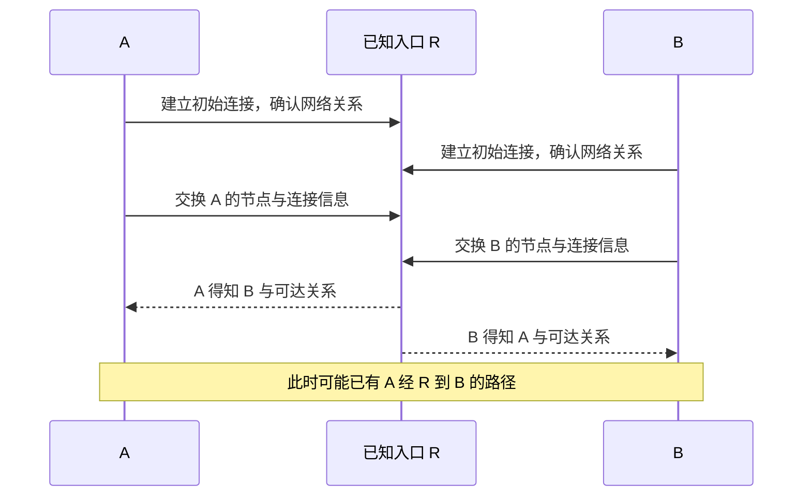

# 09 · 先认识入口，再认识彼此

## 这一章要解决的问题

A 最初只填了 R 的连接地址，B 也只认识 R。它们怎么知道对方存在，随后又怎么把数据送给正确的人？

本章把“先相遇”“确认网络关系”“知道目标”“选择运输路径”拆开。读完后，你能说明为什么 EasyTier 可以没有唯一中心控制器，却仍然需要第一条已知连接；也能区分引导节点与中继节点的职责。

## 先回顾两件事

- [第 8 章](/chapters/08-startup)：本机接口准备好、认识目标和目标应用成功是不同状态。
- [第 3 章](/chapters/03-addresses)：IP 是寻址信息，不是设备的身份证或访问密码。

## 一步一步看

### 第一步：虚拟 IP 不会自动告诉电脑“去哪里找人”

A 使用 `10.144.144.1`，B 使用 `10.144.144.2`。这两个数字给应用一个目标写法，但刚启动的 A 仍需要知道由哪个实际连接把包送到 B。给两台异地电脑填相邻的虚拟 IP，不会让互联网自动出现一条对应线路。

我们给 A 一个已知可达的初始入口 R。这个帮助建立第一条联系的过程叫**引导**。它可以类比先联系一位你已知道联系方式的人，再通过现有联系认识其他人；真实节点交换的是结构化信息，不是把所有私人配置公开给联系人。

### 第二步：建立连接后，还要确认网络关系

能够给某个地址发数据，与作为同一虚拟网络的成员参与，是不同条件。连接双方还会进行**握手**：在正式通信前交换必要的协议和身份信息。

在常见共享密钥方式中，同网正式节点配置一致的网络名与网络密钥。网络名用于区分网络；密钥是敏感凭据，参与认证和安全机制。只有相同的虚拟网段、不匹配的网络身份，不足以让两台设备成为同网可信成员。

虚拟 IP、节点标识与网络身份也不要混在一起。虚拟 IP 供应用寻址；**节点标识**是 EasyTier 内部区别节点的编号；网络身份决定节点以什么关系参与哪个网络。它们各自解决一个问题，不能互相替代。

### 第三步：沿已有联系传播成员信息

图中的 R 是同网普通节点，教程给它虚拟 IP `10.144.144.254`。A 通过已建立连接获得 B 的信息，可以把“目标虚拟 IP 属于哪个节点”与“经过哪个节点能到它”联系起来。

节点并不只交换名单，也传播已知连接与可达关系。把这种信息传播叫作**路由同步**：让节点更新自己所知道的路径。A、B 等正式节点同样参与维护网络状态，而不是每次业务都向唯一中心申请批准。

这幅图只画了初次相遇所需的联系。真实网络可以有多个入口和更多连接；各节点知道的信息也需要时间传播，不能保证任意时刻所有节点都拥有完全相同的即时视图。

### 第四步：认识 B，不等于已经能直接找 B

知道 B 存在后，A、B 可以尝试建立直接连接。网络条件允许时，业务可以直接运输；条件不允许时，只要存在允许转发的路径，也可能经 R 到达。

这里出现第二个职责：**中继**，也就是中间节点继续转发发往目标的数据。R 帮助 A、B 第一次相遇时承担引导职责；R 实际搬运 A 发给 B 的业务时才承担中继职责。同一个节点可以兼任，但“配置了 R”不能证明每次请求都经过 R。

### 第五步：加入网络不等于获得所有应用权限

网络关系确认后，仍可能有主机规则或应用账号限制 B 的 8080 服务。组网密钥不是网页登录密码，也不是“只允许这一个端口”的细粒度权限表。不要通过公开截图泄露密钥，也不要因为一个成员能入网就给它所有业务权限。

更具体的加密、身份和权限关系在[第 12 章](/chapters/12-security)讲解。这里先记住：认识目标、路径可达、应用允许，是需要分别成立的条件。

## 先预测，再观察

**预测：** GUI 列表里既有入口节点又有目标 B，是否说明 R 正在转发这次请求？入口行显示直连，能否代替 B 那一行？

**观察：** 在已经运行的 GUI 中，只查看一个已确认目标的虚拟 IP、节点行和当前路径标签。通过[本机地址预备课](/basics/my-network)认清本机与目标，不导出配置、不展示网络密码。没有现成网络时，读[历史实机案例](/cases/local-gui)里 B 的脱敏状态。

**解释：** B 出现表明当前界面有这个目标的信息；B 的路径字段才描述与这个目标相关的路径。R 的字段是另一对象的状态。把对象分清，比记住整张列表更有用。

**不能证明：** 一张列表不能还原实际引导顺序、具体打洞算法或长期可用性。目标出现也不能证明它的 HTTP 服务运行，更不能由界面确认所有认证配置已满足你的预期。

## 常见误解

“去中心化就是谁也不需要知道任何地址”忽略了第一条联系。没有唯一中心控制器，不意味着初次相遇不需要可达入口或其他发现方式。

“使用公共节点，就必须把公共节点的网络名和密钥照抄过来”也不正确。公共共享节点与自己的业务网络有不同关系，正式成员应按所选组网方式匹配自己的网络身份，不能把独立网络变成一群共享主密码的陌生节点。

“发现 B 就一定已经直连 B”把信息与连接混在一起。已知目标可以经中继可达，直接连接还取决于实际网络条件。

## 两道练习

**练习 1：** A、B 的虚拟 IP 看起来在同一网段，网络密钥却不匹配。能否仅凭这些地址判定它们是同网可信成员？

查看练习 1 的答案

不能。地址与网络身份是不同信息；还需满足相应握手、认证和路径条件。相同数字范围也可以用于完全独立的虚拟网络。

**练习 2：** R 帮助 A 得知 B，之后 A、B 显示直连。R 在这两件事里分别可能承担什么职责？

查看练习 2 的答案

R 提供初始入口与信息传播的路径；直连建立后，A、B 的业务可以不经 R。只有实际转发业务时，R 才在这条业务路径上承担中继职责。

## 进阶阅读

选读：控制面、公共共享节点和多个入口

成员、候选连接地址与拓扑信息主要属于控制面：为数据运输准备路径。应用业务主要属于数据面。两者都可能使用已有节点连接，但职责不同，看到隧道字节增加不能直接断言某个 HTTP 请求已被送达。

公共共享节点可以服务多个不同虚拟网络，不需要持有每个业务网络的主密钥。它使用自己的配置提供跨网络发现和转发能力；是否允许使用以及允许哪些网络由实际配置决定。它可能不具有业务网络的虚拟 IP，所以列表中没有这样的地址不一定表示故障。

本书把 R 画成同网普通节点，方便追踪地址，不把它与公共共享节点的信任关系混为一谈。v2.6.4 支持多个 `-p` 初始端点，但多个入口是否形成真正冗余，仍要看后续完整连接图，而不只数参数数量。

## 来源与下一章

- [v2.6.4 README：去中心化与共享节点组网](https://github.com/EasyTier/EasyTier/blob/v2.6.4/README_CN.md)
- [v2.6.4 节点握手实现](https://github.com/EasyTier/EasyTier/blob/v2.6.4/easytier/src/peers/peer_conn.rs)
- [v2.6.4 跨网络共享节点逻辑](https://github.com/EasyTier/EasyTier/blob/v2.6.4/easytier/src/peers/foreign_network_manager.rs)
- [v2.6.4 路由信息交换实现](https://github.com/EasyTier/EasyTier/blob/v2.6.4/easytier/src/peers/peer_ospf_route.rs)

下一章：[10 · 内网电脑怎样知道自己在外部看来是什么地址？](/chapters/10-stun)
