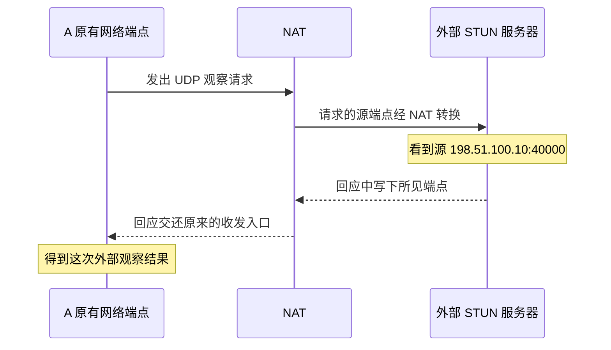

# 10 · 请外部观察者告诉我地址

## 这一章要解决的问题

A 知道自己的原有网络 IP，却不一定知道包经过 NAT 后，互联网另一端看到的源地址和端口是什么。B 想尝试直接联系 A，该去哪里找？

一个办法是请外部观察者回答：“你刚收到的包来自哪个地址和端口？”**STUN** 就是一种完成这种观察的协议，常用于辅助 NAT 穿透。它告诉节点某次探测的外部情况，并不替节点完成所有建连工作。

## 先回顾两件事

- [第 6 章](/chapters/06-nat)：NAT 的地址端口映射与允许哪些回包进入的过滤规则是两件事。
- [第 9 章](/chapters/09-membership)：节点可以沿已有连接交换信息，但知道对方存在不等于已经直连。

## 一步一步看

### 第一步：本机知道的是转换之前的信息

假设 A 用原有网络 IP `192.168.10.20` 的一个 UDP 收发入口发包，本地端口是 `30000`。这个“地址加端口”的组合叫**端点**。包出去后，NAT 可能把源端点换成 `198.51.100.10:40000`，外部服务器看到的就是后者。

这组公网数字是文档保留地址，只用于教学，不能拿来连接真实设备。我们现在引入它，是因为解释外部观察必须区分“转换前”和“转换后”。A 的虚拟 IP 仍然是 `10.144.144.1`，没有被改成这个公网地址。

### 第二步：发送一个能得到回应的观察请求

A 主动向一个 STUN 服务器发送请求。出站行为可能建立 NAT 状态，让该服务器的回应沿相应状态返回。服务器无需登录 A 的路由器；它只读取自己收到的请求源端点，并把所见地址端口写进回应。

A 收到的不是“已经配置好的公网网卡”，而是一条信息：“向这个服务器发送这个请求时，它看见了这个端点。”之后 A 可以沿已有节点连接交换候选端点，供与 B 的直接连接尝试使用。

### 第三步：同一个观察结果，换个目标可能不成立

假设 A 告诉 B：“STUN 看见我是 `:40000`。”B 立刻发向它，仍可能失败。第一种原因是 NAT 只允许 A 曾主动联系过的来源返回，B 尚不在允许条件中。地址正确，也不等于过滤规则允许。

第二种原因是 NAT 可能根据不同目标分配不同映射。A 发向 STUN 时使用外部端口 `40000`，改为发向 B 时却获得另一个端口。STUN 报告的结果是真的，但它描述的是那次目标，不保证每个目标都使用同一映射。

第三种原因是时间和网络条件改变了。状态可能过期，A 也可能换了 Wi-Fi 或热点。虚拟 IP 可以保持不变，底层端点却已经变化。因此外部观察需要与当前路径联系起来，不能永久当作固定联系方式。

### 第四步：类型标签是线索，不是完整规则表

EasyTier v2.6.4 根据探测结果维护 NAT 信息。GUI 中的类型标签，是对观测行为的一种概括。它不是直接读取路由器全部规则，也不是对所有协议作出的终身分类。

如果显示 `Unknown`，只能说这项分类没有给出明确结果。可能是探测服务或 UDP 路径有问题，也可能受到其他网络条件影响；它既不表示“一定没有 NAT”，也不表示“一定不能通信”。判断当前连接还要看指定目标的路径和实际访问。

同样，多层 NAT 的最外侧观察不能告诉我们每层设备如何配置。把外部地址读出来，只补齐一部分建连信息，不会自动消除这些规则。

### 第五步：观察者与搬运者不是同一个职责

STUN 服务器通常只参与观察，不在随后的业务路径上。R 可以帮助交换节点信息，也可以在允许时中继；B 才是最终接收业务的节点。这些功能即使碰巧由同一台机器承载，解释时仍要分开。

下一章会把观察到的候选信息与双方主动发包结合起来。现在先记住：“知道外部看来是什么端点”，比“不知道”多了一项线索，但还没有等于“直连成功”。

## 先预测，再观察

**预测：** 一个目标的 NAT 标签含有 Symmetric，而目标路径显示 `p2p`，两项信息是否必然矛盾？一个 NAT 类型能否告诉你网页是否可用？

**观察：** 只读取已运行 GUI 中本机和一个已确认目标的 NAT 标签，以及该目标的路径字段。也可以使用[历史实机案例](/cases/local-gui)：记录中本机为 `PortRestricted`，目标为 `SymmetricEasyInc`，目标连接显示 `p2p` / UDP。这些是当时的脱敏记录，不是本章的新探测。

**解释：** NAT 标签概括探测特征，目标路径描述当前节点关系，两者是不同观察。把它们并列记录，有助于避免用类型名代替实际状态。没有 GUI 或没有分类时，继续用本章的图做纸面推演即可。

**不能证明：** 标签不能复原具体 STUN 报文、完整映射表、NAT 层数或实际打洞算法；目标有路径也不证明长期稳定或业务成功。不要为了得到某个标签重启现有网络或修改路由器。

## 常见误解

“STUN 帮我开放了永久公网端口”不正确。主动请求可能建立临时状态，但服务器没有替你配置永久端口映射；端口转发是另一种操作。

“STUN 就是中继”也不正确。知道外部地址与实际转发业务是不同职责，不能把任意 STUN 服务当作业务中继。

“NAT 类型越好，下载就越快”混淆了建连条件与性能。带宽、拥塞、丢包和实际路径仍会影响连接后的体验。

## 两道练习

**练习 1：** STUN 报告 A 的端点为 `198.51.100.10:40000`，为什么 B 发向这里仍可能不被允许进入？

查看练习 1 的答案

还需看过滤规则是否允许 B、发向 B 时是否使用同一映射、状态是否过期，以及实际链路与防火墙是否可用。一次外部观察不能保证这些条件。

**练习 2：** A 从 Wi-Fi 换到热点，但虚拟 IP 没变。能否直接认为旧的外部端点仍有效？

查看练习 2 的答案

不能。虚拟 IP 属于覆盖网络；外部映射依赖当前原有网络路径。换网后通常需要重新观察、建连并更新相应信息。

## 进阶阅读

选读：socket、STUN 属性与 IPv6

socket 是程序向系统申请的通信入口。比较映射时，需要注意是否使用同一本地 UDP socket，以及外部目的地址和端口发生了什么变化。单纯看两个公网 IP 相同，不能判断端口和过滤条件相同。

STUN 的名称来自 Session Traversal Utilities for NAT。映射信息可以通过 `MAPPED-ADDRESS`、`XOR-MAPPED-ADDRESS` 等属性传递；XOR 在这里是属性编码方式，不代表业务加密。v2.6.4 的探测模块收集外部地址及 NAT 线索，再为连接策略提供信息。

公网 IPv6 通常减少 IPv4 那样的地址端口转换，但路由和有状态防火墙仍会限制通信。有 IPv6 地址不是跳过连接验证的依据。

## 来源与下一章

- [v2.6.4 STUN 探测与映射地址解析](https://github.com/EasyTier/EasyTier/blob/v2.6.4/easytier/src/common/stun.rs)
- [v2.6.4 UDP 打洞模块](https://github.com/EasyTier/EasyTier/tree/v2.6.4/easytier/src/connector/udp_hole_punch)
- [官方 P2P 优化文档：网络条件与限制](https://easytier.cn/guide/network/p2p-optimize.html)：当前指南可能随版本更新。

下一章：[11 · 双方主动发包，为什么可能建立直接连接？](/chapters/11-hole-punch)
