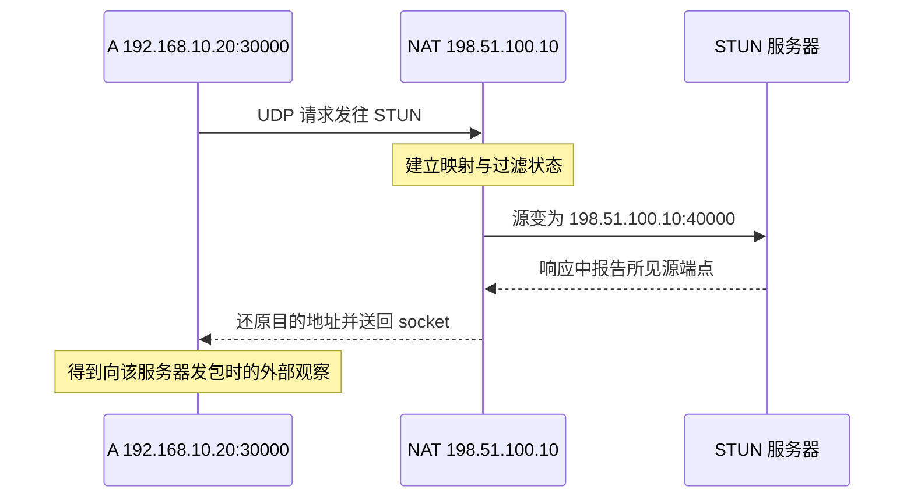

# 10 · STUN 如何观察 NAT

## 问题：A 怎么知道路由器替它换成了哪个端口？

A 的程序知道自己在 `192.168.10.20` 上使用某个 UDP 端口，却不一定知道家中路由器、甚至运营商的 NAT 把它转换成了什么。B 要从互联网向 A 发包，仅知道 A 的私网地址是不够的。

一种直观办法是请互联网另一端回答：“我刚收到的包，源地址与源端口是什么？”这就是 **STUN** 的核心用途。它的名称来自 Session Traversal Utilities for NAT，可理解为辅助 NAT 穿透的一组探测工具。它提供观察结果，后续还需要地址交换、打洞、握手和路由。

我们继续使用 A 虚拟地址 `10.144.144.1`、B 虚拟地址 `10.144.144.2` 和入口 R `10.144.144.254`。外层公网示意地址 A `198.51.100.10`、B `203.0.113.20`、R `192.0.2.10` 只用于解释，不能用于真实网络。B 的物理地址仍是 `192.168.20.30`，服务端口仍为 `8080`。

## 概念：从本地 socket 到外部观察结果

**socket** 是程序向操作系统申请的通信端点。这里先理解成“协议、本地地址与端口对应的收发入口”。A 从同一个 UDP socket 向 STUN 服务器发包，经过 NAT 后，服务器看到的源可能是 `198.51.100.10:40000`。

服务器将这个观察到的地址写进响应。响应沿原先建立的 NAT 状态返回，A 就知道了一个**公网映射端点**。端点是地址与端口的组合，不是只有一个 IP。IPv4 地址相同、端口不同，可能对应完全不同的内部程序。

在 STUN 协议中，这类信息通过映射地址属性传递，包括 `MAPPED-ADDRESS` 或 `XOR-MAPPED-ADDRESS`。这里的 XOR 是属性编码方式，不应解释成给业务通信加密。STUN 的观察结果也不是把公网地址配置到 A 的物理网卡上。

最容易遗漏的一点是：这份结果来自“向某个目的端点发送请求”的行为。它说明那个服务器看到了什么，不自动证明 B 访问同一个地址就能进入。如果 NAT 按目的地址或目的端口分配不同映射，换一个目标后，外部端口也可能改变。

## 图解：探测请求走过的两层地址

STUN 服务器通常不在后续业务数据的路径上。它可以负责观察，R 可以负责信息交换和中继，B 可以负责最终接收业务，这三个职责没有必要由同一台机器承担。即使某个服务同时承担几种职责，概念上仍要分开。

EasyTier v2.6.4 的 STUN 模块会收集外部映射与 NAT 探测信息，并维护相应状态。通过不同请求和服务端响应，软件可以推断映射是否稳定、过滤是否受地址端口限制。节点再使用这些信息选择合适的连接尝试方式。

这种推断是基于当时的网络表现，而不是读取了所有路由器的内部配置。探测失败可能是 UDP 被阻断、STUN 服务不可达、DNS 解析失败，也可能是实际路径被其他代理改变。显示 `Unknown` 不等于“一定没有 NAT”，更不等于“一定能直连”。

如果家中路由器后面还有运营商转换设备，探测看到的通常是整条出站路径最外侧的结果，而不是每一层映射细节。多层 NAT 可能让状态和过滤更复杂。软件得到一个外部端点，并不能据此知道有几层设备，或认为自己已经修改了其中任何一层。

## 小推演：相同 socket，两个不同目标

想象 A 使用本地 `192.168.10.20:30000` 连续向两个外部端点发送探测。第一次被观察为 `198.51.100.10:40000`，第二次仍是 `198.51.100.10:40000`。这提示映射可能与外部目标无关，但要区分“映射稳定”与“任何来源都能进入”。

NAT 仍然可以要求：只有 A 刚主动发过包的来源才能回复。因此 B 知道 `:40000`，却没有对应允许状态时，第一只包仍可能被丢弃。后面讲打洞时，双方主动发包就是为了建立匹配的状态。

再想象第二次变成 `198.51.100.10:41037`。如果向 STUN 的映射与向 B 的映射不同，A 把 STUN 的 `:40000` 告诉 B，就可能给错了访问目标。这正是目的相关映射让打洞变难的原因，不能只凭一次响应确定所有目标的端点。

还要考虑时间。NAT 状态通常会超时，网络切换后端点也可能变化。A 从 Wi-Fi 换到手机热点，昨天的公网映射不再可靠。软件需要重新探测、保持连接或重建路径，而不是把第一次探测结果永久保存后再也不更新。

你可以在网站中推演这些变化，无需打开路由器或发真实探测包。真实运行环境中，`easytier-cli node` 和 `easytier-cli peer` 可提供 NAT 等状态线索，但判断连接成功仍要看连接和路由本身。一个 NAT 标签概括不了带宽、延迟、丢包或目标服务可用性。

## 常见误解：STUN 帮我开了一个公网端口

STUN 请求可能作为出站流量触发 NAT 建立状态，但 STUN 服务器没有登录你的路由器，也没有自动配置永久端口映射。它更像观察者。端口转发、UPnP 建立映射和 UDP 打洞是相关但不同的机制。

也不要把 STUN 当作中继。仅从 STUN 得到映射地址，不代表业务可以经 STUN 服务器转发。EasyTier 的中继能力来自实际节点之间的连接与转发逻辑，而不是任意 STUN 服务都能代劳。

“NAT 类型越好，网络一定越快”同样不成立。探测主要帮助判断建连难度；建连后快慢还由两地的互联网路径、接入带宽、拥塞和丢包决定。一个宽松 NAT 后面的拥塞宽带，可能比经优质中继的路径更慢。

最后，公网 IPv6 往往减少 IPv4 地址转换问题，但仍受有状态防火墙和路由可达性约束。IPv6 地址存在，不是免除任何连接检查的通行证。两端还需要有可用的共同传输路径。

## 练习：读懂探测结果的限度

**练习 1：** STUN 看到 A 是 `198.51.100.10:40000`。能否直接断定 B 发往该端点的 UDP 包一定进入 A？

展开练习 1 的答案

不能。还需考虑目的相关映射、来源过滤、状态超时、两端防火墙与路由。STUN 只提供特定探测路径上的观察结果。

**练习 2：** A 从家中 Wi-Fi 切换到移动网络，虚拟 IP 没变。旧公网映射是否仍能一直使用？

展开练习 2 的答案

不能保证。虚拟 IP 属于覆盖网络，外层映射属于当前物理路径。换网后需要重新探测、建立底层连接并更新可达信息。

## 来源与下一章

- [v2.6.4 STUN 探测与映射地址解析](https://github.com/EasyTier/EasyTier/blob/v2.6.4/easytier/src/common/stun.rs)
- [v2.6.4 UDP 打洞模块](https://github.com/EasyTier/EasyTier/tree/v2.6.4/easytier/src/connector/udp_hole_punch)
- [官方 P2P 优化文档：网络条件与限制](https://easytier.cn/guide/network/p2p-optimize.html)

下一章把观察结果用于实际建连：[双方同时发包，为什么可能穿过 NAT？](/chapters/11-hole-punch)
