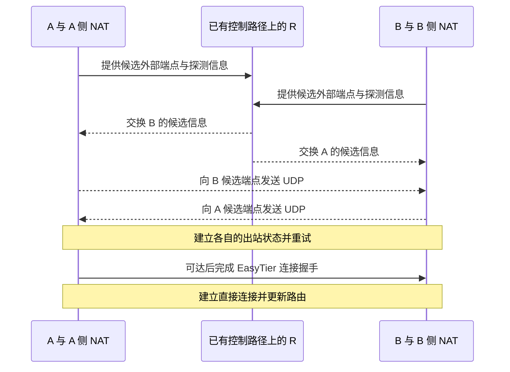

# 11 · NAT 打洞为什么可能成功

## 问题：两端都没有开放入站端口，如何直接通信？

A 在 `192.168.10.20`，B 在 `192.168.20.30`，都位于各自的家庭路由器后。A 想访问 B 虚拟地址 `10.144.144.2` 上的 `8080` 服务。A、B 已经通过 R 相遇，知道彼此存在，但从互联网主动连接 B 的私网地址显然行不通。

**打洞**就是利用两端主动发包触发的 NAT 和防火墙状态，为直接通信创造条件。它不是在路由器里挖一个永久漏洞，也不是让软件忽略安全规则。成功需要映射、过滤、时序和实际路径恰好能够配合。

本章使用 A 外层 `198.51.100.10`、B 外层 `203.0.113.20`、R 外层 `192.0.2.10`，R 虚拟 `10.144.144.254`。这些外层地址属于文档示意，不能直接运行。端口数字也用于推演，不是你的真实映射结果。

## 概念：UDP 没有握手，防火墙仍然可以记状态

UDP 协议本身不要求像 TCP 那样先建立连接，但有状态防火墙仍可记录“本机最近向哪个地址、端口发送了 UDP”。之后来自对应端点的包，可以被视为允许的回应。所谓“UDP 连接状态”，这里指网络设备的追踪状态，不是 UDP 自带的握手。

例如 A 先向 `203.0.113.20:50000` 发一只包。A 侧网络设备可能记录：本地 socket 对这个目标进行过出站通信，允许相应返回流量。即使第一只包在 B 侧被丢弃，它也已经对 A 侧状态产生了作用。

B 同时向 `198.51.100.10:40000` 发包，在自己一侧建立类似状态。如果双方使用的外部端点正确、过滤规则允许，后续包就可能穿过两侧网络设备。重复发送和重试可以缓解首次包先后顺序不合适的问题。

但这段推演依赖一个重要条件：向对端发包时形成的映射，与交换给对方的端点匹配。对目的相关映射的 NAT 来说，“发往 STUN 时的公网端口”不一定等于“发往 B 时的公网端口”。因此打洞不仅是双方各发一只包。

## 图解：先有控制路径，再尝试数据直连

控制信息可以沿已经存在的网络路径交换，不要求 A、B 先直连，也不要求 STUN 服务器负责所有协调。图中的 R 代表可达路径上的协作节点；真实系统可能有多个节点和多跳控制路径。

EasyTier v2.6.4 的 UDP 打洞模块针对不同探测类型选择策略，包括锥型之间、对称型到锥型、部分两端可预测对称型等组合。代码中也有多候选端口尝试。这些机制提高成功机会，无法证明所有 NAT4—NAT4 组合都能成功。

对于端口分配存在规律的网络，可以尝试预测下一次映射端口；对于其他情况，多次尝试可以扩大候选集合。候选不等于保证，运营商过滤、随机端口分配、映射寿命和探测误差都可能使这些方法失效。

## 小实验：改变条件，观察模型结果

<NatLab />

这个交互是**教学模型**，不会发 STUN、扫描端口、修改路由器或执行 EasyTier。它用少量条件展示“更容易直连”“需要进一步尝试”“保留中继”之间的关系。真实实现比面板复杂，结果也不能代替实际连通性测试。

先让双方使用较宽松、映射稳定的 IPv4 环境，观察模型为何容易形成直接路径。然后收紧过滤，想一想为什么双方主动发包仍可能建立对应状态。最后改成目的相关映射，追踪原来交换的端口为何可能失效。

不要只记住 NAT1、NAT2、NAT3、NAT4 的编号。这些常见标签压缩了多个行为。初学时可以先记两个问题：向不同目标发包，公网映射会不会变化？哪些外部来源的回包会被允许？这两个问题比“我的 NAT 是几级”更接近根因。

再考虑 IPv6。两端有可路由的公网 IPv6 时，通常无需 IPv4 那种地址端口转换，但防火墙依然可能只允许已发起通信的回应。两端协调主动发送，仍可能帮助建立允许状态；若规则完全阻断，IPv6 地址本身无法消除限制。

EasyTier 还支持 TCP 打洞。TCP 有自己的握手与状态机，同时发起连接时，系统、NAT 和防火墙如何处理就更复杂。不要把 UDP 示意原样当成 TCP 每一只包的精确过程。对初学者，先理解“协调尝试与状态匹配”即可。

在 v2.6.4 中，`--disable-udp-hole-punching`、`--disable-tcp-hole-punching` 可用于关闭相应自动尝试；它们不是把已存在的所有连接、所有转发或主机防火墙一并关闭的总开关。配置时应查对应版本帮助，网站只解释这些参数，不会在你的机器上执行。

## 常见误解：打洞成功就永远不需要 R

打洞形成的直接连接依赖当前网络。A 切换热点、路由器状态超时、B 重启，都可能使路径失效。软件需要检测、重新建连和更新路由。原有入口或中继可能仍为恢复与其他节点发现提供帮助。

另一误解是“打洞失败，所以虚拟网络无法使用”。只要存在允许转发且可达的中继路径，A 仍可能经 R 到达 B。打洞是改善路径的能力，不是组网可用性的唯一来源。强制只允许直连的配置会改变这个行为，应明确自己的需求。

也不要为了追求一个 NAT 标签就关闭全部防火墙。更稳妥的做法是根据实际端口和流量定位允许规则。企业、校园或运营商的严格过滤不是客户端承诺能绕过的边界，无法控制的环境里应考虑合法可用的中继路径。

最后，成功打洞只解决底层节点连接。B 的服务是否监听虚拟地址、是否允许访问 `8080`，仍是另一层问题。P2P 状态正常而网页打不开，应继续沿业务路径排查，而不是反复切换打洞参数。

## 练习：判断打洞需要什么

**练习 1：** A 的第一只 UDP 包被 B 侧丢弃。是否说明这次尝试完全没有作用？

展开练习 1 的答案

不一定。A 发出的包可能已在 A 侧建立 NAT 或过滤状态，为 B 随后发来的对应包创造条件。能否成功仍取决于端点和两侧规则。

**练习 2：** 两端拥有公网 IPv6，是否可以跳过防火墙和真实连接检查？

展开练习 2 的答案

不可以。IPv6 可以减少地址转换的阻碍，但可路由性、共同协议和防火墙仍影响连接。实际 P2P 状态比“有 IPv6 地址”更有说服力。

## 来源与下一章

- [v2.6.4 UDP 打洞策略实现](https://github.com/EasyTier/EasyTier/tree/v2.6.4/easytier/src/connector/udp_hole_punch)
- [v2.6.4 TCP 打洞实现](https://github.com/EasyTier/EasyTier/blob/v2.6.4/easytier/src/connector/tcp_hole_punch.rs)
- [官方 P2P 优化：条件与控制参数](https://easytier.cn/guide/network/p2p-optimize.html)

下一章讨论路径上能看见什么：[数据如何加密，节点身份又如何确认？](/chapters/12-security)
