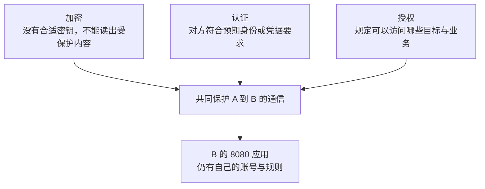

# 12 · 内容、身份与权限是三件事

## 这一章要解决的问题

A 的请求可能经 R 转发到 B。这时，“数据受到保护”究竟指什么？R 能不能读内容？A 是否找对了人？同网成员是不是就能访问所有应用？

这三问需要分别回答。**加密**让没有合适密钥的人难以读出受保护内容；**认证**确认对方持有符合要求的身份或凭据；**授权**决定确认之后允许做什么。读完本章，你要能用自己的话区分它们，不把“开了安全开关”当成所有问题的答案。

## 先回顾两件事

- [第 9 章](/chapters/09-membership)：虚拟地址、节点标识和网络身份承担不同职责。
- [第 11 章](/chapters/11-hole-punch)：连接成功只建立运输条件，不代替目标服务与访问规则。

## 一步一步看

### 第一步：先问谁持有能用的秘密

A、B 是业务网络的正式成员，教程里的 R 也可以是同网普通节点。常见共享密钥配置中，正式节点持有相同的网络密钥。**密钥**是安全机制使用的秘密材料，与容易记忆的网络名称不同。

共享密钥模式把信任放在“哪些人持有共同秘密”上。把主密钥交给访客，会扩大这个信任范围；不能一边把秘密分发给所有人，一边把持有者都当作完全没有相应入网或解密能力的旁观者。

公共共享节点通常与业务网络分开，不需要拿到每个业务网络的主密钥。同网 R 与这种公共节点不是同一个信任位置。讨论中继能看见什么，必须先说明是哪种节点关系、哪种安全模式，不能只说“它在中间”。

### 第二步：加密回答内容怎样受到保护

可以把加密想成按特定规则封好内容，只有符合条件的两端能还原。真实密码学并不是给包贴一个“保密”标签；效果取决于正确的密钥、协议和实现。路径上有人帮忙搬运，也不必然意味着他能读出里面的业务内容。

**端到端加密**表示最终通信两端之间保护内容，中间搬运者不能只凭自己的中继连接密钥解开业务负载。这里的两端是 EasyTier 节点 A、B；如果 B 再访问另一台局域网设备，那段后续通信需要另外判断。

EasyTier v2.6.4 有 `--secure-mode` 安全模式，会单独管理节点间的安全会话，包括中继路径上的目标节点会话与加密处理。因此不能把它说成“只加密 A 到 R、R 到 B，两段一到 R 就必然暴露完整业务内容”。

### 第三步：加密不能凭空回答“对方是谁”

如果 A 与一个假入口协商了加密，它们也能得到一条加密连接。旁观者读不懂，不代表 A 连接的对象就是预期 R。

认证需要一个可信依据。比如提前通过可信渠道得到预期节点的公钥，再要求连接时的身份与它匹配。**公钥**是可以公开的一部分身份材料；关键不是把它藏起来，而是确认最初拿到的是正确对象的公钥。

这类提前固定预期公钥的做法叫公钥锁定。不能从正在怀疑的连接随手获取一把钥匙，再把它当作独立可信依据。安全模式提供相应能力，但单独开启它不等于所有公共入口身份验证都已经完成。

### 第四步：认对了成员，还要限制他能做什么

授权可以在网络、主机和应用等位置执行。例如允许某个成员访问指定服务，并不一定允许它访问 B 的全部端口。网络密钥与网页账号也不是同一个东西；加入虚拟网络之后，应用仍可能要求登录。

访问控制列表常缩写为 **ACL**，就是按条件允许或拒绝流量的规则集合。规则怎样配置属于后续实践，先理解它在回答“可以做什么”，而不是在加密内容或确认身份。

### 第五步：明确保护到哪里就停止了

加密主要保护内容，不会消除通信本身的存在。中间节点和原有网络可能看到外层端点、流量大小、时间或转发所需的信息。它也不能保护已被控制的 A、B：程序收到明文之后，仍可能记录或泄漏。

GUI 显示 `p2p` / UDP，说明的是目标连接状态与传输方式，不是完整安全证明。TUN 的 MTU 数值也不能代替检查加密、身份与权限配置。不要为了观察安全效果关闭现有加密或公开网络密钥。

## 先预测，再观察

**预测：** 浏览器能显示网页文字，而运输时内容受到加密，这是否矛盾？与一个入口建立加密连接，是否已经证明入口身份正确？

**观察：** 使用[观察网页请求预备课](/basics/observe-a-request)的本机演示，浏览器能看到应用收到的内容。然后在纸上写三列：“内容保护”“身份依据”“允许访问的业务”，把网络加密、预期公钥、网页账号分别放入对应列。这个练习不读取秘密、不改变任何 GUI 设置。

**解释：** 应用在通信终点处理明文，与网络运输中的内容保护可以同时成立。三列分别记录不同证据；某一列有内容，不能替其他列做结论。本机回环网页演示本身没有验证 EasyTier 的加密过程。

**不能证明：** [历史 GUI 案例](/cases/local-gui)没有抓取安全握手，也没有核验完整认证配置。本章依据固定版本源码解释能力，不宣称在读者设备上新完成了加密、入口认证或授权测试。

## 常见误解

“只要加密，就一定连接了正确的人”遗漏了身份依据。“知道网络主密钥，就应该允许访问所有业务”遗漏了授权。“内容加密，谁也看不到任何信息”遗漏了外部元数据。

“安全模式等于应用自动使用 HTTPS”也不正确。EasyTier 节点间保护与 HTTP 应用自己的保护属于不同位置。若服务还连接其他设备或数据库，那些路径也要单独考虑。

共享秘密泄露后，不能仅因“已有加密”就认定信任边界仍完好。应按实际模式处理凭据和成员关系，而不是只改一个容易记住的网络名字。

## 两道练习

**练习 1：** A 与假入口建立了一条加密连接，为什么仍需要预先可信的身份依据？

查看练习 1 的答案

加密说明连接内容受到相应保护，不会自动证明另一端就是预期入口。通过可信渠道取得并核对预期身份，才能回答“是不是找对人”。

**练习 2：** A 已经正确入网，B 却拒绝它访问某个应用。是否必然是加密失败？

查看练习 2 的答案

不必然。网络准入与业务授权不同，主机规则、ACL 或应用账号都可能拒绝访问。先找明确拒绝发生的位置，而不是用入网成功代替全部权限判断。

## 进阶阅读

选读：Noise、会话密钥、公钥锁定与临时凭据

v2.6.4 安全模式使用 Noise 协议框架组织握手和安全会话。共享主密钥参与信任关系，具体节点会话可以使用独立密钥；这两者不能一律当成同一把钥匙。实现还处理序号、密钥版本和重放检查。重放是把捕获的包再次发送，不是应用自己正常重试一次请求。

`--secure-mode` 单独启用不等于验证公共共享节点身份。配置可以使用 `peer_public_key` 固定预期公钥；入口需要保存固定私钥，避免重启后身份改变。私钥与入网凭据都不得公开。安全模式还提供有期限和权限限制的临时凭据能力，具体签发、持久化、撤销和版本兼容需要完整部署说明。

Noise 与 WireGuard 的安全协议思想有关，不表示所有 EasyTier 连接都是标准 WireGuard 隧道。EasyTier 的 WireGuard 接入与其他底层传输也应分别讨论。

## 来源与下一章

- [v2.6.4 安全模式 CLI 定义](https://github.com/EasyTier/EasyTier/blob/v2.6.4/easytier/src/core.rs#L685)
- [v2.6.4 Noise 握手实现](https://github.com/EasyTier/EasyTier/blob/v2.6.4/easytier/src/peers/peer_conn.rs#L793)
- [v2.6.4 中继路径会话与加密](https://github.com/EasyTier/EasyTier/blob/v2.6.4/easytier/src/peers/relay_peer_map.rs#L178)
- [官方安全模式说明](https://easytier.cn/guide/network/secure-mode.html)：当前指南可能随版本更新。

下一章：[13 · 直接连接失败后，R 怎样帮忙搬包？](/chapters/13-relay)
