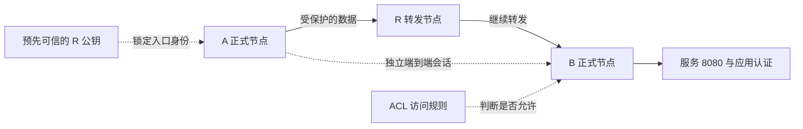

# 12 · 加密、认证与信任边界

## 问题：A 经 R 访问 B，R 能看见什么？

A 用虚拟地址 `10.144.144.1` 访问 B 的 `10.144.144.2:8080`。如果数据经 R `10.144.144.254` 转发，R 就在通信路径上。此时至少有三个问题：R 能否读取网页内容？A 能否确认对端真的是预期节点？进入网络的成员可以访问哪些服务？

这三个问题分别对应**加密、认证、授权**。加密让没有合适密钥的人不能读出受保护内容；认证确认对方持有符合要求的身份或凭据；授权规定认证之后可以做什么。它们互相配合，却不能用一个“安全”开关替代所有层次。

本章固定依据 EasyTier **v2.6.4**。A 物理地址是 `192.168.10.20`，B 是 `192.168.20.30`。外层 A `198.51.100.10`、B `203.0.113.20`、R `192.0.2.10` 均为文档地址，配置仅供阅读，不能直接连接。

## 概念：共享密钥模式的信任范围

在传统共享密钥模式中，正式节点使用相同的 `network_secret`，数据加密密钥与这个共同秘密有关。一个不持有业务网络秘密的公共转发节点，与一个持有主密钥的同网成员，不具有相同的信任地位。

主密钥应当视为整个信任域的敏感凭据。把它交给访客，意味着不能再假定访客只是一个完全没有解密或入网能力的路人。若发生泄露，也不能仅因为“流量经过加密”就认为旧的信任边界仍完好。应限制传播，并结合更细的身份和权限机制。

教程中的 R 是我们管理的同网普通节点，它持有与 A、B 相同的主密钥。社区公共共享节点则通常属于不同网络，不需要持有业务网络的主密钥。两种部署不能混为一谈，更不能把公共节点的身份可信度推导成它“拥有一个公网 IP”。

**端到端加密**是让最终通信两端之间的业务内容受到保护，即使中间有人转发，也不能用自己的中继连接密钥直接读出业务内容。这里的两端是 EasyTier 节点 A、B；如果 B 再代理到另一台局域网设备，那段后续通信需要另外判断。

## 图解：加密、身份与权限分别在哪里？



虚线分别表示会话、信任依据和权限判断，不是额外的物理线路。真正传输依旧使用现有底层连接。ACL 是 Access Control List，即访问控制列表，能按规则允许或拒绝相应通信；服务自身的账号、口令和 HTTPS 等保护仍有各自作用。

## 过程：v2.6.4 安全模式如何改变密钥关系？

v2.6.4 已实现 `--secure-mode`。正式节点可以保留网络名和主密钥，同时启用安全模式。代码使用 **Noise** 协议框架完成握手；Noise 是用于组织密钥协商与认证的成熟协议框架，不是让节点广播明文密码的机制。

安全模式将节点之间的安全会话单独管理，业务节点可以建立独立的端到端数据保护。中继路径也有目标节点会话与加密处理，不只是给 A—R、R—B 两段各加一层、再让 R 解开业务内容。

数据保护还要考虑包被复制后重新发送的风险，这叫**重放**。实现中有序号、密钥版本和重放检查等机制；序号不是用户的网页请求编号，而是安全数据处理的状态。使用 UDP 等可能乱序的底层传输时，这些机制也必须容许合法的乱序包。

这里无需背下 Noise 的全部消息格式。需要记住的是：共享主密钥用于确定信任关系，节点会话密钥用于具体传输，两者不必是同一把钥匙。另一方面，安全模式是否生效、对端是否兼容以及身份是否被验证，都应分别检查。

## 小推演：为什么开启加密还需要锁定 R 公钥？

假设 A 只知道“连接 `192.0.2.10:11010`”。若没有预先可信的身份依据，某个假入口也可以和 A 建立自己的加密连接。包在传输中加密，只能说明旁观者不容易直接读出这条连接，不能证明连接另一端就是你原本想找的 R。

**公钥锁定**就是提前知道预期 R 的公钥，并要求握手中的身份与之匹配。公钥可以公开，关键是首次得到它的渠道应当可信。不能从正在怀疑的连接里随手获取一把钥匙，再把它当作独立验证依据。

下面是 v2.6.4 配置结构示意，不会被本站执行：

```toml
[network_identity]
network_name = "learning-net"
network_secret = "<STRONG_NETWORK_SECRET>"

[secure_mode]
enabled = true

[[peer]]
uri = "tcp://192.0.2.10:11010"
peer_public_key = "<TRUSTED_R_PUBLIC_KEY_BASE64>"
```

R 需要保存固定私钥，避免重启后身份公钥变化导致锁定不匹配。这里的占位符必须替换为正确格式的真实密钥；私钥不能公开分享。`--secure-mode` 单独开启，不等于完成公共共享节点的身份验证。

安全模式还提供临时凭据机制，正式管理节点可以签发有期限和权限限制的入网凭据，避免向每位访客传播主密码。凭据仍是敏感秘密；使用时应关注持久化、期限、撤销和链路版本兼容。完整部署流程应按相应版本文档操作，不能由本章的一段结构示意替代。

## 常见误解：内容加密就没有任何泄露

中继和物理网络仍可能观察外层端点、数据量、时序以及转发所需的元数据。端到端加密主要保护内容，不会把一段通信的存在从网络里抹掉，也不等于匿名通信。

加密也不保护已经被攻陷的 A 或 B。B 的业务程序收到明文后仍可能记录、泄露或被攻击。访问 B 的 `8080` 服务时，如果它再连接数据库，那是另一段通信，需要独立考虑保护。

另一个常见混淆是“WireGuard 等于 EasyTier 的全部协议”。EasyTier 支持多种底层传输，并提供 WireGuard 接入等功能；安全模式中的 Noise 与 WireGuard 所采用的协议思想有关，但不能因此说所有 EasyTier 连接都是标准 WireGuard 隧道。

最后，网络准入与业务授权不同。知道主密钥并入网，不代表应该允许访问所有设备和端口。为 B 的服务设置合适的 ACL、主机防火墙和应用认证，可以使权限边界更具体。共享节点运营者也应控制哪些网络允许使用其转发资源。

## 练习：区分三种保护

**练习 1：** A 与一个假入口建立了加密连接。为什么“能加密”仍不足以证明入口就是 R？

<details>
<summary>展开练习 1 的答案</summary>

加密协商本身不能凭空提供可信身份。需要可信来源的身份依据，如预先锁定的 R 公钥，才能判断自己是否连接预期节点。

</details>

**练习 2：** A—B 端到端内容加密后，R 是否完全看不到通信的任何信息？

<details>
<summary>展开练习 2 的答案</summary>

不是。它仍可能观察转发所需信息、外层连接、流量大小和时间。内容机密性、身份验证、元数据隐私是不同目标。

</details>

## 来源与下一章

- [v2.6.4 安全模式 CLI 定义](https://github.com/EasyTier/EasyTier/blob/v2.6.4/easytier/src/core.rs#L685)
- [v2.6.4 Noise 握手实现](https://github.com/EasyTier/EasyTier/blob/v2.6.4/easytier/src/peers/peer_conn.rs#L793)
- [v2.6.4 中继路径会话与加密](https://github.com/EasyTier/EasyTier/blob/v2.6.4/easytier/src/peers/relay_peer_map.rs#L178)
- [官方安全模式说明](https://easytier.cn/guide/network/secure-mode.html)

下一章回答：[直连失败后，中继究竟怎样传包？](/chapters/13-relay)
