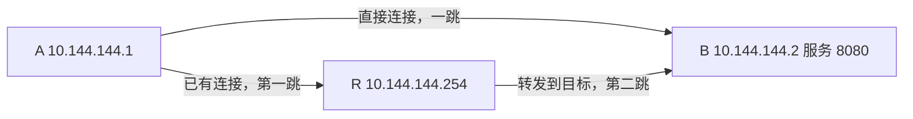

# 13 · 直连与中继各解决什么

## 问题：无法打洞，为什么仍然能访问 B？

A 的虚拟地址是 `10.144.144.1`，B 是 `10.144.144.2`，R 是 `10.144.144.254`。A、B 都能与 R 建立连接，却不能彼此形成直接连接。A 是否还能访问 B 的 `8080` 服务？如果配置和权限允许，答案是可以：R 能沿已有连接转发数据。

**中继**就是由一个或多个中间节点把发往目标的包继续向前传送。它让“双方不能直连”不必直接变成“双方不能通信”。中继增加了路径与资源依赖，但也可以是稳定、可预测的工程选择。

物理地址 A `192.168.10.20`、B `192.168.20.30` 仍在各自局域网中。外层 A `198.51.100.10`、B `203.0.113.20`、R `192.0.2.10` 只是文档示意，不能直接运行。中继没有把 B 的私网地址变成 A 可直接路由的公网地址。

## 概念：三种身份，三种职责

**初始入口**负责提供第一条已知可达连接；**发现与协调**帮助传播节点和候选端点等信息；**中继**实际转发不能或不宜直接运输的数据。这几种职责可以落在同一个 R 上，却不是同一回事。

例如 A、B 先通过 R 认识，之后形成直接连接。R 曾作为入口与协调路径，业务却可以直接传输。相反，已经互相知道地址的两个节点，也可能由于网络限制一直需要中继。不要用“有没有配置 R”推断每一只数据包走哪里。

**P2P** 是 Peer-to-Peer，在这里主要用来指两个目标节点之间的一跳直接连接。它描述 EasyTier 节点关系，不表示底层互联网没有路由器，也不表示物理光纤把两台电脑直接连在一起。

本教程的 R 是同网普通节点，便于理解三节点路径。公共共享节点可以为其他虚拟网络提供发现和转发能力，其网络身份与业务网络分开。是否允许转发、允许哪些网络、是否限流，都由实际配置与权限决定，不能假定所有节点无条件开放资源。

## 图解：同一个目标，两种运输路线



在中继路径中，A 仍然生成目的为 B 虚拟 IP 的业务包。EasyTier 根据内部节点路由决定下一跳是 R。R 读取转发所需的头部，检查目标与转发条件，再经自己的连接交给 B。B 才是最终将内层 IP 包交回本机网络栈的节点。

R 不是 B 的网页应用。它通常无需理解 HTTP 请求中的页面路径，也不因此把 A 的目的地址改成 R 的 `8080`。它处理的是组网协议与转发。子网代理可以有额外的地址转换，后面会单独讲，不能用那套过程替代普通节点中继。

内容能否被中间节点读出，要看所用安全模式和信任关系。上一章说明了 v2.6.4 的独立会话加密，以及同网共享秘密与公共共享节点的不同边界。中继负责运输，并不自动意味着“明文暴露”，也不自动意味着“任何身份验证都已完成”。

## 小推演：中继路径怎样变成直连？

最初 A—R、R—B 两条连接已经建立，A 可以先经 R 向 B 传包。后台打洞若成功，新出现 A—B 一条边，内部拓扑和路由随之更新。下一批数据就可能采用直接路径。这是增加一条可用连接之后的选择变化，不是给应用更换虚拟地址。

如果直连后来失效，且经 R 的路径仍可用，系统可以检测并重新选择路径。检测、信息传播和计算需要时间，切换期间可能出现丢包或短暂中断。不能承诺任何故障都瞬间无感，也不能承诺现有业务 TCP 一定持续不断。

现在只阅读 v2.6.4 的检查方式：

```sh
easytier-cli peer
easytier-cli route
```

`peer` 列表的 `cost` 显示规则在代码中非常明确：最少跳数路径代价为 `1` 时显示 `p2p`，其他情况显示 `relay(n)`。你需要找的是 **B 那一行**。R 那一行显示 `p2p`，只能证明 A 与 R 的直接关系，不能证明 A 与 B 直连。

`route` 会展示目标、下一跳和路径长度。最少跳数路径为一跳时，下一跳显示 `DIRECT`；经过中间节点时则展示下一跳的地址或主机名。v2.6.4 还提供延迟优先路径的相应列，必须结合你启用的策略阅读。

这有一个细节：存在一条直连路径，并不一定意味着启用延迟优先策略的业务始终选它。直连可能跨运营商拥塞，而两跳路径更快。`peer` 的一个简短标签不是逐包追踪记录，想解释实际选择，应结合对应策略的 route 列、连接统计与必要的日志。

表格是某个时刻的状态快照。刚启动、正在重连或拓扑变化时，连续观察可能得到不同结果。教程中的示例输出是说明字段，不能当作你的主机实测证据，也不能凭一张截图证明长期运行质量。

## 常见误解：中继一定慢，直连一定快

中继多了路径段，也受中继带宽、位置、负载和限流影响，常常增加延迟与带宽成本。但是互联网不是按物理直线运输，直接路径可能绕路、丢包或拥塞。优质中继在某些环境中反而提供更好的体验，应看实际指标。

带宽也不能简单相加。A—R 能跑很快，但 R—B 只有较小上限，整条路径仍会受后者约束。许多用户同时使用一个公共 R，还可能分享它的总出口资源。中继不是免费、无限、永远在线的抽象通道。

另一个误解是“有 R 就只有 R 能转发”。去中心化网络可以存在多跳和其他可用节点，路由可以寻找替代路径；是否可用要看连接、转发政策和安全授权。图里只有三台机器，是为了读得清楚，不是协议硬性限制。

如果启用 `--p2p-only`，没有直连时的数据会被丢弃，不再自动采用中继。这个选项表达的是部署偏好，不会提高防火墙允许程度，也不会凭空提高打洞成功率。需要稳定可达的业务应理解其失败行为再选用。

## 练习：正确阅读一条路径

**练习 1：** A 的 peer 列表中，R 显示 `p2p`，B 显示 `relay(2)`。能否说 A—B 已经直连？

<details>
<summary>展开练习 1 的答案</summary>

不能。目标 B 的最少跳数路径仍需两跳；R 的 `p2p` 只描述 A 到 R 的关系。还应结合 B 的下一跳和实际策略读取 route。

</details>

**练习 2：** A—B 直接路径延迟高于 A—R—B。启用延迟优先时，是否一定仍使用一跳？

<details>
<summary>展开练习 2 的答案</summary>

不一定。延迟优先可能选择延迟更低的多跳路径。具体决定来自测量、计算和配置，不能只按节点数量推断快慢。

</details>

## 来源与下一章

- [v2.6.4 README：P2P 失败时中继](https://github.com/EasyTier/EasyTier/blob/v2.6.4/README_CN.md)
- [v2.6.4 中继转发实现](https://github.com/EasyTier/EasyTier/blob/v2.6.4/easytier/src/peers/relay_peer_map.rs)
- [peer 路径标签显示规则](https://github.com/EasyTier/EasyTier/blob/v2.6.4/easytier/src/utils/string.rs#L1)
- [route 输出与两组路径字段](https://github.com/EasyTier/EasyTier/blob/v2.6.4/easytier/src/easytier-cli.rs#L1704)

下一章扩展到更多节点：[大家如何同步拓扑，并选择下一跳？](/chapters/14-topology)
