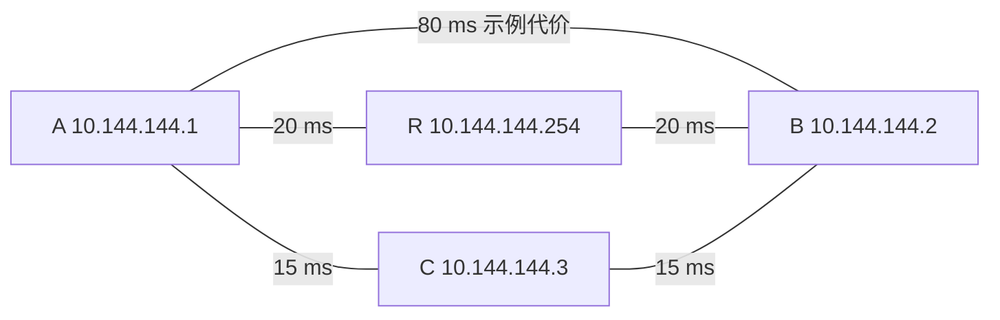

# 14 · 拓扑、选路与故障收敛

## 问题：有多条路径时，A 应该把包交给谁？

A 的虚拟地址是 `10.144.144.1`，要访问 B 的 `10.144.144.2:8080`。现在既有 A—B 直连，也有 A—R—B 和 A—C—B 两条转发路径。R 是 `10.144.144.254`，新增的 C 是 `10.144.144.3`。哪条路径应当使用？

“能到达”与“选哪条”是两个问题。为了选择，节点需要认识当前连接关系，并按照配置的目标比较路径。这个连接关系叫**拓扑**，就是哪些节点之间存在可用连接。它不同于你家中网线怎样插，也不同于运营商骨干路由器的完整地图。

A 物理地址仍为 `192.168.10.20`，B 为 `192.168.20.30`；外层 A `198.51.100.10`、B `203.0.113.20`、R `192.0.2.10` 都是文档地址，不可实际连接。下面的延迟和边只是教学假设，不是实测结果。

## 概念：节点、边、权重和下一跳

把网络画成一张**图**：节点是图上的点，可用连接是点之间的边，衡量连接好坏的数字是**权重**。同一对节点可以存在不同传输方式或多个连接，教学图先把它们概括成一条边，避免一开始就被细节淹没。

**一跳**是经过一条 EasyTier 节点连接。A—B 是一跳；A—R—B 是两跳。这里的跳数不是物理网络 `traceroute` 中的路由器数量。一条 EasyTier 边在互联网中可以经过很多普通路由器，图上不会逐台列出。

**下一跳**是本节点决定首先交包的 EasyTier 节点。A 选 A—R—B 时，下一跳是 R；R 收到包后，仍需根据自己维护的路由决定如何继续到 B。A 无需在每个业务包里装入一整本全网路由说明。

虚拟 IP 先映射到目标节点，然后目标节点映射到下一跳，这是内部选路。操作系统此前已经根据系统路由把包交到 TUN。两层路由分别发生在系统和 EasyTier 中，修改其中一层不能自动修复另一层的问题。

## 图解：一跳不一定比两跳延迟低

纸面上，按最少跳数比较，A—B 用一跳，比另外两条两跳路径少。按图中示意延迟代价相加，A—R—B 得到 `40 ms`，A—C—B 得到 `30 ms`，直接路径则是 `80 ms`。因此最少跳数选择 A—B，示意延迟优先选择 A—C—B。两种目标自然可能给出不同结果。

这些数字只是把同一指标作为边权比较。真实网络的测量有方向、抖动与变化，逐段延迟相加也不能当作应用每次请求的精确耗时。握手、排队、服务处理和丢包重传还会增加时间，带宽更不能这样简单相加。

## 过程：同步拓扑，再计算可用路径

EasyTier 节点交换自己所知的节点信息与连接关系，各自维护网络状态。连接新增、失效或测量发生变化后，信息需要传播到相关节点，再触发路由更新。因此节点具有本地视图，不是随时读取一个绝对即时、绝对完整的中央数据库。

v2.6.4 源码包含最少跳数与最小代价两类路径计算，使用 **Dijkstra** 等图算法。Dijkstra 可以理解为：从本机开始，逐步寻找累计非负代价更小的可达路径，同时记下到目标的第一步。读懂这个目的就够了，不必先掌握算法证明。

最少跳数策略通常先优先较少的跳数，再在相同跳数候选中比较内部代价；避免某些节点承担中继的政策也会影响计算。延迟优先则以相关测量代价比较路径，可以选中更低延迟的多跳路线。它不是承诺永远选择地理距离最近的节点。

实现文件名中有 `peer_ospf_route`，它体现节点拓扑交换与内部路由设计。不要据此说 EasyTier 在物理网卡上加入了运营商的标准 OSPF 域，或要求家庭路由器支持 OSPF。这里讨论的控制信息属于 EasyTier 覆盖网络。

v2.6.4 的 `easytier-cli route` 同时展示最少跳数路径和延迟优先路径的字段。读表时先找到 B，然后看对应配置策略的下一跳、路径长度与延迟，不应把两个策略列中的数值混成一条不存在的路径。

## 小实验：断开一条边会发生什么？

<TopologyLab />

这个面板把可用连接画成图，允许你比较策略、改变连接条件。它是**教学模型**，不连接真实机器，不测量真实延迟，也不复刻 EasyTier 的所有代价政策、同步报文、连接优先级和安全权限。

先保持所有连接可用，比较两种策略：最少跳数选择一跳的 A—B，示意延迟优先选择两跳的 A—C—B。接着保持延迟优先，让 C—B 失效，观察路径改为 A—R—B，示意代价为 `40 ms`。恢复所有连接后，再让 A—B 失效，最少跳数也会改为两跳；模型在同跳数候选中比较延迟，所以选择 C 的 `30 ms` 路径。最后让所有通往 B 的路径断开：路由算法可以选择已有边，却不能凭空生成一条连接。

面板通常立即根据当前图重新计算，而真实软件需要经过检测、传播和更新，这个逐渐形成一致可用路由的过程叫**收敛**。拓扑刚变化时，A 可能仍把包交给 R，R 却已经发现自己不能到 B，于是暂时出现丢包或无路由。

有替代路径时，收敛后可能恢复通信；没有替代路径时，计算再快也无用。即使路由已恢复，应用还可能等待重传、重新连接或超时处理。因此故障恢复既有网络层时间，也有应用层时间，不能只看路由表已经出现 B 就承诺用户无感。

模型中的相等代价如果展示了一条选中路径，那只是为了让结果清楚。真实实现可能根据其他连接状态和内部规则取舍；不要从某个动画总结出“代价相同永远按字母顺序选”。我们需要学会的是读路径与理解约束。

## 常见误解：所有节点必然形成完整网状直连

去中心化网络允许节点平等参与，并不要求任何时刻每一对节点都直接相连。NAT 限制、按需连接、连接策略和资源条件都可能使实际拓扑较稀疏。只要可达的连接形成允许转发的路径，节点仍可能互通。

另一误解是“延迟优先也会自动保证最高带宽、最低丢包”。延迟、带宽、丢包是不同指标，针对一个指标优化不等于所有指标同时最优。持续测量也会有误差和短期波动，实际体验需要结合业务观察。

入口冗余同样需要看连接图。如果 A 配置两个入口，但两者最终都依赖同一个失效节点才能到 B，仍存在共同故障点。仅增加 `-p` 的数量不等于消除所有单点，应追踪从 A 到 B 的完整可用路径。

最后，不能把 `relay(2)` 的数字直接当成延迟倍数。它表示相关路径的跳数信息，而延迟由各段质量决定。路由表告诉我们当前网络视图中的选择，业务流量是否持续成功还需另外验证。

## 练习：在图上选路

**练习 1：** 在图中直接边代价为 `80 ms`，经 C 两段均为 `15 ms`，经 R 两段均为 `20 ms`。最少跳数与示意延迟优先分别选择哪条？

展开练习 1 的答案

在没有额外政策约束的教学假设下，最少跳数选择一跳的 A—B，代价为 `80 ms`；示意延迟优先选择 A—C—B，累计代价为 `30 ms`。这是模型比较，不是对真实应用耗时的保证。

**练习 2：** 延迟优先原来选择 A—C—B。C—B 断开后，A—R—B 仍可用且代价为 `40 ms`。模型会选哪条？为什么真实系统可能仍短暂失败？

展开练习 2 的答案

模型选择 A—R—B 的 `40 ms` 路径，比剩余直连的 `80 ms` 更低。真实系统的故障检测、拓扑传播和路由重算需要时间，各节点可能暂时持有不同视图；应用还可能需要重传或重连。替代路径使恢复成为可能，却不保证瞬时切换。

## 来源与下一章

- [v2.6.4 拓扑同步与两类路由表](https://github.com/EasyTier/EasyTier/blob/v2.6.4/easytier/src/peers/peer_ospf_route.rs)
- [v2.6.4 Dijkstra 与第一跳计算](https://github.com/EasyTier/EasyTier/blob/v2.6.4/easytier/src/peers/graph_algo.rs)
- [v2.6.4 下一跳策略接口](https://github.com/EasyTier/EasyTier/blob/v2.6.4/easytier/src/peers/route_trait.rs)
- [v2.6.4 route 输出字段](https://github.com/EasyTier/EasyTier/blob/v2.6.4/easytier/src/easytier-cli.rs#L1704)

下一章把这些环节串起来：[跟随一只包，完整走过 A 到 B 的去程与回程。](/chapters/15-journey)
