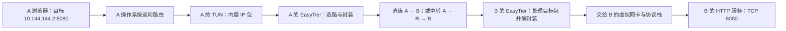

# 15 · 追踪一次完整请求

## 把前面的零件拼成一次访问

现在，A 要打开 `http://10.144.144.2:8080/`。A 的物理地址是 `192.168.10.20`，虚拟地址是 `10.144.144.1`；B 的物理地址是 `192.168.20.30`，虚拟地址是 `10.144.144.2`，其 HTTP 服务监听 TCP 8080。R 的虚拟地址为 `10.144.144.254`，需要时承担中转。

先把条件说清楚：EasyTier 已启动，A 与 B 在同一虚拟网络内，虚拟地址没有冲突，B 的服务确实接受发往虚拟地址的连接。这里只访问数字 IP，因此先跳过 DNS；域名的问题留到[第 17 章](/chapters/17-apps-dns)。

图中的 A 公网 `198.51.100.10`、B 公网 `203.0.113.20`、R 公网 `192.0.2.10` 都来自保留的文档地址段，只用于说明，不能拿来连接真实设备。物理地址是设备在原来网络中的位置，虚拟地址是应用在 EasyTier 网络中使用的位置。它们不是同一地址换了一个名字。

## 去程：先选路，再封装

浏览器要求操作系统建立到 `10.144.144.2:8080` 的 TCP 连接。系统还会分配一个临时源端口，例如教学用的 `50000`。于是内层连接的两个端点是 `10.144.144.1:50000` 和 `10.144.144.2:8080`。这个源端口并非 EasyTier 固定配置，下次访问可能不同。

TCP 通常先完成握手，之后浏览器才发送 HTTP 请求。我们把其中一个内层 IP 包拿出来观察：它的目标是 B 的虚拟 IP。A 的操作系统查询路由表，发现这类目标应交给虚拟网卡，于是把包交给 TUN。TUN 不会自己寻找远方设备；运行中的 EasyTier 进程读取这个包，才开始下一段工作。

EasyTier 根据目的地址找到目标节点及可用路径，再添加自己的封装，交给底层隧道发送。如果采用 UDP 直连，物理网络上看到的是 A 到 B 的 UDP 隧道数据。原来的 TCP 包在里面，浏览器并没有因为外层用了 UDP 就变成 UDP 应用。

这里出现了两套地址。内层回答“哪个应用访问哪个服务”；外层回答“这一段隧道的包交给哪台物理网络设备”。经过家庭 NAT 后，A 的外层源地址和源端口可能变成路由器的公网映射，B 也可能有类似映射。不要把内层的 `50000 → 8080` 当成 NAT 打洞的端口。

如果路径是 A → R → B，A 先向 R 的实际隧道端点发送，R 再向 B 转发。每段外层端点可以不同，但业务的最终目标仍是 `10.144.144.2:8080`。R 的作用不是替 B 的 HTTP 服务回答请求。中转、封装与加密的关系，应结合[第 12 章](/chapters/12-security)和[第 13 章](/chapters/13-relay)理解，而不是从图中一条箭头推断信任关系。

## 到达与回程：响应也要重新选路

B 收到隧道数据后，EasyTier 处理发往自身的业务包，将其交给虚拟网卡和操作系统网络栈。系统发现目标地址属于本机，再按 TCP 目标端口把数据交给监听 8080 的进程。如果服务只监听 `127.0.0.1:8080`，即使隧道正常，这一步也可能失败。

B 的服务读取 HTTP 请求，产生响应。响应的内层源端点变成 `10.144.144.2:8080`，目标端点变成 `10.144.144.1:50000`。B 的系统再次查询路由，再经 TUN 和 EasyTier 发回。回复不是自动沿着图中箭头倒退：它同样需要可用路由、正确的过滤规则和工作的隧道；实际去程与回程也不必完全对称。

响应可能被拆成多个 TCP 段。接收端根据序号重组，丢失时还涉及确认与重传。一次网页成功，只能说明这次请求所依赖的链路和服务工作了，不能证明所有协议、所有网段、任意包大小都正常。

把整条路径记成三次交接很有帮助：应用交给操作系统；操作系统交给 TUN 与 EasyTier；目的端再交还操作系统与应用。每次交接都带着明确的目标，排障时就能问“包到了哪一次交接”，而不是只问“VPN 有没有开”。

还可以分别观察三个位置：在 A 的虚拟接口看业务目标，在 A 的物理接口看实际隧道端点，在 B 的服务日志看应用是否收到请求。它们显示不同信息是正常现象。不能因为物理网卡抓不到明文 HTTP，就判断浏览器没有发出请求；也不能因为看到隧道字节增加，就断定其中一定包含本次 HTTP 请求。节点还可能在交换控制信息，观察时需要关联时间、目标和服务日志。

## 小实验：跟随一个包

<PacketJourney />

先选直连，逐步走完请求与响应，分别指出业务地址和隧道地址。再切换中转，观察 R 出现在哪些步骤，以及最终服务端点有没有改变。演示使用确定的教学模型，不建立真实隧道、不发真实网络包，也不是 Wireshark 抓包结果。

最后暂时不看图，自己复述：“A 为什么把包送入 TUN？R 为什么没有接管 TCP 8080 服务？B 为什么还需要回程？”如果只能背出设备顺序，却讲不出每段使用什么地址，可以回到[虚拟网卡](/chapters/07-tun)和[拓扑选路](/chapters/14-topology)重新连接这些概念。

## 三个容易混淆的地方

“目标是虚拟地址，所以公网不参与”不成立。虚拟地址用于选择业务目的地，物理网络仍负责搬运封装后的数据。互联网中间路由器通常并不靠 B 的虚拟 IP 为这一层外部数据选路。

“使用公共节点进入网络，所以所有请求都经过它”也不成立。进入网络的初始连接与后续 A、B 的数据路径是两个问题，要查看目标 B 的当前状态。

“ping 成功，所以 HTTP 一定成功”同样不成立。ping 检查的是 ICMP 往返；HTTP 还要求 TCP 连接、8080 监听、允许访问的规则和应用处理。它们共享部分路径，但成功条件不完全相同。

## 练习与答案

1. A 经 R 访问 B 时，内层 HTTP 请求的目标应写 `10.144.144.254:8080` 还是 `10.144.144.2:8080`？为什么？

第 1 题参考答案

应写 B 的 `10.144.144.2:8080`。R 是隧道路径上的转发节点，外层某一段可以发往 R，内层业务服务仍在 B。

2. B 的虚拟 IP 能 ping 通，浏览器却提示连接被拒绝。你会先检查哪一次交接？

第 2 题参考答案

先检查 B 的操作系统到应用这次交接：服务是否启动、是否监听 TCP 8080、监听地址是否包含 B 的虚拟地址。连接被拒绝通常意味着收到明确拒绝，仍需结合防火墙与日志判断；它不是“服务一定没启动”的绝对证明。

## 来源与继续学习

- [EasyTier v2.6.4 README：组网与节点查询](https://github.com/EasyTier/EasyTier/blob/v2.6.4/README.md)：固定版本的操作依据。
- [v2.6.4 虚拟网卡实现](https://github.com/EasyTier/EasyTier/blob/v2.6.4/easytier/src/instance/virtual_nic.rs)与[节点实例](https://github.com/EasyTier/EasyTier/blob/v2.6.4/easytier/src/instance/instance.rs)：TUN 与节点处理的实现入口。
- [RFC 9293：TCP](https://www.rfc-editor.org/rfc/rfc9293)及[RFC 5737：文档 IPv4 地址](https://www.rfc-editor.org/rfc/rfc5737)：通用原理与教学地址约束。

下一章把目标从 B 本机扩展到[远端局域网设备](/chapters/16-subnet-proxy)。
