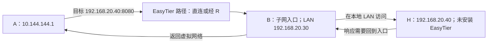

# 16 · 访问远端整个局域网

## B 通了，为什么 B 身后的设备还不通

A 已能访问 B 的 `10.144.144.2:8080`，现在想访问 B 局域网中的另一台设备 H，比如 `192.168.20.40:8080`。H 没安装 EasyTier，也不知道虚拟网络是什么。B 的物理地址是 `192.168.20.30`，它能从本地访问 H；A 的物理地址是 `192.168.10.20`，无法仅靠两个私网地址隔空连接。

节点间互通只建立了 A 到 B 的路径，还没有说明发往 `192.168.20.40` 的包应该进虚拟网，更没有说明 B 如何帮它访问 H。这就是子网代理要补上的边界：把某节点能够访问的网段，通过这个节点开放给虚拟网络中的其他节点。

贯穿案例中的公网 A `198.51.100.10`、B `203.0.113.20`、R `192.0.2.10` 均为文档保留地址，不能用于真实连接。R 的虚拟地址仍为 `10.144.144.254`；是否经 R 中转不会改变本章对子网入口 B 的要求。

## 发布网段只是第一步

在 v2.6.4 中，B 可以用 `-n 192.168.20.0/24` 发布这个子网。它的含义是“这段地址可以由我代理”，不是为所有 LAN 设备安装 EasyTier，也不是把 B 的物理网卡变成虚拟网卡。应把这个参数加入 B 原有的完整启动配置，保留网络名、密钥、虚拟地址和初始连接设置。

随后，子网信息传播到其他节点。通常，A 会获得把相应网段交给虚拟网络的路由。用 `easytier-cli route` 检查 `proxy_cidrs` 中是否出现目标子网，再检查本机系统路由是否匹配。EasyTier 的网络路由信息与操作系统的实际路由表相互关联，但不能当成同一张表。

发布成功也不等于服务成功。B 必须自己能到达 H，H 的服务必须监听可访问地址，B 到 H 的实际网络和过滤规则必须允许所用协议。若 B 本机都访问不到 H，应先解决这个本地问题，不能期待 A 的虚拟网络替它补齐。

## 默认模式：内置 NAT 帮忙处理回程

v2.6.4 默认启用内置子网代理/NAT。以 TCP 服务为例，B 的代理接受来自虚拟网络的流量，再从 B 发起面向 H 的本地连接，并维护对应关系。H 通常看到的是 B 在这条 LAN 路径上使用的源地址，例如 `192.168.20.30`，而非 A 的 `10.144.144.1`。实际源地址还取决于 B 的本地选路和接口。

因此 H 回答 B 就可以，通常无需给 H 或其网关另外配置虚拟网段的回程路由。B 再利用代理状态把结果返回 A。这解释了为什么一台普通电脑也能当子网入口，不一定必须把 EasyTier 安装在家庭路由器上。

代价是 H 未必能根据网络层源 IP 区分 A 与其他访问者。应用日志可能都记录为 B，依赖来源地址的白名单也应按实际观测配置。应用自己的账号仍然有价值，它能识别用户，而内置 NAT 不能替代这种身份验证。

这里的“内置 NAT”是功能层面的名称。v2.6.4 为 TCP、UDP、ICMP 提供相应代理处理，不应理解成任意 IP 协议、任意二层广播都能原样穿过。某些自动发现协议和携带地址信息的应用，还需要另行验证。

## 系统模式：把转发责任交给操作系统

启用 `--proxy-forward-by-system` 后，普通 TUN 场景中的子网数据转发交给系统内核，关闭该模式下的内置 NAT。此时不能再假定 B 自动替你解决回程。需要确认系统 IP 转发已开启、相关转发链允许流量、路由正确，而且返回流量也知道怎样回到 A。

假设没有另外设置系统源 NAT，H 会看到请求来自 `10.144.144.1`。H 发现它不在本地网段，可能把响应交给默认网关。但默认网关若不知道 `10.144.144.0/24` 应经 B 的 `192.168.20.30` 返回，响应就走错了。这时可在合适的网关上配置回程路由，或根据明确设计配置系统 NAT；两种方法的来源地址效果不同。

所以这个参数不是“打开后更快”的通用按钮。它选择了另一种系统边界：EasyTier 负责带包到入口，操作系统和 LAN 路由设计负责继续转发与返回。具体系统配置取决于 Linux、Windows、macOS 和网络环境，本教程不提供可盲目套用的全局转发命令。

## 小实验：在纸上找回程

画出 A、B、H 与 H 的默认网关。先模拟默认内置 NAT：在 H 旁写“收到来自 B 的连接”，把响应画回 B。再模拟系统转发且不做源 NAT：改写为“收到来自 A 虚拟地址”，沿 H 的路由画回复。

当回复走到默认网关时停一下，问它是否知道虚拟网段在哪里。如果不知道，在图中明确标出缺失的回程路由。这个实验无需修改真实路由器，却能解释“去程抓到了包，访问仍然超时”的常见现象。真实部署时应记录修改前后的路由，结束后只撤销实验新增的规则。

还要检查地址重叠：若 A 本地也有 `192.168.20.0/24`，相同数字可能指向两个不同的 LAN。自动发布不会消除歧义，要规划不重叠的地址或研究版本支持的网段映射，不能把更改路由优先级当作永远正确的解决办法。

## 常见误解

子网代理不是把服务搬到 B，也不是默认把整个互联网改走 B。发布的网段应明确、尽量小；只需要一台 H 时，可以研究 `/32` 的单地址发布。出口节点是另一个用途，不应顺手开启。

“默认 NAT 不需要回程配置”也不意味着没有回程。回程由 B 的代理状态和本地连接承担；B 的本地网络、服务规则与代理进程仍必须正常。发布一个自己无权开放的 LAN，也不会因为技术上可行就成为合理配置。

## 练习与答案

1. 默认代理下，H 为什么通常无需知道 A 的虚拟 IP？这种便利会怎样影响 H 的访问日志？

第 1 题参考答案

B 维护代理关系并从本地访问 H，H 通常把 B 当作网络层来源。回复 B 即可，但日志可能无法直接区分多个虚拟网访问者。

2. 系统转发模式下，H 已收到来自 `10.144.144.1` 的请求，却把回复送向普通默认网关。应检查什么？

第 2 题参考答案

检查 H 或其网关到虚拟网段的回程路由是否经 B、B 的系统转发与过滤规则是否允许返回流量，以及是否另外设计了系统 NAT。不要只重复修改 A 的去程路由。

## 来源与继续学习

- [v2.6.4 README：Subnet Proxy](https://github.com/EasyTier/EasyTier/blob/v2.6.4/README.md)：`-n` 与路由查询。
- [v2.6.4 参数定义](https://github.com/EasyTier/EasyTier/blob/v2.6.4/easytier/src/core.rs)、[参数说明](https://github.com/EasyTier/EasyTier/blob/v2.6.4/easytier/locales/app.yml)与[IpProxy 实例](https://github.com/EasyTier/EasyTier/blob/v2.6.4/easytier/src/instance/instance.rs)：系统转发开关与默认代理。
- [v2.6.4 TCP 子网代理](https://github.com/EasyTier/EasyTier/blob/v2.6.4/easytier/src/gateway/tcp_proxy.rs)：本地目标连接的实现。
- [当前官方子网代理指南](https://easytier.cn/guide/network/point-to-networking.html)：补充阅读，可能随新版更新。

接着学习[服务监听、DNS 与权限](/chapters/17-apps-dns)，把“网络可达”落实到“应用可用”。
