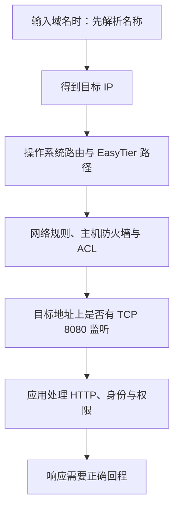

# 17 · 网络通了，应用为什么还不通

## 同一条网络，也可能出现不同结果

A 的物理地址是 `192.168.10.20`，虚拟地址是 `10.144.144.1`；B 分别是 `192.168.20.30` 和 `10.144.144.2`。现在 A 能 ping B，却打不开 B 的 HTTP 8080。换成域名又出现“无法解析”。这并不矛盾：应用访问要通过几道关，ping 只检查其中一部分。

R 的虚拟地址 `10.144.144.254` 是否参与中转，也不改变服务所在位置。A、B、R 的公网教学地址分别为 `198.51.100.10`、`203.0.113.20`、`192.0.2.10`，属于文档保留段，不能用于执行实验。

最有效的做法是先固定一个简单目标：`http://10.144.144.2:8080/`。暂时避开域名、HTTPS、反向代理和登录跳转，确认数字 IP 下的基础服务后，再逐项加回。否则一次“打不开”会混合多个独立故障，很难知道改动有没有作用。

## 服务监听决定包能交给谁

“监听”是进程告诉操作系统：我愿意在某个本地地址、某种协议、某个端口接收新连接。B 的 HTTP 服务若只监听 `127.0.0.1:8080`，它接受的是 B 本机回环接口的访问。A 发往 `10.144.144.2:8080` 的包不会因此自动变成发往 `127.0.0.1:8080`。

监听 `10.144.144.2:8080` 可以把范围限定到虚拟地址，但必须等地址已存在时再启动。监听 `0.0.0.0:8080` 一般表示接受所有本机 IPv4 地址上的这类连接，可能也包括 B 的物理 LAN 接口；范围更广，应结合防火墙和应用权限控制。`0.0.0.0` 是监听配置中的通配地址，A 仍应访问 B 的实际虚拟 IP。

还要核对 TCP 与 UDP。一个 UDP 8080 监听不能接受 TCP HTTP 连接；外层 EasyTier 隧道使用 UDP，也不会改变内层 HTTP 使用 TCP 的事实。IPv4 的通配监听与 IPv6 的 `::` 是否同时涵盖另一类地址，还取决于系统及应用设置，不能仅看到“8080”就判定监听正确。

在 B 上先访问服务本身，是重要的对照。B 的 `127.0.0.1` 访问成功，只证明回环路径和应用处理工作；还应访问 B 的虚拟 IP，观察监听和本机规则是否适配。然后才从 A 访问同一个目标。

## DNS 只负责找地址，不负责打通连接

为了便于记忆，可以在教学中把 `b.lab.test` 对应到 `10.144.144.2`。`.test` 是保留的测试名称，这里只是一个假定映射，不会因为阅读页面就自动在系统 DNS 中生效。输入这个名称时，系统或应用先询问解析器，拿到 IP 后才建立连接。

所以要区分三种结果。无法解析，先看名称、DNS 服务器及查询路径；解析成错误 IP，先看记录、缓存与使用的解析器；解析成正确 IP 但连接失败，就继续看路由、监听、规则和应用。反复换 DNS 不能修好 B 没启动服务的问题。

v2.6.4 提供 `--accept-dns` 魔法 DNS 选项，参数说明使用 `<hostname>.et.net` 访问其他节点。这是额外的名称解析能力，并非所有设备连接 EasyTier 后都会自动拥有任意域名记录。系统 DNS 配置、节点主机名及所用版本也影响结果；启用前应阅读对应平台说明，记下原有 DNS 设置。

普通 LAN 自动发现又是另一回事。有些软件靠广播、组播或专用发现协议寻找设备。三层虚拟网络能访问一个 IP，不保证应用的自动发现自然成功。初次排查可在应用中手动填写明确地址，先验证连接，再考虑发现协议。

## 规则与应用权限是不同的门

主机防火墙可以允许某来源访问 TCP 8080，同时阻止其他连接。路由器规则影响的是经过它的物理流量；B 的主机规则影响到达 B 的业务流量。允许外层 EasyTier 监听端口，并不等于允许内层 TCP 8080，这两种端口服务不同目的。

ACL 是访问控制列表：按来源、目标、协议、端口等条件决定允许或拒绝。EasyTier 也有自身的 ACL 实现。具体规则格式与默认行为应按版本配置核对，本章不假定“加入同一网络就拥有所有权限”。规则也可能用于子网代理转发，而不只是节点本机应用。

网络层允许之后，应用还可能要求登录、授权或可信的请求主机名。收到 HTTP `401`、`403`，甚至正常的 `404`，与完全无法建立连接是不同阶段：它表明某个 HTTP 服务已回答，但业务请求未必成功。开启隧道加密不能替代应用账号，也不应为排障全局关闭防火墙。

## 小实验：用结果定位阶段

不修改系统，先写一张四行观察表：数字 IP 可否连；域名能否解析；解析结果是什么；HTTP 得到什么状态。依次模拟“名称不存在”“正确 IP 上没有监听”“服务答复 403”“服务答复 200”，为每个结果圈出图中的阶段。

真实实验时按[第 20 章](/chapters/20-practice)启动一个只绑定 B 虚拟地址的临时 Python 服务。先从 B 自测，再从 A 访问数字 IP，最后才研究域名。只在明确需要时添加限制来源、接口和端口的允许规则，并记录以便撤销。不要把敏感目录作为临时文件服务的根目录。

## 常见误解

“网页有回复就证明连接到了我想找的服务”并不充分。地址冲突、错误 DNS 或反向代理都可能让另一个服务回答。应核对目标地址、服务内容和日志。

“网络密钥就是 HTTP 密码”也不成立。前者用于虚拟网络的成员关系与相关安全机制，后者由应用验证，作用范围不同。共享给节点的密钥也不应写在网站公开示例中。

“所有网卡监听最省事”会扩大可访问面。实验中知道访问从哪个接口进入，就应优先采用能满足目标的具体绑定；某些应用确需通配监听时，再明确设计允许来源。

## 练习与答案

1. B 上 `http://127.0.0.1:8080/` 成功，A 访问 B 虚拟 IP 失败。这能证明 EasyTier 一定有问题吗？

第 1 题参考答案

不能。先确认服务是否仅监听回环地址，再检查虚拟地址监听、主机防火墙与 ACL；随后结合 EasyTier 状态检查网络路径。回环成功只排除了部分应用问题。

2. `b.lab.test` 解析为正确虚拟 IP，访问收到 403。应首先重试 NAT 打洞还是查看应用规则？

第 2 题参考答案

先查看应用或前置代理的授权与访问规则，同时确认回答来自预期服务。403 已是 HTTP 层的明确答复，重新打洞通常不能改变该权限判断。

## 来源与继续学习

- [v2.6.4 参数说明：accept_dns](https://github.com/EasyTier/EasyTier/blob/v2.6.4/easytier/locales/app.yml)与[DNS 实现目录](https://github.com/EasyTier/EasyTier/tree/v2.6.4/easytier/src/instance/dns_server)：固定版本的名称解析入口。
- [v2.6.4 ACL 处理](https://github.com/EasyTier/EasyTier/blob/v2.6.4/easytier/src/common/acl_processor.rs)：访问控制实现依据。
- [RFC 1034：DNS 概念](https://www.rfc-editor.org/rfc/rfc1034)、[RFC 2606：保留测试域名](https://www.rfc-editor.org/rfc/rfc2606)及[RFC 9110：HTTP 语义](https://www.rfc-editor.org/rfc/rfc9110)：通用协议原理。
- [当前官方魔法 DNS 指南](https://easytier.cn/guide/network/magic-dns.html)与[ACL 指南](https://easytier.cn/guide/config/acl.html)：补充阅读，系统支持和配置可能随新版变化。

下一章解释[连接成功却不够快](/chapters/18-performance)的问题。
