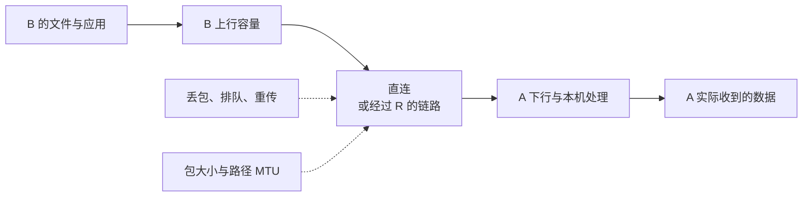

# 18 · 延迟、丢包与 MTU

## 这一章要解决的问题

网页能打开，却要等很久；小文件正常，大文件时快时慢。此时“通不通”已经不足以描述现象，要继续问：等待发生在哪一段、谁的发送能力有限、是否有包丢失、包是不是太大。

本章仍以 A 的虚拟 IP `10.144.144.1` 下载 B `10.144.144.2:8080` 的文件为例，可能直连，也可能经 R `10.144.144.254`。A、B 的原有网络 IP 是 `192.168.10.20`、`192.168.20.30`。这里的速度和延迟数字都是推演条件，不是替你的 EasyTier 进行了测速。

初学阶段不急着开加速选项或改 MTU。先能分清四个指标，再观察已有记录；修改配置应留到有基线、能对照、能恢复的时候。

## 先回顾两件事

第一，浏览器的一次请求有多个阶段。建立连接、等待服务生成响应、接收响应，都可能花时间。[观察一次请求](/basics/observe-a-request)里的 Network 时序能帮助区分阶段，但不是直接显示 EasyTier 每段隧道耗时的仪器。

第二，去程与回程都要工作，且中继可能增加路径。A 下载 B 的文件，主要数据从 B 发向 A，因此要看 B 的上传条件，而不是只看 A 宽带宣传的下载数字。

需要回查时，可读[端口和传输协议](/chapters/04-protocols)和[完整往返](/chapters/15-journey)，再继续下面的观察。

## 一步一步看

### 1. 延迟回答“要等多久”

RTT 是一次往返时间：发出探测后，到收到对应回应经过多久。它包括两个方向及相关处理，不能不加条件地除以二当成真实单向延迟。短小交互往往很在意等待，例如远程按下按钮后多久看到反馈。

[实机案例](/cases/local-gui)中的四次 ping RTT 分别为 118.798、17.790、31.675、25.961 ms。平均值不能消除每次的差异；第一包较高也不能单靠这个数字断言“在打洞”或“经中继”。GUI 延迟又有自己的测量方式，应分列记录。

### 2. 带宽与吞吐量回答不同问题

带宽可以先理解为链路能搬运数据的容量；吞吐量是某段时间实际搬完的数据量。类比一条路的通行能力与实际送到的货物，能帮助区分这两个数字，但真实网络还有协议开销、拥塞控制和处理能力，不能简单按车道数直接算下载速度。

假设 B 上行只有 10 Mbps，A 下行有 1 Gbps，A 下载 B 的文件仍可能受 B 上行限制。Mbps 的 b 是比特，MB/s 的 B 是字节，一字节是八比特；换算后还要扣协议开销。不要把两个单位直接比较后宣称“少了八倍”。

经过 R 时还可能受到 R 与两端链路、资源和拥塞的约束。CPU、加密、磁盘和服务处理也会影响最终速度。看到速度低不能立即归因于某种 NAT，更不能用更快的本机回环网页来代表跨网吞吐量。

### 3. 丢包会带来额外等待

包没有按预期到达，就是丢包的线索。TCP 会重传未确认的数据，同时按拥塞控制调整发送；应用可能因此等待。原因可能是无线条件、拥塞、规则、路径变化或包大小限制，不能只从丢包百分比确定发生在哪一处。

四次 ping 都回应，只说明那四次没有观测到丢失，不代表长期丢包为零。GUI 的 4% 和一次四包 ping 的 0.0% 可以同时存在：窗口和统计口径不同。测试要保留次数、时段、方向和协议，数字才能被正确解释。

### 4. MTU 回答“这段路能放多大的 IP 包”

MTU 是接口或路径能承载的 IP 包大小上限，通常用字节计。原来的包加上隧道外层说明以后会变大，沿途最小的一段可能放不下。处理可能涉及分片或调整大小的反馈；如果必要反馈受阻，就可能出现小请求正常、大响应停住。

v2.6.4 默认配置 `mtu` 为 1380，普通 TUN 实现在启用加密时再减 20，因此默认加密情况下实际接口可能显示 1360。[实机案例](/cases/local-gui)也观测到 1360。参数值与接口最终值不是总能直接画等号，单看这个数也不能证明全部安全配置。

小 ping 只测试了小包，不能排除大包问题。但“大文件慢”也不自动等于 MTU 错误。先记录原值和现象，不照着本书数字修改正在使用的 GUI；过小 MTU 会增加包数和处理开销，也不一定更好。

## 先预测，再观察

**预测：**在[拓扑选路实验](/labs)中，直连演示延迟 80 ms，而经 C 两段合计 30 ms。最少跳数与最低演示延迟会选同一路径吗？

**观察：**分别选择两种指标，记录所选路径，再关闭 C—B，看最低延迟模式怎样改选。随后读实机四包结果，指出 RTT 的最小、最大和平均值，写出这些数字没有测量哪项能力。

**解释：**少一跳不总意味着等待最短；低 RTT 也不代表最高吞吐量。路径指标和下载方向各自回答不同问题，不宜混成“速度好不好”一个结论。

**边界：**模型延迟直接相加、立即重选，真实网络有排队和收敛。已有四包结果不是带宽压测。本章不运行压测、不触碰现有节点，只训练根据证据提出假设。

## 常见误解

“直连一定最快”忽略了底层绕行、拥塞和资源。直连减少中继依赖，但某时刻的中继路径可能有更低 RTT。

“ping 很快就一定下载快”混淆等待与容量。文件传输还受发送侧上行、接收侧下行、丢包和应用处理限制。

“打开所有代理选项总会更快”缺少对照。重传机制也会耗费带宽和 CPU；物理容量已经饱和时，更积极重传可能增加拥塞。先固定一个目标、文件、方向与时间窗口，一次改变一个条件。

## 两道练习

1. B 上行 10 Mbps，A 下行 1 Gbps，A 下载 B 很慢。已知条件中该先关注哪一侧？

第 1 题参考答案

先关注 B 的上传能力和实际路径；A 的下行容量不能让 B 发送超过自身能力。还要核对单位、其他流量及应用处理，不仅凭一组宣传数字确定全部根因。

2. 小 ping 正常，大响应停住。是否可以排除 MTU 问题？

第 2 题参考答案

不能。小包未测试封装后的大包是否能通过路径最小 MTU。它只是一个待进一步验证的假设，还要排除丢包、限速和服务处理等其他可能。

## 进阶阅读

KCP、QUIC 代理与可归因的性能对照

v2.6.4 的 `--enable-kcp-proxy`、`--enable-quic-proxy` 为虚拟网络内 TCP 流提供其他搬运方式；目的端有 `--disable-kcp-input`、`--disable-quic-input` 等控制。目的端接受能力及构建特性影响结果，参数存在不代表已产生代理连接。

KCP、QUIC 有各自可靠传输策略和成本，不等于 NAT 打洞，也不把所有 UDP 应用变成它们。QUIC 代理不代表浏览器自动使用 HTTP/3；隧道 QUIC 与 QUIC 代理也位于不同层。UDP 完全受阻时不会因某个代理开关凭空通行。

如需实际对照，使用同一非敏感文件，固定方向，记录路径，重复小规模测量，再只改一项并保留恢复方法。不要同时开两个代理、关闭加密或改多个 MTU 值，否则难以判断原因。

公网教学端点 `198.51.100.10`、`203.0.113.20`、`192.0.2.10` 不用于测速或连接。

## 来源与下一章

- [v2.6.4 默认配置](https://github.com/EasyTier/EasyTier/blob/v2.6.4/easytier/src/common/config.rs)、[TUN MTU 设置](https://github.com/EasyTier/EasyTier/blob/v2.6.4/easytier/src/instance/virtual_nic.rs)及[参数说明](https://github.com/EasyTier/EasyTier/blob/v2.6.4/easytier/locales/app.yml)：默认值、加密调整与代理选项。
- [v2.6.4 KCP 代理](https://github.com/EasyTier/EasyTier/blob/v2.6.4/easytier/src/gateway/kcp_proxy.rs)及[QUIC 代理](https://github.com/EasyTier/EasyTier/blob/v2.6.4/easytier/src/gateway/quic_proxy.rs)：实现入口。
- [RFC 1191：路径 MTU 发现](https://www.rfc-editor.org/rfc/rfc1191)、[RFC 9000：QUIC](https://www.rfc-editor.org/rfc/rfc9000)及[当前官方代理指南](https://easytier.cn/guide/network/kcp-proxy.html)：通用原理与会更新的补充资料。

下一章建立[逐层排障流程](/chapters/19-diagnostics)。
