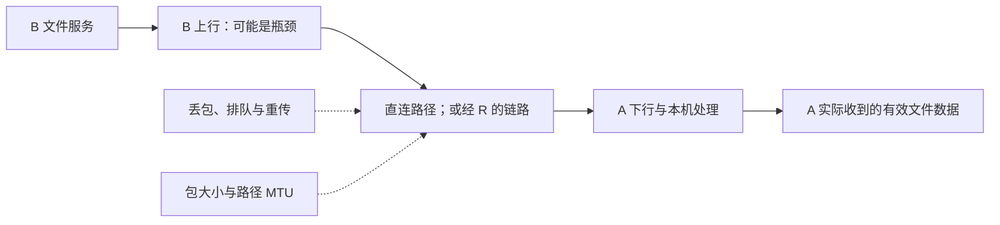

# 18 · 延迟、丢包与 MTU

## 为什么 ping 很快，下载却很慢

A 从 `10.144.144.1` 访问 B 的 `10.144.144.2:8080`，小网页能打开，大文件却慢，甚至停住。A、B 的物理地址仍为 `192.168.10.20`、`192.168.20.30`；路径可能直连，也可能经过虚拟地址 `10.144.144.254` 的 R。不要把“能建立连接”当成“所有包都能高效通过”。

公网教学地址 A `198.51.100.10`、B `203.0.113.20`、R `192.0.2.10` 是保留文档地址，不能执行连接。本章的数字用于说明关系，不是 EasyTier 的性能承诺，也不是对你的网络进行了测速。

先拆开四个指标：延迟描述等待多久，带宽描述链路容量，吞吐量描述实际完成多少有效数据，丢包率描述发送的数据有多少未到达。它们互相影响，但不能用一个 ping 数字概括。ping 显示的通常是一次往返时间 RTT，不等于单向传输时间，更不直接代表文件吞吐量。

## 路径与瓶颈：多跳不一定更慢

假设直连路径 RTT 为 80 毫秒，经 C 的两段路径合计约 30 毫秒，绕行可能反而更快。真实网络还存在排队、链路波动与测量误差；[拓扑演示](/labs)里的简单求和只是帮助理解路径指标。最少跳数和较低延迟是不同目标。

下载还要看方向。A 下载 B 的文件，主要消耗 B 的上传能力和 A 的下载能力；经 R 时，还受到 R 与两端链路的约束。B 上行只有 10 Mbps，即使 A 下行是 1 Gbps，也不能因此让 B 发得更快。若用 MB/s 显示速度，要记得一字节是八比特，协议开销还会降低有效数据比例。

CPU、加密、磁盘和应用处理也可能成为瓶颈。检查网络时，应使用大小明确、内容无敏感信息的同一测试文件，记录方向和耗时。改变多个选项后看到速度变化，很难归因；应一次只改变一个条件。

## MTU：封装后，包比原来大

MTU 是某接口或路径能承载的 IP 包大小上限，通常以字节计。一个原始 IP 包进入隧道后，还会增加外层协议与 EasyTier 的相关开销。因此内层包能塞进虚拟接口，不代表封装后一定能塞进实际链路的每一段。

路径上的小 MTU 可能触发分片、需要调整包大小的反馈，或在反馈被过滤时导致大包失败。表现常是“小请求成功，大响应停住”。小 ping 只走过了小包，不能排除 MTU 问题；也不能把所有下载慢都归结为 MTU，丢包、限速与服务处理都可能产生相似现象。

v2.6.4 的配置 `mtu` 默认值为 1380；在普通 TUN 实现中，启用加密会再减 20，实际设置为 1360。加密默认启用，所以本教程不把“默认 MTU 是 1380”当作完整结论。`--mtu` 参数与最终系统接口显示值可能因此不同，应核对启动配置和虚拟网卡状态。

排查时可以先记录原值，再按平台方法测试不同包大小，必要时适当降低虚拟网卡的配置值重新验证。不要猜一个对所有协议和链路都正确的固定开销；不同封装、IPv4/IPv6 和底层路径可能不同。盲目把 MTU 设得很小也会增加包数和处理开销，不能当作长期性能方案。

## KCP 与 QUIC 代理：改变 TCP 流的搬运方式

TCP 遇到丢包会重传，并根据拥塞控制调整发送。高延迟与丢包叠加时，应用可能等待很久。EasyTier 的 KCP、QUIC 代理为虚拟网络内的 TCP 流提供另一种传输方式；这不同于 NAT 打洞，也不同于把所有 UDP 应用流量改成 KCP 或 QUIC。

v2.6.4 存在发起端选项 `--enable-kcp-proxy`、`--enable-quic-proxy`，以及目的端禁用输入选项 `--disable-kcp-input`、`--disable-quic-input`。目的端是否接受、构建是否包含相应能力都会影响结果。查看实际代理连接状态，比只看到启动参数更可靠。

KCP 的重传策略可以在某些丢包网络中改善等待，但重传也消耗带宽和处理资源。QUIC 有自己的可靠传输、流控制与拥塞控制机制，实际表现取决于实现、路径及工作负载。官方指南介绍了它们在丢包环境中的用途，但不能据此承诺“开启就更快”。

若 UDP 被完全阻断，代理机制不会凭空让 UDP 通行；若物理链路容量已饱和，更积极地重传可能增加拥塞。先定位路径、丢包与容量，再做单独对照。初次实验不要同时开启两个代理，也不要为性能测试关闭加密；先保留清楚的基线，才能判断改动是否有价值。

## 小实验：设计一个能归因的对照

在纸上列三组结果：小 HTTP 请求、大文件、相同方向的 RTT。假设小请求稳定、大文件失败，先提出 MTU 假设；假设所有请求都间歇等待且有明显丢包，提出链路或重传假设；假设速度稳定但接近 B 的已知上行容量，提出容量瓶颈假设。

实际测试时先记录目标 B 当前是直连还是中转，保持文件、方向、时间窗口尽量一致。测三次而不是依赖一次偶然结果；再只改一个选项，观察耗时、稳定性和资源使用。浏览器里的[三种演示](/labs)只提供模型，不是吞吐量基准，也不会模拟真实拥塞控制算法。

## 常见误解

直连减少中转依赖，却未必在每个时刻具有最低 RTT。低 RTT 有利于交互，但不保证最高下载吞吐量。隧道状态里的某段延迟，也不应直接当成完整应用响应时间。

QUIC 隧道协议与 QUIC 代理是不同位置的能力；阅读配置时应看完整参数名称。代理 TCP 流不表示 HTTP 自动变成 HTTP/3，应用仍可以保持原来的协议接口。

丢包不是只能靠某个开关处理的问题。无线信号、运营商限制、队列拥塞、中转资源和 MTU 都值得检查。工具应服务于已观察到的问题，而不是因为听起来先进就全部启用。

## 练习与答案

1. B 上行 10 Mbps，A 下行 1 Gbps。A 下载 B 文件很慢，应先认为 A 的宽带不够吗？

第 1 题参考答案

应先看 B 的上行、实际路径和有效吞吐量；A 下行不是这个已知条件中的主要容量瓶颈。还需确认速度单位与其他消耗。

2. 小请求正常、大响应经常停住。为什么“小 ping 成功”不能排除 MTU 问题？

第 2 题参考答案

因为小包没有测试较大的封装后包是否能通过路径中的最小 MTU。大包行为及相关反馈才是进一步证据，但仍需排除丢包和应用等其他原因。

## 来源与继续学习

- [v2.6.4 默认配置](https://github.com/EasyTier/EasyTier/blob/v2.6.4/easytier/src/common/config.rs)、[TUN MTU 设置](https://github.com/EasyTier/EasyTier/blob/v2.6.4/easytier/src/instance/virtual_nic.rs)及[参数说明](https://github.com/EasyTier/EasyTier/blob/v2.6.4/easytier/locales/app.yml)：默认值、加密调整与代理选项。
- [v2.6.4 KCP 代理](https://github.com/EasyTier/EasyTier/blob/v2.6.4/easytier/src/gateway/kcp_proxy.rs)及[QUIC 代理](https://github.com/EasyTier/EasyTier/blob/v2.6.4/easytier/src/gateway/quic_proxy.rs)：实现入口。
- [RFC 1191：路径 MTU 发现](https://www.rfc-editor.org/rfc/rfc1191)、[RFC 9000：QUIC](https://www.rfc-editor.org/rfc/rfc9000)及[当前官方代理指南](https://easytier.cn/guide/network/kcp-proxy.html)：通用原理与会更新的补充资料。

下一章建立[逐层排障流程](/chapters/19-diagnostics)。
