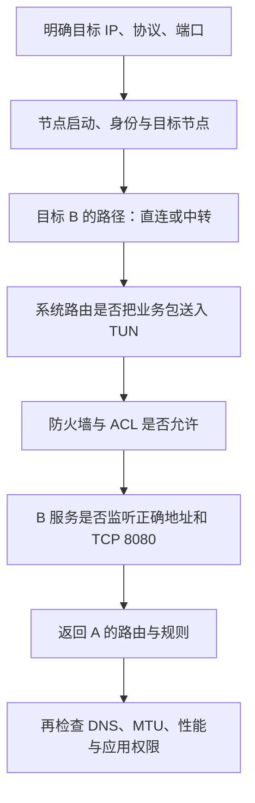

# 19 · 按层排查，而不是反复重装

## 先把“不通”变成一个明确的问题

“EasyTier 不通”描述得太宽。我们改成：“A `10.144.144.1` 要访问 B `10.144.144.2` 上的 TCP 8080，数字 IP 访问超时。”A 的物理地址 `192.168.10.20`、B 的 `192.168.20.30` 和 R 的虚拟地址 `10.144.144.254` 应记在同一张记录中。

公网 A `198.51.100.10`、B `203.0.113.20`、R `192.0.2.10` 仍是文档保留地址，不能用于实际探测。真实环境要记录真实端点、运行版本和时间，但不要把网络密钥、完整敏感配置贴到公开报告中。

开始修改前，先留一份现状：进程是否运行、启动参数、目标、错误信息、节点状态、路由与服务日志。反复重启可能暂时改变映射或路径，却也会抹掉定位线索。逐层检查的目标是找到第一个有证据的失败环节，再选择对应修复。

## 第一步：节点有没有正常启动和进入网络

在解压目录运行只读查询。下面使用 Linux/macOS 写法；Windows 把 `./easytier-cli` 改成 `.\easytier-cli.exe`，把 core 名称改成 `.\easytier-core.exe`。完整操作参见[实践章](/chapters/20-practice)。

```bash
./easytier-core --version
./easytier-cli node
./easytier-cli peer
./easytier-cli route
```

本教程按 v2.6.4 核对行为。先确认 core 正在运行、虚拟地址符合预期、虚拟网卡创建成功，再看是否存在目标 B 的节点信息。A、B 的网络名和密钥需要按组网方式正确匹配。虚拟 IP 重复、权限不足或初始端点填错，都比“算法失效”更值得优先检查。

如果 CLI 无法连接，不要立刻推断虚拟网已断开。CLI 使用本机管理 RPC，v2.6.4 CLI 默认访问 `127.0.0.1:15888`。core 未启动、管理端口被修改或端口冲突，都能让查询失败。检查 core 日志中的管理入口，查询正确实例；不要为解决本机查询把管理端口暴露到公网。

## 第二步：看目标 B，而不是只看公共节点

`easytier-cli peer` 输出包含当前可见节点与相关路径信息。要找到目标地址 `10.144.144.2` 那一行，结合节点 ID、主机名判断是不是 B，避免地址冲突或认错节点。A 到公共节点显示 `p2p`，只说明这段关系；它不能证明 A 与 B 已经直连。

v2.6.4 的显示转换把 `cost == 1` 写为 `p2p`，其他值写为 `relay(n)`，其中 n 是该路由的 cost。教学上可以把它理解为显示的路径跳数：`relay(2)` 表示两跳路径，通常有一个中间节点，并不是“经过两个中转节点”。还应结合 `route` 的下一跳、路径与实际配置观察，不把名称当作测速结论。

下面是**预期格式的简化教学示例，不是实际测量**；真实列名、值和节点可能不同。两行 B 是不同时间或情形的对照，不应同时当成两台 B。

| 观察对象       | 虚拟地址       | cost 示例 | 可以得出的结论                    |
| -------------- | -------------- | --------- | --------------------------------- |
| 目标 B，情形一 | 10.144.144.2   | p2p       | 该目标的显示路径为一跳            |
| 目标 B，情形二 | 10.144.144.2   | relay(2)  | 该目标的显示路径为两跳            |
| 某公共节点     | 可能不显示地址 | p2p       | 到此节点的连接，不能代替 B 的判断 |

TCP 初始连接成功也不证明 UDP 打洞成功。初始入口与候选直连路径使用的协议可能不同；某些网络允许向外建立 TCP，却限制 UDP。应从目标关系和日志定位，不因公共入口可用就跳过底层连通性检查。

## 第三步：业务路由、监听和回程是否完整



如果目标是 B 本机，检查本机到虚拟地址的路由和 B 的服务监听；如果目标是 B 身后的 H，另外检查代理网段是否发布、A 系统是否装入对应路由、B 能否本地访问 H。在系统转发模式下，还要检查 H 或其网关的回程。详见[子网代理](/chapters/16-subnet-proxy)。

用对照缩小范围：B 本地能否访问服务，B 虚拟地址能否访问，A 数字 IP 能否访问。服务仅监听回环、端口写错、TCP/UDP 混淆、主机防火墙或 ACL 拒绝，都可能让隧道正常而应用失败。收到拒绝、持续超时和收到 HTTP 错误是不同证据，不应套用同一结论。

数字 IP 已可用、域名不可用时，再检查 DNS。小请求正常、大包失败时，再检查 MTU。所有请求都间歇等待时，结合丢包、链路变化和资源负载检查。这个顺序不是说后一层不重要，而是先获得能解释现象的最小证据，避免同时改动五个地方。

## 小实验：写一份能交给别人看的报告

在[演示页](/labs)把 A 与 B 的直接链路断开，保留经 R 的路径。记录“目标 B 仍可达，但路径变成中转”，再断开所有可用路径，记录“目标不可达”。这是模型中的状态变化，不是真实 EasyTier 日志。

接着写四句话：我要访问什么；当前看到了什么；因此暂时排除了什么；下一项要验证什么。例如“B 本机虚拟 IP 下的 HTTP 成功，A 请求超时；服务基本可用，接着核对 A 路由与 B 入站规则”。每一步只做有指向的检查，并记录修改前后结果。

真实排障中可以保留脱敏的命令输出、时间点和错误。若要抓包，应明确接口与目标，在有权限的环境中短时抓取；不要把捕获文件当成没有敏感内容的普通附件。这里不要求通过关闭所有过滤规则换取一个暂时成功。

## 常见误解

看到 `p2p` 先问“对谁”。看到 `relay(2)` 先问“这是哪条路径的 cost”。看到 NAT 类型先把它当作诊断线索，而不是直接宣布某类设备永远不能打洞。网络状态会随映射、链路与节点退出而变化。

“没有公网 IP 就不能组网”忽略了打洞和中转；“有公网 IP 就一定可直连”忽略了端口、监听与过滤。进程在线、虚拟网在线、某个应用可用，都是不同层次的事实。

“重装之后好了，所以原因是安装损坏”也未必正确。重装可能伴随配置改变、进程重启和路径重建；没有对照证据，仍然不能确定根因。

## 练习与答案

1. 公共节点那行显示 p2p，B 那行显示 relay(2)。A 与 B 当前能否据此判定已直连？有几个中间节点？

<details>
<summary>第 1 题参考答案</summary>

不能。应以目标 B 的路径为准，示例是两跳中转，通常一个中间节点。公共节点的一跳连接不能代替 A、B 的判断。

</details>

2. CLI 提示无法连接 `127.0.0.1:15888`，是否可以立刻认定 A 与 B 的隧道断开？

<details>
<summary>第 2 题参考答案</summary>

不能。首先排查本机管理 RPC、core 进程和配置端口。管理查询失败与远端隧道不可达不是同一个现象。

</details>

## 来源与继续学习

- [v2.6.4 CLI](https://github.com/EasyTier/EasyTier/blob/v2.6.4/easytier/src/easytier-cli.rs)：默认管理地址、peer 与 route 输出。
- [v2.6.4 cost 显示转换](https://github.com/EasyTier/EasyTier/blob/v2.6.4/easytier/src/utils/string.rs)：p2p 和 relay(n) 的直接依据。
- [v2.6.4 README](https://github.com/EasyTier/EasyTier/blob/v2.6.4/README.md)：node、peer、route 查询与组网方法。
- [当前官方 P2P 优化指南](https://easytier.cn/guide/network/p2p-optimize.html)：补充诊断建议，可能随新版变化。

想先看现成网络的证据，可以读[实机案例：读懂已有 GUI 组网](/cases/local-gui)。它把目标节点状态、TUN 路由和一次有界 ICMP 验证放在一起，逐项说明能得出什么结论。

最后进入[模拟复习与可选两机实践](/chapters/20-practice)。
