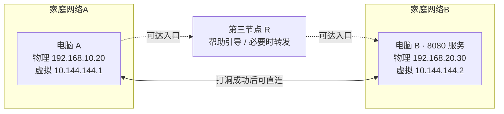

# 学习路线与贯穿案例

这套教程写给“能使用网络，但还没有把原理串起来”的读者。按顺序读，每章先回答一个问题，再引入解决它所需的概念。遇到陌生词可以查[术语表](/glossary)，看完后用章末练习检查理解。

## 全书只跟踪一个场景

A、B 分别在两个家庭网络里。A 想访问 B 的网页服务 `8080`。R 是双方都能连接的第三个节点；它可以承担引导或转发职责，但这两种职责要分别理解。

| 角色 | 家庭局域网接口     | EasyTier 虚拟 IP | 教学公网端点          |
| ---- | ------------------ | ---------------- | --------------------- |
| A    | `192.168.10.20/24` | `10.144.144.1`   | `198.51.100.10:31000` |
| B    | `192.168.20.30/24` | `10.144.144.2`   | `203.0.113.20:32000`  |
| R    | 视部署而定         | `10.144.144.254` | `192.0.2.10:11010`    |

公网示例使用 RFC 5737 的文档保留网段，**不能拿来连接真实节点**。虚拟 IP 也仅是示例，真实实验先检查网段冲突。第 14 章模型另加普通节点 C，用于演示另一条路径。

图中虚线表示可用入口或转发连接。A 和 B 是否直连取决于实际可达性，画出一条线不等于网络一定会允许它。

## 建议怎样读

先读 01—06，建立 IP、端口、路由和 NAT 的基础。07—14 解释 EasyTier 的组件如何协作。15—18 把完整通信和更复杂的应用场景串起来。19—20 学习用状态验证理解。

有基础时可以跳到第 07 章，但建议完整阅读第 15 章的去程与回程。每次用自己的话解释“目标是谁、经过哪里、当前失败在哪一步”，比背术语更能检验理解。

<CourseMap />

## 模型、文档与真实证据

[交互实验](/labs)展示简化规则，不会配置设备或真实探测 NAT。每章有来源；具体实现固定依据 EasyTier v2.6.4，官网文档可能继续更新。[第 20 章](/chapters/20-practice)提供自选真实两机实验，未准备设备时也可以完成全套学习。
