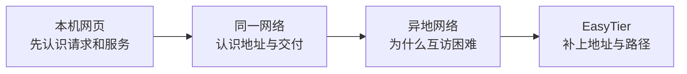

# 学习路线：从本机网页到异地组网

你不需要先懂网络缩写。如果“地址、端口、服务”还说不清，先完成[五节预备课](/basics)。在自己电脑上看到一次真实请求，比一开始记住多套地址更有用。

## 先走一条看得见的路

第一站是本机：浏览器向同一台电脑上运行的网页服务请求内容。第二站是同一网络：另一台电脑有自己的地址，数据需要交给它。第三站是异地：两台电脑分别能上网，不代表彼此能够主动访问。第四站才是 EasyTier：让应用使用虚拟地址，利用已有网络搬运请求和回应。

## 正文跟踪什么场景

A 是发起访问的电脑，B 是提供网页的电脑。两者位于不同家庭网络。A 想请求 B 上端口 8080 的网页；端口的含义在预备课和第 4 章讲解。预备实验用 8877，因为它是独立的本机实验，不应混成已验证的远端 8080 服务。

当 A、B 的底层连接需要帮助时，会出现第三个节点 R。帮助认识其他节点称为引导，帮忙搬运业务数据称为中继；同一节点可能承担两种职责，但认识目标不等于所有业务数据必须经过它。

每次读图先问三个问题：**谁发起，最终找谁，这一步交给谁？** 数字地址只在影响判断时加入图里，不要求在第一章背全表。

选读：后续图表采用的地址清单

| 角色 | 原有网络接口 IP    | EasyTier 虚拟 IP | 教学隧道端点          |
| ---- | ------------------ | ---------------- | --------------------- |
| A    | `192.168.10.20/24` | `10.144.144.1`   | `198.51.100.10:31000` |
| B    | `192.168.20.30/24` | `10.144.144.2`   | `203.0.113.20:32000`  |
| R    | 视部署而定         | `10.144.144.254` | `192.0.2.10:11010`    |

`/24` 在第 3 章解释，隧道端点在第 7、10、15 章逐步展开。原有网络 IP 不是 MAC 物理地址；虚拟 IP 是应用目标所在网络的地址；隧道端点是承担外层运输的地址与端口。公网示例使用 RFC 5737 保留网段，不能拿去连接真实节点。第 14 章还加入 C 演示另一条路径。

## 怎样选择阅读入口

完全零基础按下面顺序读；已经在运行 GUI，也可以先看[实机附录](/cases/local-gui)，再按其中的基础链接补课。附录是具体证据，并不替代原理学习。每章练习都应能用已经讲过的概念完成，进阶折叠可以先跳过。

<CourseMap />

## 区分三种证据

本机网页实验是实际运行的 HTTP 服务；[三个浏览器实验](/labs)是简化教学模型；GUI 附录记录的是 2026 年 10 月 13 日一次真实四包 ICMP 测试。它们各自能证明不同事情。尤其不能把 ping 成功说成 HTTP 成功，也不能把模型中的打洞过程说成本机抓到了真实探测包。

## 来源

版本行为固定依据 [EasyTier v2.6.4](https://github.com/EasyTier/EasyTier/releases/tag/v2.6.4)，官网可能继续更新。保留地址的含义见 [RFC 5737](https://www.rfc-editor.org/rfc/rfc5737.html)，详细资料见[来源页](/sources)。
